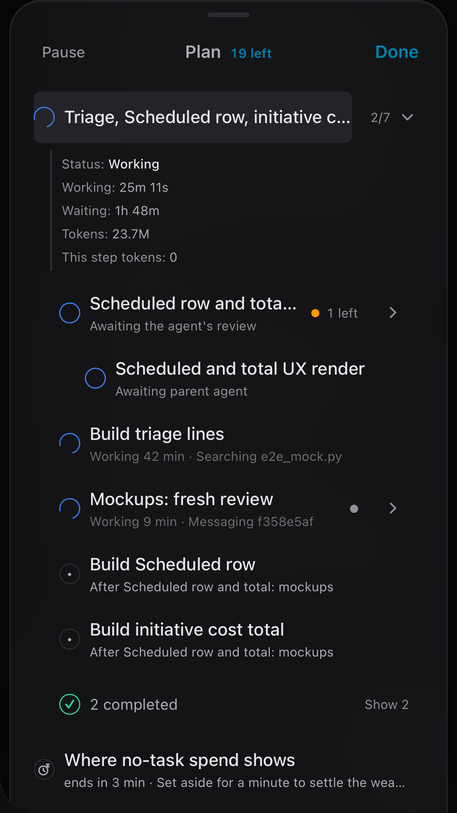
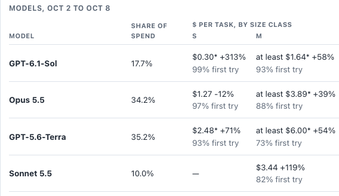
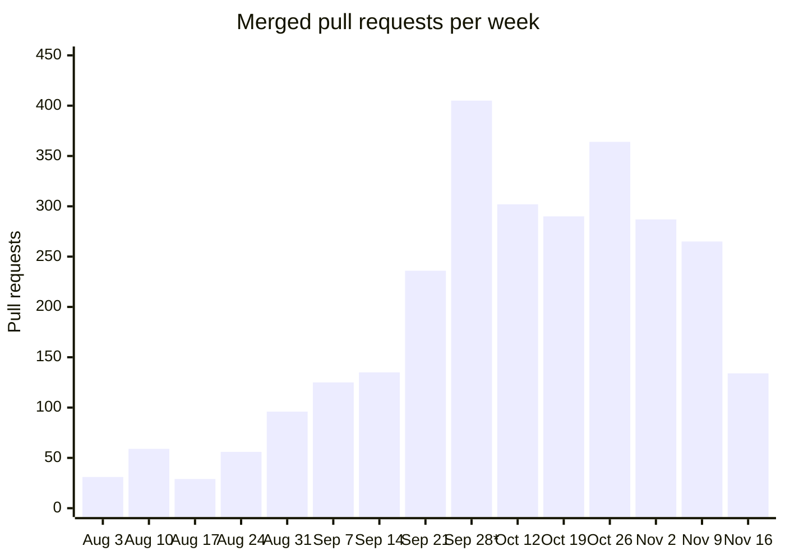

# C.O.R.S.I.A.

<sub>Community-Orchestrated Recursive Self-Improving Agents</sub>

### A team of AI agents that organizes itself, checks its own work, and measures what it delivers per hour of your attention.

CORSIA is a free, open-source app that runs on your own computer. The agents run on the Claude or Codex subscription you already pay for, an API key, or a local model.

**[Download CORSIA for Mac](https://github.com/cebertowicz/corsia/releases/latest)** (Apple Silicon, macOS 15 or later): on the page that opens, download the file ending in `.dmg`. Or [run it as a Linux server](#getting-started).


## The problem

One AI agent is easy to run. A team of agents can take on far more of your work, but a team brings two jobs that grow with every agent you add: organizing the agents, and supervising their work. Without help, both land on you.

## What CORSIA does

Each agent works toward a goal you can measure, such as how much of your time a kind of work takes, bugs that reach users, or new users who quit during setup. CORSIA drafts those goals with you, and you decide what each agent may do without asking you. Three things then work together:

**The agents organize the team themselves.** Once you connect a model and describe your work, CORSIA, the assistant you talk to first, creates the projects and agents your work needs, writes their instructions and keeps them current, and connects your tools, such as email, calendar, files and GitHub. Setup explains which instruction files are yours to edit and which the agents maintain. Each agent keeps a written plan, so its work survives a closed chat, a restart or a switch to another model.

**Every piece of work has one accountable agent, and agents check each other.** Agents message each other and hand smaller tasks to helper agents, but one agent answers for each result. When two goals pull in different directions, such as shipping fast and shipping without bugs, separate agents hold each one and review each other's work.

**You steer from one ranked list, and changes have to prove themselves.** You set the plans and priorities. The Activity screen lists what is waiting on you in one list, ranked by your agents, each item with a one-line reason; it works on your Mac, and in your phone's browser once you connect it. The agents' working detail stays folded unless you open it. You and your agents can edit the same document, and each comment goes to the agent responsible for that part.




For every agent, CORSIA records the minutes you spent in the app on each finished result, the share of results accepted without being sent back, and what they cost; the numbers fill in as work is finished. When you correct an agent, the lesson can be tried on some of its later tasks and compared with tasks done without it, and it is kept on that comparison, not on the agent's say-so. Agents can also install reviewed workflows and skills from a shared library.




*The Measurement screen on the install that builds CORSIA, September 25 to October 8, 2026.*

The three parts depend on each other. Agents that keep the team organized and their plans current give each result one accountable agent to measure; checks between agents with opposing goals make those numbers harder to game; and one ranked list keeps a growing team's work reviewable by you.

**Start with one agent, for any kind of work.** One agent on one piece of ongoing work is enough to begin: a household's paperwork, a client practice, a research project or a codebase. Add agents as the work grows.

[How it works](docs/how-it-works/README.md) · [What it measures](docs/measurement.md) · [How lessons are tested](docs/how-it-works/learning.md) · [All documentation](docs/README.md)

## Built by its own agents

CORSIA is built and maintained by agents running on CORSIA. They write the issues, pull requests and reviews, merge their own work after CI and a review by a separate agent pass, and prepare each release. They merged 1,069 pull requests in the 30 days to November 22, 2026. The count shows how much they ship, not how good it is ([how this is counted, and what the reviews catch](docs/readme-evidence.md)).



Weeks run Monday to Sunday, Pacific time. The September 28 week counts Monday to Friday only.

## Runs on the models you already have

Agents run on a Claude Code or Codex subscription, an API key billed by use, or a local model at no cost per use on a Mac with 32 GB of memory or more. Every model gets the same instructions, skills and tools. Changing an agent's model or account keeps its plan and documents, and when an account reaches its usage limit, the agent can move to another account you allow. CORSIA itself is free; model use is billed by whoever provides the model: your subscription's usage limits, your API bill, or nothing per use with a local model.

A team of agents uses far more of a subscription than one agent does, so start with one.

## Getting started

1. [Download CORSIA](https://github.com/cebertowicz/corsia/releases/latest) (`CORSIA-<version>-aarch64.dmg`), open it and drag CORSIA to Applications.
2. Open CORSIA. Setup continues in the app: create a local account, then connect a model.
3. Already use Claude Code or Codex? During setup, or any time after, CORSIA can read what they know about you, their skills and their connected apps. It shows you what it found and keeps only what you agree to.

To run it from a source checkout, or as a server on Ubuntu 24.04+ or Debian 12+:

```bash
git clone --branch main https://github.com/cebertowicz/corsia.git ~/.corsia
cd ~/.corsia
bash scripts/install.sh
```

The installer opens CORSIA at `http://localhost:1956`. More in the [getting-started guide](docs/getting-started/README.md).

## Safety

Agents act as your own user account, with network access, so they can work without stopping to ask at every step. What limits a mistake:

- **Sandboxed by default.** Shell commands run inside an open-source sandbox (Agent Safehouse on a Mac, bubblewrap on Linux). Reaching outside it takes a short-lived lease that a reviewer model checks; as a model, it can miss things. Leases work on macOS; on Linux, agents stay inside the sandbox.
- **Only the accounts you connect.** An agent reaches your email, calendar or other apps only after you sign in to connect them. Its instructions tell it to ask you before sending, publishing, deleting or paying on your behalf; that is an instruction, not a hard block.
- **Your workspace stays on your machine,** in plain files and a SQLite database. What an agent sends to a model goes to the provider you chose; with a local model, model calls stay on your Mac. Everything that leaves your machine, item by item, and the **Local only** setting that keeps a chat or project on local models: [data and privacy](docs/security/data-and-privacy.md).

How each control works and every known limit: [security documentation](docs/security/README.md).

## Contributing

Read [`CONTRIBUTING.md`](CONTRIBUTING.md). Open pull requests to `dev` from feature branches.

## License

CORSIA is licensed under the [GNU Affero General Public License, version 3](LICENSE) (AGPL-3.0-only). Contributions are accepted under the [Contributor License Agreement](CLA.md). Parts bundled with the app keep their own licences.
