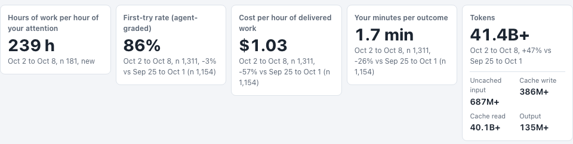
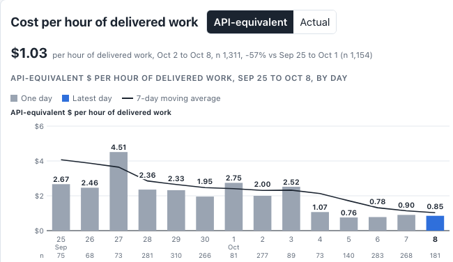
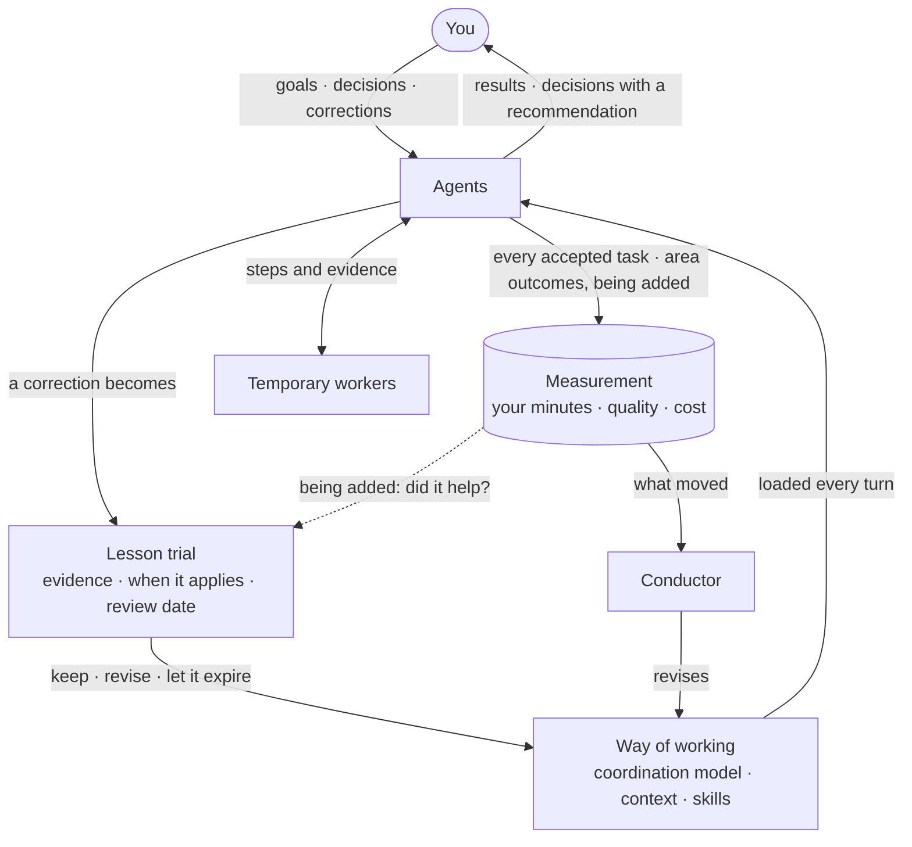
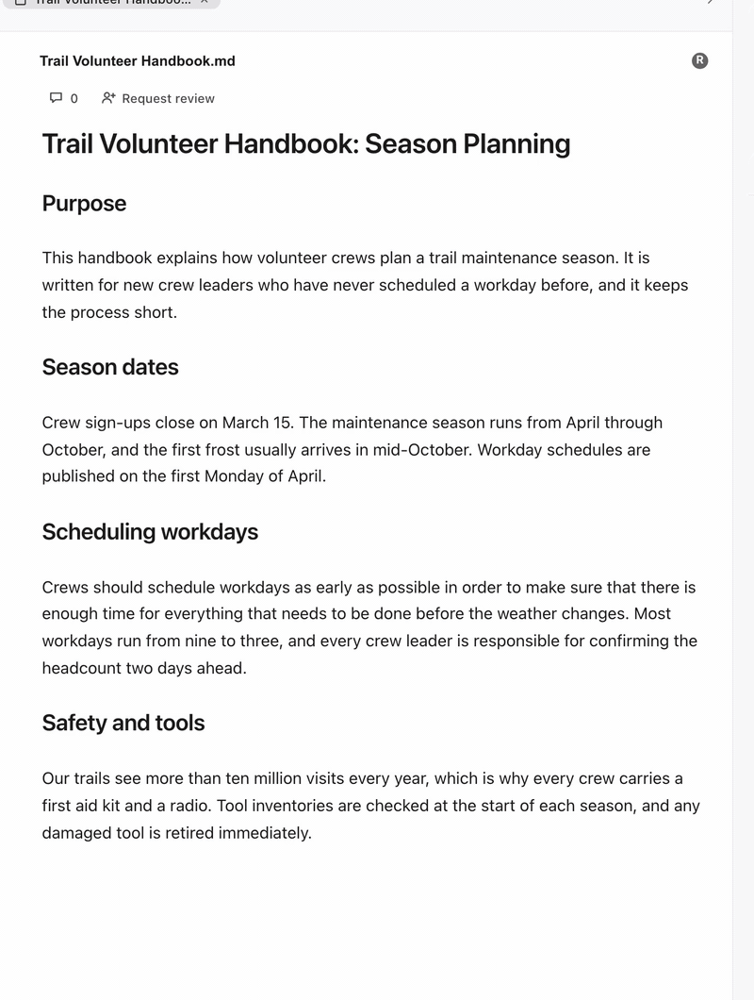
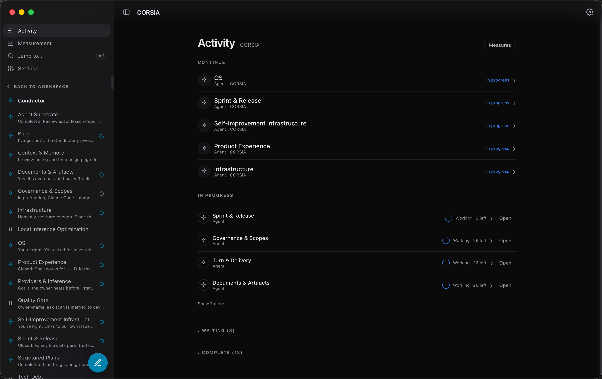
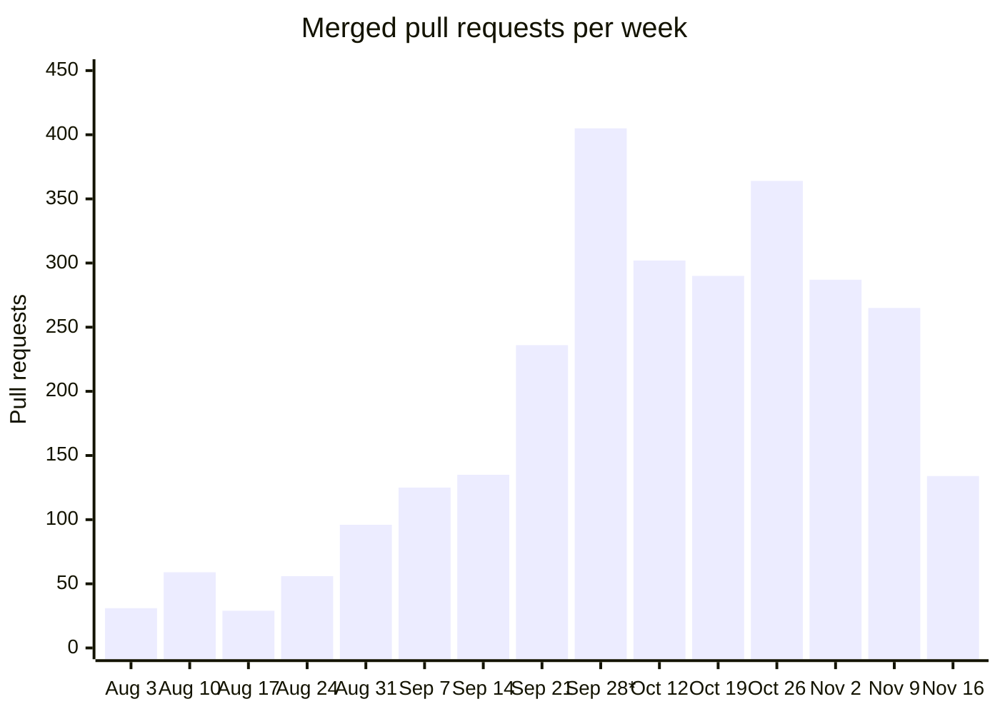
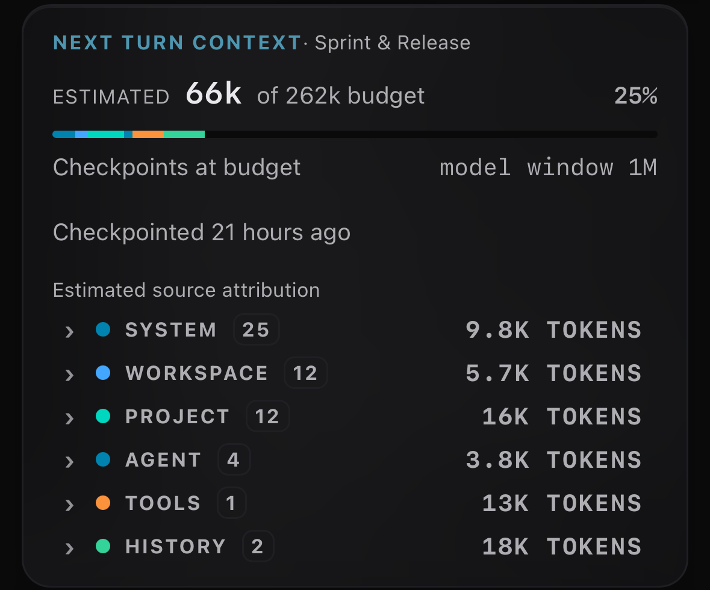
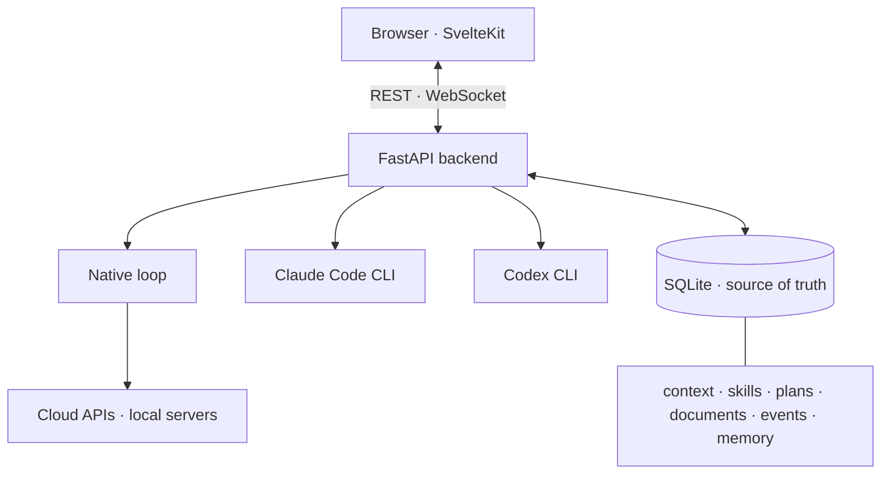

# C.O.R.S.I.A.

### Give an agent a problem to own. CORSIA measures it on its results and on your attention.

CORSIA estimates the minutes each agent takes from you and how much of its work is accepted on the first try. It is built so agents learn from both and need less of your time; that they do is not yet proven.

**[Download CORSIA for Mac](https://github.com/cebertowicz/corsia/releases/latest)** (Apple Silicon, macOS 15 or later)

**What it costs:** CORSIA is free and open source. Its agents run on a model you bring: a Claude or ChatGPT subscription you already pay for, an API key billed by use, or a local model at no cost per use on a Mac with 32 GB of memory or more. A team of agents uses far more of a subscription than one agent does, so start with one.






*Screenshots of the Measurement screen on the install that builds CORSIA, showing September 25 to October 8, 2026. The figures further down come from other periods, and each gives its own dates.*

**CORSIA is built by its own agents:** [1,069 pull requests in the 30 days to November 22, 2026](#built-by-its-own-agents), under one maintainer.


[How it works](#how-it-works) · [How you know it's working](#how-you-know-its-working) · [What it asks of you](#what-it-asks-of-you) · [Getting started](#getting-started) · [Built by its own agents](#built-by-its-own-agents) · [Security](#security) · [Questions](#questions)

## How it works

Most agents do what you ask and remember more each time. A CORSIA agent answers for a result instead: it is measured on it, checked by an agent other than itself where it matters, and keeps each lesson it learns on trial: on a set date, it decides whether to keep, change or drop it.

**Pick a problem and let an agent own it.** The agent answers for a measurable outcome: your time, for an assistant that takes email, scheduling and follow-ups off your week; bugs that reach users; new users who quit during setup. It picks the numbers that show whether that problem is getting better, its KPIs (key performance indicators), and answers for them, on top of the two goals every agent starts with: less of your time, better results. Recording those KPIs beside CORSIA's own measures is being added. It carries work from decision to verified result, hands bounded steps to **temporary workers**, and messages other agents directly. Each deliverable has one accountable agent.

Anything measured can be gamed, by agents as much as by people. So every agent is measured on the cost of its own shortcuts: rework and your corrections (recorded once the local corrections classifier is installed), taken from the work itself rather than from its own grading. When an outcome matters too much for the agent doing the work to be the only check, a separate agent owns the check. That is one reason for a **project**: agents whose problems check or pull against each other, such as a builder that wants to ship and a reviewer that owns what slips through. Each project has a **conductor**, an agent that keeps the project's way of working, written down as its **coordination model**: who owns what, how work moves, what "done" means and when you are asked. [A default one](docs/coordination-models/corsia-default/) ships with CORSIA.



### Scopes

Agents answer for outcomes. **CORSIA**, the assistant every install starts with, answers for your platform and your attention, and each project's **conductor** answers for that project's way of working: who owns what, the context and skills each agent gets, and the coordination model. Every agent receives the workspace's context and its own project's on every turn, and never another project's.

| Scope | Holds | Kept by |
|---|---|---|
| **Workspace** | Rules for everything you run, such as which models agents may use, and agents that don't need a project | **CORSIA**, your assistant. It sets up and configures the platform, and watches your attention across every agent |
| **Project** | One body of work: its purpose, rules, reference documents, skills, coordination model and agents | Its **conductor**, created with the project |
| **Agent** | Its problem, authority, plan and lessons | The agent itself; changes to its scope go through the conductor |
| **Worker** | One bounded step and its brief, under its agent's authority | The agent that sent it |

Start a project when work needs context of its own, such as a codebase, a client or a rulebook that other agents shouldn't load, or agents that check each other.

## How you know it's working

Asking for less of your attention is only safe with proof that the work is getting better. Fewer of your minutes with worse results is a worse team, not a better one. So CORSIA measures both sides for every agent, the same way in every project, with no setup. The same numbers show whether a new model helped or quietly got worse; the same check for a new skill or rule is being added.

- **Your minutes per result.** The time you spend with an agent's conversations or project open in CORSIA, split evenly across what you have open, divided by the results you accept. Every agent works to bring it down.
- **Quality and cost per result.** The first-try rate counts tasks accepted without being sent back or corrected. Cost counts the tokens of each accepted task, including every worker it used, and their dollars at API list prices where a model has them.
- **Each agent against its own past.** Measurement compares each agent with its previous weeks and flags one that moved the wrong way. Models compete on your work: each gets one row of accepted tasks and cost per accepted task, against the week before.
- **Each agent on its own KPIs.** Every agent keeps KPIs for the problem it owns, such as bugs that reach users, for an agent that owns release quality, or hours of your week spent on email and meetings, for an assistant. Agents record those outcomes as they happen, a tool on the same computer can send them as OpenTelemetry logs, and the agent is told when a KPI lands on the wrong side of its line. Being added: showing them on the Measurement screen beside the built-in measures.
- **Lessons expire unless the agent renews them.** Most agent memory only grows. When a CORSIA agent learns from a correction or a failure, it writes a short trial: the evidence, when the lesson applies and when it doesn't, and a review date. The trial loads until that date. Then the agent keeps, revises or retires it, with a report of which turns received and read each version. Being added: a comparison of tasks that received the lesson with similar tasks that didn't, so the review sees whether it helped, not only who saw it (the dashed line above). A retired lesson stops loading and keeps its history. Your own instructions are never trials and never expire.
- **The conductor acts on what moved.** It revises the coordination model, context and skills from what the measurements show, and recommends a new agent when a problem outgrows the one that has it. Each change is versioned with its reason. Being added: the trends mark when guidance changed, so a shift in the numbers lines up with its cause.

## What it asks of you

A problem for each agent, and the authority to work on it. The agent sets its KPIs and measures itself on your work; you steer as much or as little as you like.

- **You set the authority.** Agents act within it. A choice outside it comes with options, the trade-off and a recommendation, and you can answer from your phone. Widen it as the measurements show the work holding up.
- **Focus mode**, on by default, shows your messages, each agent's marked updates and its decisions. Working steps collapse.
- **Work doesn't stop when the chat does.** With GitHub connected, a pull-request comment, review or CI result wakes the agent that owns that work. Every wait has a deadline, a worker that stops with open work wakes the agent that sent it, and a step closes only with evidence against its acceptance criteria.
- **Work in the same document.** You and your agents edit a document at the same time, and every change merges live. A comment or suggested edit goes to the agent that owns it.
- **Pause** an agent and its workers stop at a safe point. A paused agent still answers when you message it.






*Every agent and its plan, on your Mac and on your phone.*

CORSIA is for people willing to let agents make mistakes and learn from them, **not** for anyone who wants to approve every step.

## Runs on the models you already have

Usage limits, outages and model regressions shouldn't take your work with them.

- **One context, any harness.** A harness is the program that runs an agent's turns and tools: Claude Code, Codex, or CORSIA's own loop on an API or a local model on Apple Silicon. Every harness receives the same instructions, skills and tools. CORSIA runs Claude Code and Codex with their own memory, skills, hooks and tools switched off, so every turn uses CORSIA's own and is governed and counted the same way.
- **Switching keeps the work.** CORSIA writes its own checkpoint of each conversation, so changing an agent's model or account from the model picker keeps its plan, history and documents. Optionally, when an account reaches its usage limit, the next turn moves to another ready account you allow.

## Built by its own agents

Most open-source projects move at the pace of their maintainers' spare time. CORSIA tests what happens when agents do the maintaining and, in time, the community sets the direction. It is built and maintained by agents running on CORSIA, under the conductors that ship with it. Each agent watches the health and KPIs of its own problem, follows recent trends, and keeps each lesson on trial until a set date, when it decides whether to keep it. The agents write the issues, pull requests and reviews, merge their own work after CI and an independent LLM reviewer pass on the exact commit, and prepare each release.

Under one maintainer, the team merged 1,069 pull requests in the 30 days to November 22, 2026 ([how this is counted](docs/readme-evidence.md)). The bars below are whole weeks starting on Monday, so they don't line up with that 30-day window, which starts mid-week.



*Work pull requests merged into the development branch or a team's integration branch, each counted once. Weeks run Monday to Sunday, Pacific time; the last bar, November 16 to 22, is a full week. * Monday to Friday only. The week of October 5, when work moved to this repository, is not shown.*

Review at this volume is automated, so the reviewer is itself audited. The two checks below were each run once, on the dates given, and have not been repeated on newer work. Of the pull requests merged from October 1 to 9, 2026, about a third failed CI or review on their first push and were corrected before merging. Nightly audits on 14 days between September 10 and 27, 2026, confirmed 95.0% of 462 audited reviewer findings correct. They also confirmed that defects reach the development branch. That is partly by design: agents are allowed to make mistakes so that recurring failure modes surface. Sixteen are now catalogued as [LLM anti-patterns](docs/standards/llm-anti-patterns.md) that the reviewer checks for, and the mechanically detectable ones also have blocking CI rules. The rest is tracked as debt ([method](docs/readme-evidence.md#review-and-quality)).

## Getting started

1. [Download CORSIA](https://github.com/cebertowicz/corsia/releases/latest) (`CORSIA-<version>-aarch64.dmg`), open it and drag CORSIA to Applications. It needs a Mac with Apple Silicon and macOS 15 or later.
2. Open CORSIA. Setup continues in the app: create a local account, then connect a model.

- Macs with less than 32 GB of memory need a cloud model provider (Claude Code, Codex or an API key) for agent work. Teams use a lot of tokens, so start with one agent.
- Agents run as your own user account with unrestricted network access, so read [Security](#security) first.

To run CORSIA from a source checkout, or as a server on Ubuntu 24.04+ or Debian 12+, open Terminal and run:

```bash
git clone --branch main https://github.com/cebertowicz/corsia.git ~/.corsia
cd ~/.corsia
bash scripts/install.sh
```

The installer opens CORSIA at `http://localhost:1956`, where setup continues in the browser. The [getting-started guide](docs/getting-started/README.md) covers [requirements and install options](docs/getting-started/install.md), [your first project](docs/getting-started/first-project.md) and [your first agent](docs/getting-started/first-agent.md).

## Security

An agent you don't watch needs real capabilities, or it stops to ask you at every step. So CORSIA lets agents get the work done and limits what a mistake can reach, in layers, rather than taking away tools and routing every action back to you.

- **Sandboxed by default.** Shell commands run inside Agent Safehouse on a Mac and bubblewrap on Linux, open-source sandboxes that limit what a command can read and change, and file tools reach only allowed paths.
- **Leases for anything outside.** To reach beyond the workspace, an agent applies for a **host-access lease**, a short-lived permission that states the purpose, the exact resources and the effects. A reviewer model checks the request, then every command run under it. It is instructed to block secret exposure, changes to access controls, needless destruction, and commands clearly unrelated to that purpose; as a model, it can miss them. If the reviewer can't reach a verdict, the answer is no. Every request, verdict and reviewed command is kept. Leases work on macOS only for now; on Linux, agents stay inside the sandbox.
- **Some things no leased command can read or change:** CORSIA's key store, the agents' browser sign-ins, and the sandbox it runs in. A leased command can still change CORSIA's own code or your startup files, which run later outside the sandbox; the reviewer is told to block changes to the code that governs a lease, and can miss them. The one stored key agents can use without a lease is their own GitHub token.
- **Agents can't approve their own access.** A lease is approved by a signed-in person or by the automatic reviewer, which is on for new installs and can be turned off. A lease that launches an outside agent always needs a person.
- **Recognized credentials are masked.** Values with a credential-looking name or a known key shape are masked in tool results before they reach a model; other values aren't.

In the week to October 2, 2026, on the install building CORSIA, with automatic approval on, 471 of 519 reviewed lease requests (91%) were approved automatically, 34 were rejected and 14 went to a person. Of 1,586 commands run under leases, 48 were blocked. A server setup listens on your network behind sign-in, so run it on a trusted network or a private tailnet. How each control works, what it doesn't stop, and every known limit: [security documentation](docs/security/README.md).

## Questions

### Will a team of agents cost more than Claude Code or Codex alone?

A team uses more tokens than one agent, because agents and their workers each run turns. CORSIA is built to make that spend pay: each delegated step goes to the least costly model that can do it, every step shows its tokens and time, and the conductor tunes the way of working to bring down the cost per accepted task. The install building CORSIA runs on top-tier Claude and Codex plans. On one SWE-bench task (`pylint-dev__pylint-7114`), each harness ran once on the same local model, with Claude Code and Codex pointed at it through their own endpoint settings:

| Harness | Model calls | Cost if billed at Sonnet 4.5 prices | Minutes | Patch review score (of 5) |
|---|--:|--:|--:|--:|
| Claude Code | 91 | $4.75 | 42.1 | 4.5 |
| Codex | 64 | $3.30 | 38.5 | 4.5 |
| CORSIA, built-in agent loop | 53 | $3.06 | 48.7 | 4.6 |

All three patches passed, and CORSIA's loop used the fewest model calls: 42% fewer than Claude Code and 17% fewer than Codex. One task cannot show a repeatable difference; fuller benchmarks are coming. See the [methods](docs/readme-evidence.md).

**Where an agent's actions go.** One long-running agent on the install that builds CORSIA, over one night in November 2026: 196 of its actions (commands, file reads, plan updates and the like), each read and sorted into one of the categories below, rather than counted by a tool.

| What the action was for | Share of actions | Share of text the agent wrote |
|---|--:|--:|
| The work: commands, files, search | 77% | 76% |
| Reading and updating its plan | 7% | 8% |
| Starting, checking and messaging other agents | 7% | 7% |
| Re-reading a skill | 6% | 1% |
| Memory and lessons | 4% | 8% |
| Messages to the person | 0% | 0% |

These are rounded shares of actions, not of tokens or dollars, for one agent on one night. With 196 actions, the largest share is uncertain by about 6 points either way and the others by 3 to 4, and by more than that, because they were taken as ten runs of back-to-back actions rather than picked one by one. This one-off count will be replaced by figures CORSIA computes from its own records as they come in. See the [methods](docs/readme-evidence.md#where-an-agents-actions-go).

### How do I give agents instructions?

Write each instruction once, at the [scope](#scopes) it applies to: **Settings → Context → New file**, in the top group for everything or in a project's group for that project. Each agent keeps its own file current. Every harness receives the same files. You rarely write them yourself: on the install that builds CORSIA, the team maintains almost all of its own context files.

**Skills** are procedures an agent loads when its task matches. Add one as `skills/<name>/SKILL.md` at any level. When none of its skills fits and you've agreed to use community improvements, an agent can install one from the public [skill library](docs/skill-library.md) and keep it up to date.

Every turn shows what the agent loaded, by source and size. A context file in that list opens straight from it, so you can read or change what an agent works from.



### How do agents choose a model, and how do I restrict them?

The shipped spawn policy uses the least costly model that can reliably do the work, moves up for ambiguity, interacting systems or high stakes, and dispatches only to models shown as ready. Add `SPAWN-POLICY.md` at the workspace or project level to set your own allowed models, roles and budgets. For a hard stop, turn a model off under **Settings → Providers**. Claude Code and Codex models can only be hidden from the picker there, so sign out of that CLI to stop it entirely.

### How should I shape the team?

Pick a problem and let an agent own it. Start with one agent, and add another when there is another outcome you can measure and want off your plate, when a problem crowds an existing agent's context, or when an agent's work needs a separate check. Keep one accountable agent per deliverable, even when others contribute. A common shape combines three kinds of agent: **domain agents**, one per lasting problem; an **independent reviewer**, which owns the quality of work it didn't produce; and a **coordinator**, which owns sequencing across agents and releases. Name each agent for the outcome it answers for, not a process stage. Merge or retire agents when coordinating costs more than it saves.

### What ships today and what's next

The main capabilities in each area, with their status.

**Agents and plans**
- [x] Agents with their own notes, authority, success measures and plans
- [x] CORSIA, the assistant that sets up and runs your workspace, and a conductor for each project
- [x] Temporary workers for bounded steps, checked by the agent that sent them
- [x] Agents that message each other directly
- [x] Acceptance criteria and evidence on every step; dependencies, deadlines and decisions with a recommendation
- [x] GitHub pull-request, comment and CI events routed to the agent that registered the work
- [x] Focus mode, a live plan view, and pausing an agent and its workers

**Documents**
- [x] Shared documents in a canvas beside chat, co-edited live
- [x] Comments and suggested edits that reach the agent that owns the document

**Context, memory and models**
- [x] Layered context (workspace, project, agent), the same in every harness, with a per-turn record of what each turn received
- [x] Sourced decisions and preferences carried across sessions and models
- [x] CORSIA-written checkpoints that move with the work between models
- [x] Claude Code and Codex logins, Anthropic, OpenAI and OpenAI-compatible APIs, and local models through oMLX, a model server for Apple Silicon
- [x] Subscription usage per account, shown in the model picker before you choose
- [x] Optional account rollover on usage limits, set for the workspace or per project

**Measurement and learning**
- [x] Outcomes, first-try acceptance, corrections, tokens, decisions and estimated active time by project and agent ([how to read them](docs/measurement.md))
- [x] Per-model results on your own work, and cost at public list rates beside actual charges
- [x] Versioned guidance, and lesson trials that say when they apply and carry a review date
- [ ] Per-version comparison of guidance and lesson changes, marked on the trends *(being added)*
- [x] Agent KPIs: outcomes agents record for their problems, and OpenTelemetry logs from tools on the same computer
- [ ] Agent KPIs on the Measurement screen *(being added)*
- [ ] Share and adopt coordination models with their evidence *(in progress)*
- [ ] Anonymous aggregate results across installs *(planned; opt-in)*
- [ ] Remote analytics API and per-provider tuning from your data *(planned)*

**Control and safety**
- [x] Plain Markdown files and SQLite on your machine
- [x] Agent Safehouse sandbox, allowed-path file tools, reviewed host-access leases and credential masking
- [ ] Scoped permissions for agent and API tokens *(planned)*
- [ ] Signed maintainer notices *(once release signing keys are configured)*

**Apps**
- [x] Web app and an installable phone app
- [x] macOS desktop app that updates itself

### Architecture at a glance



**Execution** is which harness carries a turn: CORSIA's native loop, Claude Code or Codex. **Inference** is which model serves a native turn. The two are independent. A workspace holds `context/`, `skills/`, `shared/`, `projects/` and `.threads/`; operational state lives under Application Support on a Mac, `~/.local/state/corsia` on Linux, or `CORSIA_STATE_DIR`.

## Documentation

| Topic | Read |
|---|---|
| Code map and runtime isolation | [`ARCHITECTURE.md`](ARCHITECTURE.md) · [`BACKEND.md`](BACKEND.md) · [`FRONTEND.md`](FRONTEND.md) |
| Security and accounts | [`docs/security/`](docs/security/README.md) · before reporting a vulnerability: [`SECURITY.md`](SECURITY.md) |
| Every documentation page | [`docs/README.md`](docs/README.md) |
| What has shipped | [`CHANGELOG.md`](CHANGELOG.md) |
| Rules for coding agents in this repository | [`AGENTS.md`](AGENTS.md) |

## Contributing

Read [`CONTRIBUTING.md`](CONTRIBUTING.md), then the developer path in [`docs/contributing/`](docs/contributing/README.md). Open pull requests to `dev` from feature branches, and keep private workspace material out of issues, commits, pull requests and screenshots.

## License

CORSIA is licensed under the [GNU Affero General Public License, version 3](LICENSE) (AGPL-3.0-only). Contributions are accepted under the [Contributor License Agreement](CLA.md). Parts bundled with the app keep their own licences.
