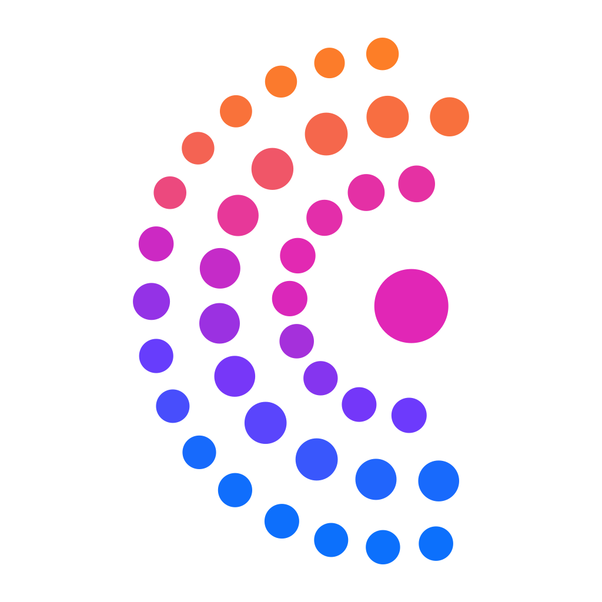
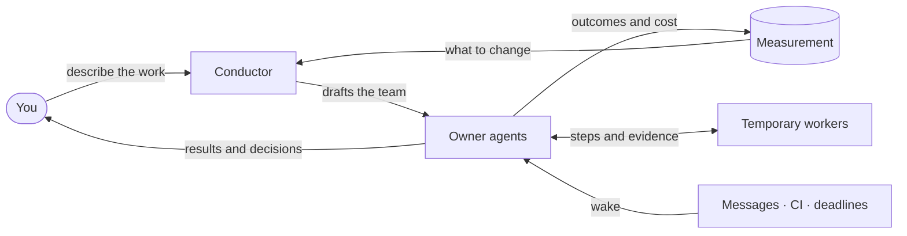
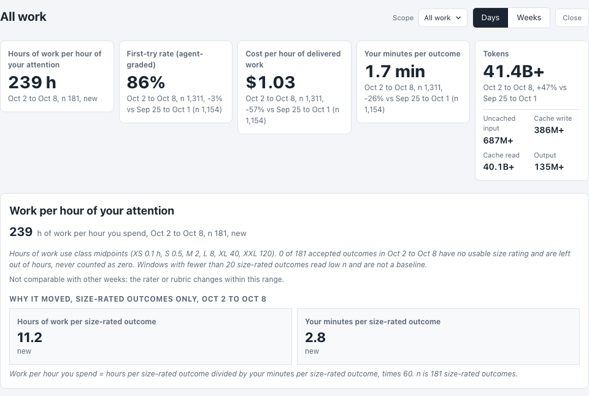
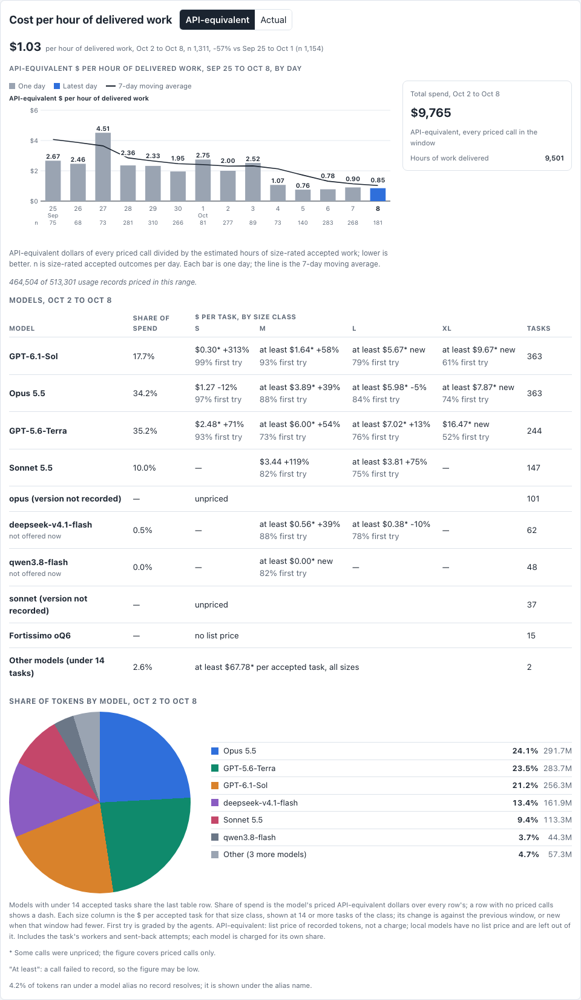
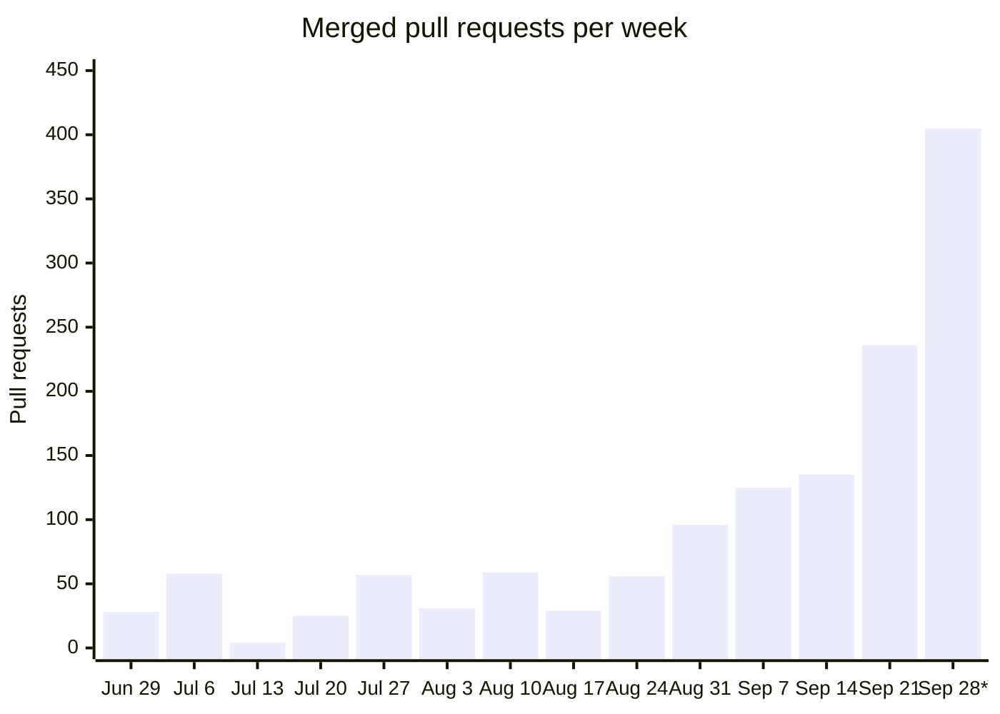
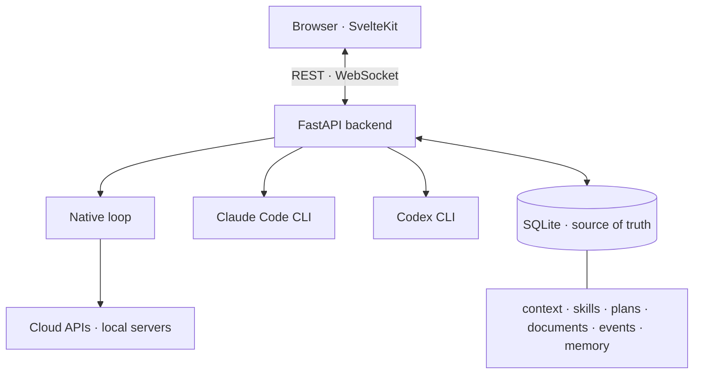

<p align="center">
  
</p>

<h1 align="center">CORSIA</h1>

<p align="center"><strong>Community-Orchestrated Recursive Self-Improving Agents</strong></p>

<h3 align="center">CORSIA gives your AI agents the structure a human team relies on:<br/>owners, a written way of working, a definition of done and a scoreboard.</h3>

<p align="center"><b>For people who hand AI agents whole areas of work, not just tasks.</b><br/>Every project is measured by how much of your attention it takes, and CORSIA is built to bring that number down.</p>

<p align="center">Self-hosted on your Apple Silicon Mac. Owners keep their plans, history and documents as you switch between the Claude Code and Codex subscriptions, APIs and local models you already use.</p>

<p align="center">
  
  
  
  
  
  
</p>

<p align="center">
  <a href="#how-it-works">How it works</a> ·
  <a href="#getting-started">Getting started</a> ·
  <a href="#built-by-its-own-agents">Built by its own agents</a> ·
  <a href="#questions">Questions</a> ·
  <a href="#security">Security</a>
</p>


## Why owners

An AI agent is good at a task and poor at a job. Give one agent all your work and its context fills with unrelated detail, its lessons blur, and you become its memory, its relay and its reviewer.

CORSIA gives each recurring area of your work, such as your inbox and calendar, research, a product surface or releases, an **owner agent**. An owner is long-lived. It keeps its own context, notes, success measures and authority, and it carries work from decision to verified result. It hands bounded steps to **temporary workers** and briefs them with what it knows.

Each piece of work has one accountable owner. Splitting a deliverable across agents is where multi-agent systems break: in one study, over a third of failures came from agents misaligned with each other ([MAST](https://arxiv.org/abs/2503.13657)). Instead, each owner becomes the expert on its area and keeps that knowledge always loaded or one lookup away. Owners message each other directly, so a question reaches the agent that knows the answer and comes back complete.

One owner is a good start. A team is what turns babysitting AI into delegating real authority, and decision fatigue into leverage. CORSIA is for people willing to let agents make mistakes and learn from them, **not** for anyone who wants to approve every step.

## How it works



1. **You describe your work.** A **conductor** drafts the team with you. Every install starts with one, and an owner can work there without any project; a project that needs its own context, access or team gets its own conductor. The conductor writes the **coordination model**: one readable file that says who owns what, how work moves, what "done" means and when you are asked. [A default](docs/coordination-models/corsia-default/) ships with CORSIA.
2. **Owners plan.** Each goal becomes a **plan** of steps with acceptance criteria, and a step closes only with evidence.
3. **You decide only what's yours.** Owners act within the authority you give them. A choice outside it arrives as a **decision** with options and a recommendation. Widen the authority as they earn your trust, and fewer decisions reach you.
4. **The way of working improves.** Every task is measured the same way. The conductor revises the coordination model from what the measurements show, and recommends a new owner when an area outgrows the one that has it. When the team needs an integration CORSIA lacks, a conductor builds it from skills, scheduled automations, the `corsia` CLI and MCP servers you approve.

## Owners carry work to done

Agents usually stop when the chat stops, leaving you to relay CI results and ask whether the work is done.

- **Events wake the right owner; other changes wait.** With GitHub connected, a pull-request comment, review or CI result wakes the owner of that work. Edits to its documents, plan, team or instructions arrive together with its next turn, so staying current costs no extra turns.
- **Nothing stalls silently.** Every wait has a deadline, and a worker that stops with open work wakes the owner that sent it.
- **Done means evidence.** Steps close against their acceptance criteria. A skill can declare a repeatable workflow, such as an independent review before release, and each of its steps becomes a plan step with its own check.
- **Cost is visible per step.** Tokens and time roll up from workers to the step they served.

<p align="center"></p>

## You review outcomes, not transcripts

Every agent you add is another stream to watch, unless it only interrupts you when something needs you.

- **Focus mode**, on by default, shows your messages, each owner's marked updates and its decisions. Working steps collapse.
- **Decisions arrive prepared** with options, the trade-off and a recommendation. Answer them from your phone.
- **Work in the same document.** You and your agents edit a document at the same time, and every change merges live. A comment or suggested edit goes to the agent that owns it.
- **Pause** an owner and its workers stop at a safe point. A paused owner still answers when you message it.


## The work outlives the model

Usage limits, outages and model regressions shouldn't take your work with them.

- **One context, any harness.** Owners run on Claude Code, Codex, or CORSIA's own loop on an API or a local model on Apple Silicon. Every harness receives the same instructions, skills and tools. CORSIA runs Claude Code and Codex with their own memory, skills, hooks and tools switched off, so every turn uses CORSIA's own and is governed and counted the same way.
- **CORSIA keeps the history.** It writes its own checkpoint of each conversation: a summary plus sourced decisions and work state. Switching an owner's model keeps its plan, history and documents, and long conversations stay inside the model's context window.
- **Every turn shows its inputs.** Each turn records exactly which context sources and versions it received.
- **Switch whenever you like.** Change an owner's model or account from the model picker at any time. Optionally, when an account reaches its usage limit, the next turn moves to another ready account you allow.

## It gets measurably better

Without measurement, nobody can tell whether a new model, skill or rule helped, or whether the same model quietly got worse.

- **Every task is measured the same way:** outcomes, first-try acceptance, corrections, tokens, cost and estimated active time, by project and owner. Owners add their own KPIs as OpenTelemetry events.
- **Models compete on your work.** Each model gets one row: accepted tasks and cost per accepted task, compared with last week.
- **Guidance is versioned.** The coordination model, context files and skills record each change with its reason, and the trends show the weeks before and after it.
- **Lessons are trials.** A lesson an agent learns carries its evidence, its boundary and a review date. At that date its owner promotes, extends or retires it from what happened in the meantime, so guidance that doesn't earn its place drops out.
- **Shared improvement is next.** Publishing a proven coordination model with its evidence, and adopting someone else's, is in progress.

<picture>
  <source media="(prefers-color-scheme: dark)" srcset="docs/measurement-headline-dark.png">
  
</picture>

<picture>
  <source media="(prefers-color-scheme: dark)" srcset="docs/measurement-cost-dark.png">
  
</picture>

## Built by its own agents

Most open-source projects move at the pace of their maintainers' spare time. CORSIA tests what happens when agents do the maintaining and, in time, the community sets the direction. It is built and maintained by owner agents running on CORSIA, under the conductors that ship with it. Each owner watches the health and KPIs of its own area, follows recent trends, and tries changes on itself before rolling them out. The owners write the issues, pull requests and reviews, merge their own work after CI and an independent LLM reviewer pass on the exact commit, and prepare each release.

Under one maintainer, the team merged 962 pull requests in the 30 days to 2026-10-02 ([how this is counted](docs/readme-evidence.md)).



<sub>Work pull requests merged into the development branch or a team's integration branch, each counted once. * Monday to Friday.</sub>

Review at this volume is automated, so the reviewer is itself audited. From October 1 to 9, about a third of pull requests failed CI or review on their first push and were corrected before merging. Nightly audits of 14 days in September confirmed 95.0% of 462 audited reviewer findings correct. They also confirmed that defects reach the development branch. That is partly by design: agents are allowed to make mistakes so that recurring failure modes surface. Sixteen are now catalogued as [LLM anti-patterns](docs/contributing/bootstrap/starter-kit/shared/standards/llm-anti-patterns.md) that the reviewer checks for, and the mechanically detectable ones also have blocking CI rules. The rest is tracked as debt ([method](docs/readme-evidence.md#review-and-quality)).

## Getting started

### Know before you start

- **macOS on Apple Silicon only.** Agent Safehouse, which sandboxes agent shell commands, is built on macOS `sandbox-exec`. Local models need macOS 15 or later.
- **Agents run as your macOS user, with unrestricted network access.** Read [Security](#security) first.
- **Keep the workspace out of Documents, Desktop, Downloads and iCloud Drive.** CORSIA's sandbox refuses those folders, and macOS privacy prompts can keep interrupting background agents there. The default, `~/corsia`, avoids both; agents still reach files there through a reviewed request (see [Security](#security)).
- **Teams use a lot of tokens.** Start with one owner, watch its usage, and set spending limits on any API key.
- **Pre-release.** Releases are dated tags on `main`. There is no packaged desktop app yet.

### Install

Open Terminal and run:

```bash
git clone --branch main https://github.com/cebertowicz/corsia.git ~/.corsia
cd ~/.corsia
bash scripts/install.sh
```

The installer adds any missing prerequisites, builds the environment and opens CORSIA at `http://localhost:1956`. The rest happens in the browser:

1. Choose where your work lives and create a local account.
2. Connect a model source. CORSIA detects Claude Code and Codex logins, takes an API key, or connects a local [oMLX](https://github.com/jundot/omlx) server, and offers a fix for anything missing.
3. Describe your work, or start with the ready-made Assistant for Gmail, Google Calendar, Drive and Docs. The workspace conductor shows each setup step in its plan as it sets up your first owner with you.

Updates arrive through **Settings → Update**, which waits for running turns to finish and keeps the old build serving if the new one fails.

**On your phone:** reach your Mac over a private HTTPS address, for example `tailscale serve --bg http://127.0.0.1:1956`, then use **Add to Home Screen**.

<details>
<summary><strong>Manual install and requirements</strong></summary>

| Need | Install |
|---|---|
| Python 3.11 (SQLite 3.45+) | `brew install python@3.11` |
| Node.js 20.19+ or 22.12+ | `brew install node` |
| Git 2.36+ | `xcode-select --install` |
| Agent Safehouse 0.11.1+, on `PATH` as `safehouse` | `brew install eugene1g/safehouse/agent-safehouse` |
| GitHub CLI, signed in with `gh auth login` | `brew install gh` |
| `agent-browser` 0.31.x (the installer adds it) | `npm install -g agent-browser@0.31 && agent-browser install` |
| Optional: web search | A Brave Search API key (entered in **Settings → Keys**) |

```bash
git clone --branch main https://github.com/cebertowicz/corsia.git ~/.corsia
cd ~/.corsia
python3.11 -m venv .venv
.venv/bin/python -m pip install -r backend/requirements.lock
(cd frontend && npm ci && npm run build)
cp .env.example .env                  # optional
scripts/corsia start
```

First-run setup runs only from a checkout at `~/.corsia`.

</details>

<details>
<summary><strong>Everyday commands</strong></summary>

`corsia` means `~/.corsia/scripts/corsia`.

| Command | Does |
|---|---|
| `corsia start` / `stop` / `restart` / `status` / `logs` | Run and inspect the backend |
| `corsia sources` / `sources recheck` | Show each model source with a fix for anything missing |
| `corsia setup local` / `setup server` | Switch between this-computer-only and an always-on server |
| `corsia service install` / `uninstall` | Run as a launchd service |
| `corsia user …` / `corsia token …` | Manage accounts and API tokens |
| `corsia delegate …` / `doc …` / `context …` / `providers …` | Drive threads, documents, context files and model endpoints from the shell |

A second checkout on the same machine needs its own `CORSIA_WORKSPACE`, `CORSIA_STATE_DIR` and `BACKEND_PORT`.

</details>

## Security

An agent you don't watch needs real capabilities, or it stops to ask you at every step. So CORSIA lets agents get the work done and limits what a mistake can reach, in layers, rather than taking away tools and routing every action back to you.

- **Sandboxed by default.** Shell commands run inside Agent Safehouse, and file tools reach only allowed paths.
- **Leases for anything outside.** To reach beyond the workspace, an agent applies for a short **host-access lease** that states the purpose, the exact resources and the effects. A reviewer checks the request, then every command run under it, and blocks any that is harmful or clearly unrelated to that purpose. If the reviewer can't reach a verdict, the answer is no. Every request, verdict and reviewed command is kept.
- **Some things no lease opens:** credentials and SSH keys, CORSIA's own state and sandbox, and system startup files.
- **Agents can't approve their own access.** A lease is approved by a signed-in person or, if you turn it on, by the automatic reviewer. A lease that launches an outside agent always needs a person.
- **Credentials stay masked.** Credential values are masked before file contents reach a model.

In one week on the install building CORSIA, with automatic approval on, 471 of 519 reviewed lease requests (91%) were approved automatically, 34 were rejected and 14 went to a person. Of 1,586 commands run under leases, 48 were blocked. A server setup listens on your network behind sign-in, so run it on a trusted network or a private tailnet. More in [`SECURITY.md`](SECURITY.md).

## Questions

<details>
<summary><strong>Will a team of agents cost more than Claude Code or Codex alone?</strong></summary>

<br/>A team uses more tokens than one agent, because owners and workers each run turns. CORSIA is built to make that spend pay: each delegated step goes to the least costly model that can do it, every step shows its tokens and time, and the conductor tunes the way of working to bring down the cost per accepted task. The install building CORSIA runs on three max-tier plans: Claude, Codex and Alibaba. On one SWE-bench task (`pylint-dev__pylint-7114`), each harness ran once on the same local model, with Claude Code and Codex pointed at it through their own endpoint settings:

| Harness | Model calls | Cost if billed at Sonnet 4.5 prices | Minutes | Patch review score (of 5) |
|---|--:|--:|--:|--:|
| Claude Code | 91 | $4.75 | 42.1 | 4.5 |
| Codex | 64 | $3.30 | 38.5 | 4.5 |
| CORSIA, built-in agent loop | 53 | $3.06 | 48.7 | 4.6 |

All three patches passed, and CORSIA's loop used the fewest model calls: 42% fewer than Claude Code and 17% fewer than Codex. One task cannot show a repeatable difference; fuller benchmarks are coming. See the [methods](docs/readme-evidence.md).

</details>

<details>
<summary><strong>How do I give agents instructions?</strong></summary>

<br/>Write each instruction once, at the level it applies to. Every agent receives the levels that cover it on every turn, in any harness. You rarely write them yourself: on the install that builds CORSIA, the team maintains almost all of its own context files.

| Level | Put here | How |
|---|---|---|
| Workspace | Rules for everything, such as which models may be used | **Workspace settings → Create new context file** |
| Project | The project's purpose, rules and reference material | **Project settings → Create new context file** |
| Owner | Its responsibilities, authority and notes | The owner keeps this file current; scope changes go through the conductor |

**Skills** are procedures an agent loads when its task matches. Add one as `skills/<name>/SKILL.md` at any level.

Every turn shows what the agent loaded, by source and size. A context file in that list opens straight from it, so you can read or change what an owner works from.

<p align="center"></p>

</details>

<details>
<summary><strong>How do agents choose a model, and how do I restrict them?</strong></summary>

<br/>The shipped spawn policy uses the least costly model that can reliably do the work, moves up for ambiguity, interacting systems or high stakes, and dispatches only to models shown as ready. Add `SPAWN-POLICY.md` at the workspace or project level to set your own allowed models, roles and budgets. For a hard stop, turn a model off under **Settings → Providers**. Claude Code and Codex models can only be hidden from the picker there, so sign out of that CLI to stop it entirely.

</details>

<details>
<summary><strong>How should I shape the team?</strong></summary>

<br/>Start with one owner. Add another when an area recurs, needs its own expertise or memory, or crowds an existing owner's context. Keep one accountable owner per deliverable, even when others contribute. A common shape combines three kinds of owner: **domain owners**, one per lasting area; an **independent reviewer** that checks work it didn't produce; and a **coordinator** that sequences work across owners and runs releases. Name owners for lasting outcomes, not process stages. Merge or retire them when coordinating costs more than it saves.

</details>

<details>
<summary><strong>What ships today and what's next</strong></summary>

<br/>The main capabilities in each area, with their status.

**Ownership and plans**
- [x] Owner agents with their own notes, authority, success measures and plans
- [x] A workspace conductor, plus optional project conductors
- [x] Temporary workers for bounded steps, checked by the owner that sent them
- [x] Owners that message each other directly
- [x] Acceptance criteria and evidence on every step; dependencies, deadlines and decisions with a recommendation
- [x] GitHub pull-request, comment and CI events routed to the owner that registered the work
- [x] Focus mode, a live plan view, and pausing an owner and its workers

**Documents**
- [x] Shared documents in a canvas beside chat, co-edited live
- [x] Comments and suggested edits that reach the document's owner

**Context, memory and models**
- [x] Layered context (workspace, project, owner), the same in every harness, with a per-turn record of what each turn received
- [x] Sourced decisions and preferences carried across sessions and models
- [x] CORSIA-written checkpoints that move with the work between models
- [x]  Claude Code and Codex logins, Anthropic, OpenAI and OpenAI-compatible APIs, and  local models through oMLX
- [x] Subscription usage per account, shown in the model picker before you choose
- [x] Optional account rollover on usage limits, set for the workspace or per project

**Measurement and learning**
- [x] Outcomes, first-try acceptance, corrections, tokens, decisions and estimated active time by project and owner
- [x] Per-model results on your own work, and cost at public list rates beside actual charges
- [ ] Per-version comparison of guidance changes *(planned)*
- [x] Owner KPIs as  OpenTelemetry events
- [x] Versioned guidance and lesson trials with a boundary and review date
- [ ] Share and adopt coordination models with their evidence *(in progress)*
- [ ] Anonymous aggregate results across installs *(planned; opt-in)*
- [ ] Remote analytics API and per-provider tuning from your data *(planned)*

**Control and safety**
- [x] Plain Markdown files and  SQLite on your machine
- [x] Agent Safehouse sandbox, allowed-path file tools, reviewed host-access leases and credential masking
- [ ] Scoped permissions for agent and API tokens *(planned)*
- [ ] Signed maintainer notices *(once release signing keys are configured)*

**Apps**
- [x] Web app and an installable phone app
- [ ] Packaged macOS desktop app *(source in `desktop/`)*

</details>

<details>
<summary><strong>Architecture at a glance</strong></summary>



**Execution** is which harness carries a turn: CORSIA's native loop, Claude Code or Codex. **Inference** is which model serves a native turn. The two are independent. A workspace holds `context/`, `skills/`, `shared/`, `projects/` and `.threads/`; operational state lives under Application Support or `CORSIA_STATE_DIR`.

</details>

## Documentation

| Topic | Read |
|---|---|
| Code map and runtime isolation | [`ARCHITECTURE.md`](ARCHITECTURE.md) · [`BACKEND.md`](BACKEND.md) · [`FRONTEND.md`](FRONTEND.md) |
| Security and accounts | [`SECURITY.md`](SECURITY.md) |
| What has shipped | [`CHANGELOG.md`](CHANGELOG.md) |
| Rules for coding agents in this repository | [`AGENTS.md`](AGENTS.md) |

## Contributing

Read [`CONTRIBUTING.md`](CONTRIBUTING.md). Open pull requests to `dev` from feature branches, and keep private workspace material out of issues, commits, pull requests and screenshots.

## License

No repository-wide license has been specified yet.
