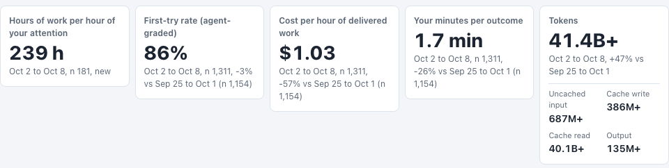
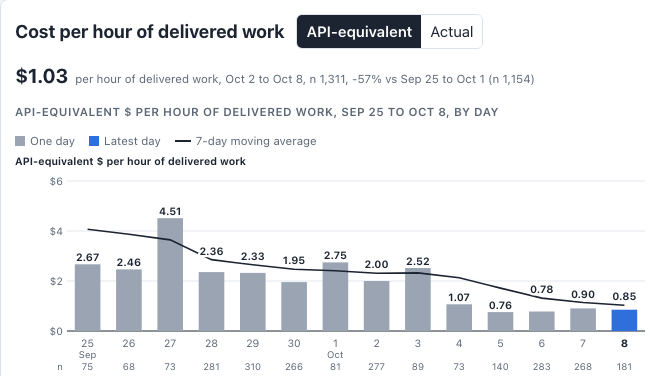
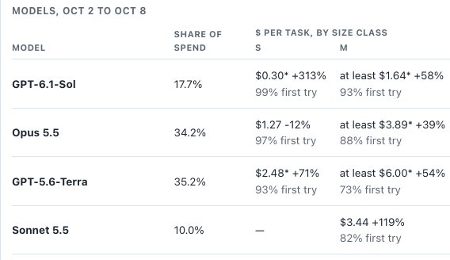
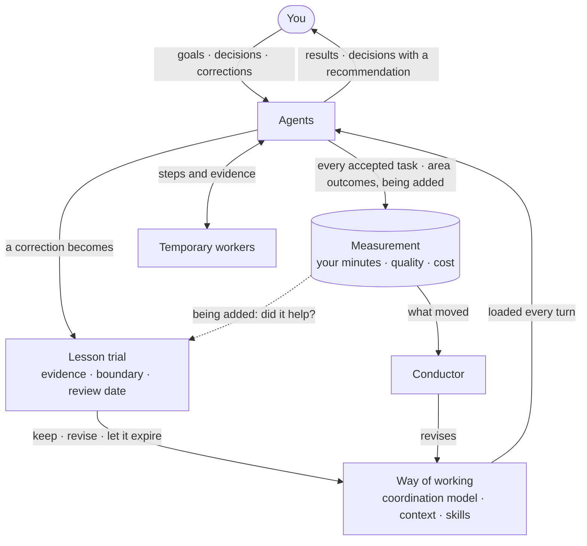
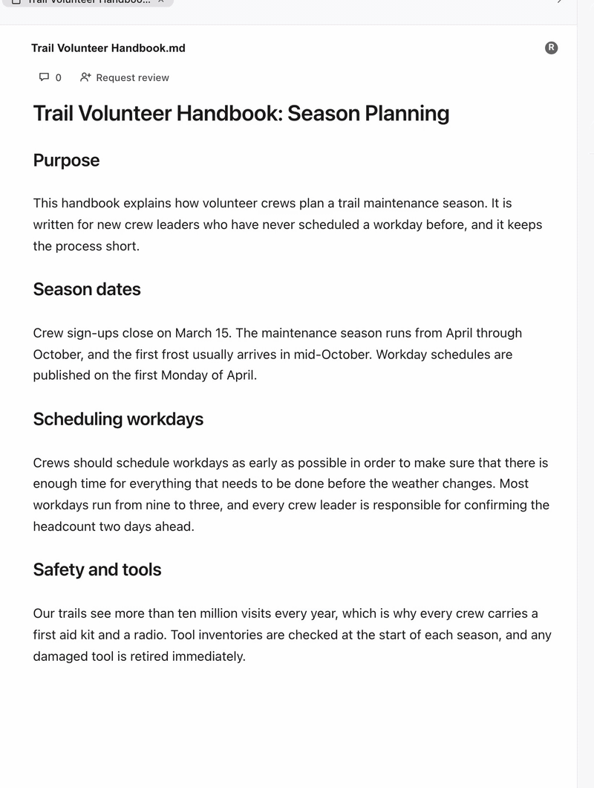
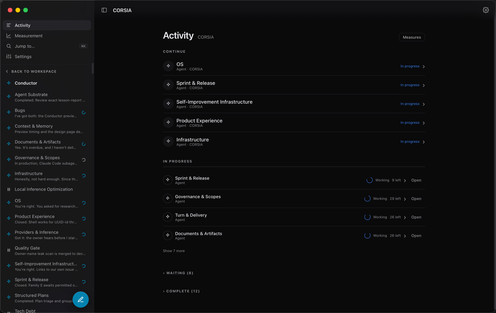
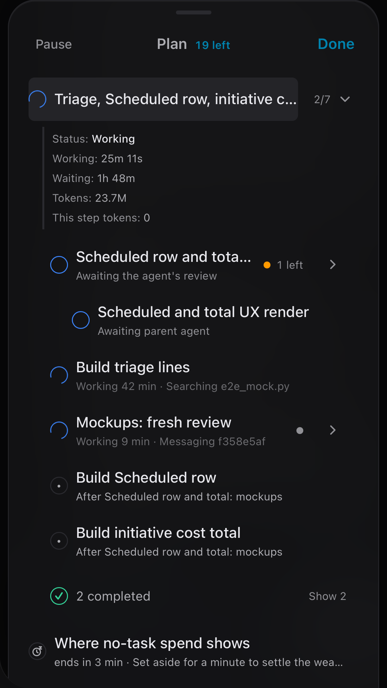
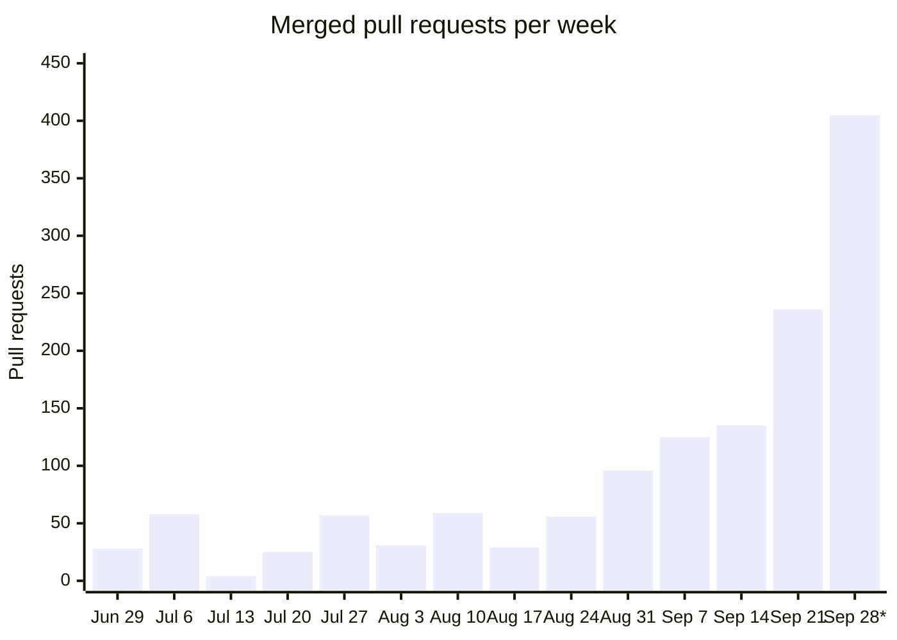
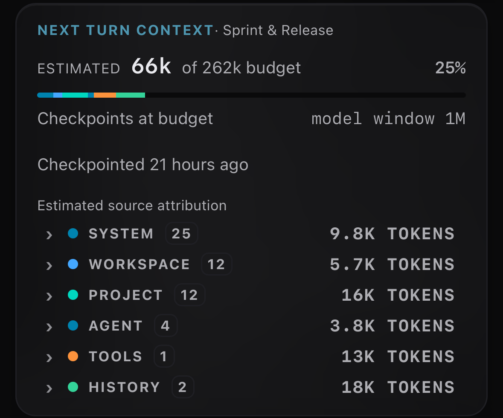
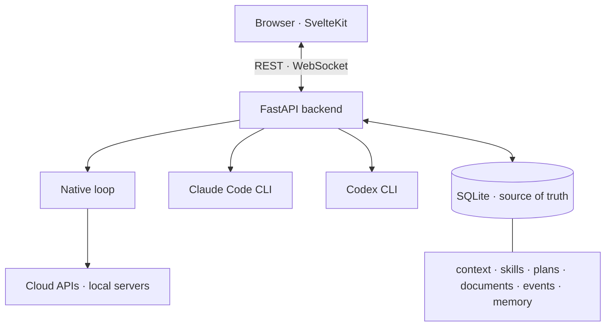

<h1 align="center">C.O.R.S.I.A.<br/><sub><sub>Community-Orchestrated Recursive Self-Improving Agents</sub></sub></h1>

<h3 align="center">Give an agent a problem to own.<br/>It improves itself, measured on its results and your attention.</h3>

<p align="center">It sets KPIs for the problem you gave it, and CORSIA counts every minute it takes from you. The agent learns from both, to get better results for less of your time.</p>

<p align="center">
  <picture>
    <source media="(prefers-color-scheme: dark)" srcset="docs/measurement-kpis-dark.png">
    
  </picture>
</p>
<p align="center">
  <picture>
    <source media="(prefers-color-scheme: dark)" srcset="docs/measurement-trend-dark.png">
    
  </picture>
  <picture>
    <source media="(prefers-color-scheme: dark)" srcset="docs/measurement-models-dark.png">
    
  </picture>
</p>
<p align="center"><sub>Measured on the install that builds CORSIA, September 25 to October 8.</sub></p>

<p align="center"><strong>CORSIA improves itself the same way.</strong> Its own agents build and maintain it: <a href="#built-by-its-own-agents">962 pull requests in 30 days</a>, under one maintainer.</p>

<p align="center">
  
  
  
  
  
  
</p>

<p align="center">
  <a href="#how-it-works">How it works</a> ·
  <a href="#how-you-know-its-working">How you know it's working</a> ·
  <a href="#what-it-asks-of-you">What it asks of you</a> ·
  <a href="#getting-started">Getting started</a> ·
  <a href="#built-by-its-own-agents">Built by its own agents</a> ·
  <a href="#security">Security</a> ·
  <a href="#questions">Questions</a>
</p>

## How it works

Most agents do what you ask and remember more each time. A CORSIA agent answers for a result instead: it is measured on it, checked by an agent other than itself where it matters, and keeps a lesson only while the lesson earns its place.

**Pick a problem and let an agent own it.** The agent answers for a measurable outcome: your time, for an assistant that takes email, scheduling and follow-ups off your week; bugs that reach users; new users who quit during setup. It sets the KPIs for that problem and answers for them, on top of the two goals every agent starts with: less of your time, better results. Recording those KPIs beside CORSIA's own measures is being added. It carries work from decision to verified result, hands bounded steps to **temporary workers**, and messages other agents directly. Each deliverable has one accountable agent.

Anything measured can be gamed, by agents as much as by people. So every agent is measured on the cost of its own shortcuts: rework and your corrections, taken from the work itself rather than from its own grading. When an outcome matters too much for the agent doing the work to be the only check, a separate agent owns the check. That is one reason for a **project**: agents whose problems check or pull against each other, such as a builder that wants to ship and a reviewer that owns what slips through. The project's **coordination model** says how they work together: who owns what, how work moves, what "done" means and when you are asked. [A default one](docs/coordination-models/corsia-default/) ships with CORSIA.



### Scopes

Agents answer for outcomes. **CORSIA**, the assistant every install starts with, answers for your platform and your attention, and each project's **conductor** answers for that project's way of working: who owns what, the context and skills each agent gets, and the coordination model. Every agent receives the workspace's context and its own project's on every turn, and never another project's.

| Scope | Holds | Kept by |
|---|---|---|
| **Workspace** | Rules for everything you run, such as which models agents may use, and agents that don't need a project | **CORSIA**, your assistant. It sets up and configures the platform, and watches your attention across every agent |
| **Project** | One body of work: its purpose, rules, reference documents, skills, coordination model and agents | Its **conductor**, created with the project |
| **Agent** | Its problem, authority, plan and lessons | The agent itself; changes to its scope go through the conductor |
| **Worker** | One bounded step and its brief, under its agent's authority | The agent that sent it |

Start a project when work needs context of its own, such as a codebase, a client or a rulebook that other agents shouldn't load, or agents that check each other.

## How you know it's working

Asking for less of your attention is only safe with proof that the work is getting better. Fewer of your minutes with worse results is a worse team, not a better one. So CORSIA measures both sides for every agent, the same way in every project, with no setup. The same numbers show whether a new model helped or quietly got worse; the same check for a new skill or rule is being added.

- **Your minutes per result.** The time you spend with an agent's conversations or project open in CORSIA, split evenly across what you have open, divided by the results you accept. Every agent works to bring it down.
- **Quality and cost per result.** The first-try rate counts tasks accepted without being sent back or corrected. Cost counts the tokens of each accepted task, including every worker it used, and their dollars at API list prices where a model has them.
- **Each agent against its own past.** Measurement compares each agent with its previous weeks and flags one that moved the wrong way. Models compete on your work: each gets one row of accepted tasks and cost per accepted task, against the week before.
- **Each agent on its own KPIs** (being added). Every agent keeps KPIs for the problem it owns, such as bugs that reach users, for an agent that owns release quality, or hours of your week spent on email and meetings, for an assistant. Agents record those outcomes as they happen, and any project can send its own OpenTelemetry events, so a problem's progress sits beside the built-in measures.
- **Lessons expire unless they earn their place.** Most agent memory only grows. When a CORSIA agent learns from a correction or a failure, it writes a short trial: the evidence, when the lesson applies and when it doesn't, and a review date. The trial loads until that date. Then the agent keeps, revises or retires it, with a report of which turns received and read each version. Being added: a comparison of tasks that received the lesson with similar tasks that didn't, so the review sees whether it helped, not only who saw it (the dashed line above). A retired lesson stops loading and keeps its history. Your own instructions are never trials and never expire.
- **The conductor acts on what moved.** It revises the coordination model, context and skills from what the measurements show, and recommends a new agent when a problem outgrows the one that has it. Each change is versioned with its reason. Being added: the trends mark when guidance changed, so a shift in the numbers lines up with its cause.

## What it asks of you

Decisions and results, not transcripts. Every agent you add is another stream to watch, unless it only interrupts you when something needs you.

- **Decisions arrive prepared.** Agents act within the authority you give them. A choice outside it arrives with options, the trade-off and a recommendation, and you can answer from your phone. Widen the authority as results earn your trust, and fewer decisions reach you.
- **Focus mode**, on by default, shows your messages, each agent's marked updates and its decisions. Working steps collapse.
- **Work doesn't stop when the chat does.** With GitHub connected, a pull-request comment, review or CI result wakes the agent that owns that work. Every wait has a deadline, a worker that stops with open work wakes the agent that sent it, and a step closes only with evidence against its acceptance criteria.
- **Work in the same document.** You and your agents edit a document at the same time, and every change merges live. A comment or suggested edit goes to the agent that owns it.
- **Pause** an agent and its workers stop at a safe point. A paused agent still answers when you message it.



<p align="center">
  
  
</p>
<p align="center"><sub>Every agent and its plan, on your Mac and on your phone.</sub></p>

CORSIA is for people willing to let agents make mistakes and learn from them, **not** for anyone who wants to approve every step.

## Runs on the models you already have

Usage limits, outages and model regressions shouldn't take your work with them.

- **One context, any harness.** Agents run on Claude Code, Codex, or CORSIA's own loop on an API or a local model on Apple Silicon. Every harness receives the same instructions, skills and tools. CORSIA runs Claude Code and Codex with their own memory, skills, hooks and tools switched off, so every turn uses CORSIA's own and is governed and counted the same way.
- **Switching keeps the work.** CORSIA writes its own checkpoint of each conversation, so changing an agent's model or account from the model picker keeps its plan, history and documents. Optionally, when an account reaches its usage limit, the next turn moves to another ready account you allow.

## Built by its own agents

Most open-source projects move at the pace of their maintainers' spare time. CORSIA tests what happens when agents do the maintaining and, in time, the community sets the direction. It is built and maintained by agents running on CORSIA, under the conductors that ship with it. Each agent watches the health and KPIs of its own problem, follows recent trends, and tries changes on itself before rolling them out. The agents write the issues, pull requests and reviews, merge their own work after CI and an independent LLM reviewer pass on the exact commit, and prepare each release.

Under one maintainer, the team merged 962 pull requests in the 30 days to 2026-10-02 ([how this is counted](docs/readme-evidence.md)).



<sub>Work pull requests merged into the development branch or a team's integration branch, each counted once. * Monday to Friday.</sub>

Review at this volume is automated, so the reviewer is itself audited. From October 1 to 9, about a third of pull requests failed CI or review on their first push and were corrected before merging. Nightly audits of 14 days in September confirmed 95.0% of 462 audited reviewer findings correct. They also confirmed that defects reach the development branch. That is partly by design: agents are allowed to make mistakes so that recurring failure modes surface. Sixteen are now catalogued as [LLM anti-patterns](docs/contributing/bootstrap/starter-kit/shared/standards/llm-anti-patterns.md) that the reviewer checks for, and the mechanically detectable ones also have blocking CI rules. The rest is tracked as debt ([method](docs/readme-evidence.md#review-and-quality)).

## Getting started

### Know before you start

- **macOS on Apple Silicon only.** Agent Safehouse, which sandboxes agent shell commands, is built on macOS `sandbox-exec`. Local models need macOS 15 or later.
- **Agents run as your macOS user, with unrestricted network access.** Read [Security](#security) first.
- **Keep the workspace out of Documents, Desktop, Downloads and iCloud Drive.** CORSIA's sandbox refuses those folders, and macOS privacy prompts can keep interrupting background agents there. The default, `~/corsia`, avoids both; agents still reach files there through a reviewed request (see [Security](#security)).
- **Teams use a lot of tokens.** Start with one agent, watch its usage, and set spending limits on any API key.
- **Pre-release.** Releases are dated tags on `main`. There is no packaged desktop app yet.

### Install

Open Terminal and run:

```bash
git clone --branch main https://github.com/cebertowicz/corsia.git ~/.corsia
cd ~/.corsia
bash scripts/install.sh
```

The installer adds any missing prerequisites, builds the environment and opens CORSIA at `http://localhost:1956`. The rest happens in the browser:

1. Choose where your work lives and create a local account.
2. Connect a model source. CORSIA detects Claude Code and Codex logins, takes an API key, or connects a local [oMLX](https://github.com/jundot/omlx) server, and offers a fix for anything missing.
3. Describe your work, or start with the ready-made Assistant for Gmail, Google Calendar, Drive and Docs. CORSIA shows each setup step in its plan as it sets up your first agent with you.

Updates arrive through **Settings → Update**, which waits for running turns to finish and keeps the old build serving if the new one fails.

**On your phone:** reach your Mac over a private HTTPS address, for example `tailscale serve --bg http://127.0.0.1:1956`, then use **Add to Home Screen**.

<details>
<summary><strong>Manual install and requirements</strong></summary>

| Need | Install |
|---|---|
| Python 3.11 (SQLite 3.45+) | `brew install python@3.11` |
| Node.js 20.19+ or 22.12+ | `brew install node` |
| Git 2.36+ | `xcode-select --install` |
| Agent Safehouse 0.11.1+, on `PATH` as `safehouse` | `brew install eugene1g/safehouse/agent-safehouse` |
| GitHub CLI, signed in with `gh auth login` | `brew install gh` |
| `agent-browser` 0.31.x (the installer adds it) | `npm install -g agent-browser@0.31 && agent-browser install` |
| Optional: web search | A Brave Search API key (entered in **Settings → Keys**) |

```bash
git clone --branch main https://github.com/cebertowicz/corsia.git ~/.corsia
cd ~/.corsia
python3.11 -m venv .venv
.venv/bin/python -m pip install -r backend/requirements.lock
(cd frontend && npm ci && npm run build)
cp .env.example .env                  # optional
scripts/corsia start
```

First-run setup runs only from a checkout at `~/.corsia`.

</details>

<details>
<summary><strong>Everyday commands</strong></summary>

`corsia` means `~/.corsia/scripts/corsia`.

| Command | Does |
|---|---|
| `corsia start` / `stop` / `restart` / `status` / `logs` | Run and inspect the backend |
| `corsia sources` / `sources recheck` | Show each model source with a fix for anything missing |
| `corsia setup local` / `setup server` | Switch between this-computer-only and an always-on server |
| `corsia service install` / `uninstall` | Run as a launchd service |
| `corsia user …` / `corsia token …` | Manage accounts and API tokens |
| `corsia delegate …` / `doc …` / `context …` / `providers …` | Drive threads, documents, context files and model endpoints from the shell |

A second checkout on the same machine needs its own `CORSIA_WORKSPACE`, `CORSIA_STATE_DIR` and `BACKEND_PORT`.

</details>

## Security

An agent you don't watch needs real capabilities, or it stops to ask you at every step. So CORSIA lets agents get the work done and limits what a mistake can reach, in layers, rather than taking away tools and routing every action back to you.

- **Sandboxed by default.** Shell commands run inside Agent Safehouse, and file tools reach only allowed paths.
- **Leases for anything outside.** To reach beyond the workspace, an agent applies for a short **host-access lease** that states the purpose, the exact resources and the effects. A reviewer checks the request, then every command run under it, and blocks any that is harmful or clearly unrelated to that purpose. If the reviewer can't reach a verdict, the answer is no. Every request, verdict and reviewed command is kept.
- **Some things no lease opens:** credentials and SSH keys, CORSIA's own state and sandbox, and system startup files.
- **Agents can't approve their own access.** A lease is approved by a signed-in person or, if you turn it on, by the automatic reviewer. A lease that launches an outside agent always needs a person.
- **Credentials stay masked.** Credential values are masked before file contents reach a model.

In one week on the install building CORSIA, with automatic approval on, 471 of 519 reviewed lease requests (91%) were approved automatically, 34 were rejected and 14 went to a person. Of 1,586 commands run under leases, 48 were blocked. A server setup listens on your network behind sign-in, so run it on a trusted network or a private tailnet. More in [`SECURITY.md`](SECURITY.md).

## Questions

<details>
<summary><strong>Will a team of agents cost more than Claude Code or Codex alone?</strong></summary>

<br/>A team uses more tokens than one agent, because agents and their workers each run turns. CORSIA is built to make that spend pay: each delegated step goes to the least costly model that can do it, every step shows its tokens and time, and the conductor tunes the way of working to bring down the cost per accepted task. The install building CORSIA runs on three max-tier plans: Claude, Codex and Alibaba. On one SWE-bench task (`pylint-dev__pylint-7114`), each harness ran once on the same local model, with Claude Code and Codex pointed at it through their own endpoint settings:

| Harness | Model calls | Cost if billed at Sonnet 4.5 prices | Minutes | Patch review score (of 5) |
|---|--:|--:|--:|--:|
| Claude Code | 91 | $4.75 | 42.1 | 4.5 |
| Codex | 64 | $3.30 | 38.5 | 4.5 |
| CORSIA, built-in agent loop | 53 | $3.06 | 48.7 | 4.6 |

All three patches passed, and CORSIA's loop used the fewest model calls: 42% fewer than Claude Code and 17% fewer than Codex. One task cannot show a repeatable difference; fuller benchmarks are coming. See the [methods](docs/readme-evidence.md).

</details>

<details>
<summary><strong>How do I give agents instructions?</strong></summary>

<br/>Write each instruction once, at the [scope](#scopes) it applies to: **Workspace settings → Create new context file** for everything, **Project settings → Create new context file** for one project. Each agent keeps its own file current. Every harness receives the same files. You rarely write them yourself: on the install that builds CORSIA, the team maintains almost all of its own context files.

**Skills** are procedures an agent loads when its task matches. Add one as `skills/<name>/SKILL.md` at any level.

Every turn shows what the agent loaded, by source and size. A context file in that list opens straight from it, so you can read or change what an agent works from.

<p align="center"></p>

</details>

<details>
<summary><strong>How do agents choose a model, and how do I restrict them?</strong></summary>

<br/>The shipped spawn policy uses the least costly model that can reliably do the work, moves up for ambiguity, interacting systems or high stakes, and dispatches only to models shown as ready. Add `SPAWN-POLICY.md` at the workspace or project level to set your own allowed models, roles and budgets. For a hard stop, turn a model off under **Settings → Providers**. Claude Code and Codex models can only be hidden from the picker there, so sign out of that CLI to stop it entirely.

</details>

<details>
<summary><strong>How should I shape the team?</strong></summary>

<br/>Pick a problem and let an agent own it. Start with one agent, and add another when there is another outcome you can measure and want off your plate, when a problem crowds an existing agent's context, or when an agent's work needs a separate check. Keep one accountable agent per deliverable, even when others contribute. A common shape combines three kinds of agent: **domain agents**, one per lasting problem; an **independent reviewer**, which owns the quality of work it didn't produce; and a **coordinator**, which owns sequencing across agents and releases. Name each agent for the outcome it answers for, not a process stage. Merge or retire agents when coordinating costs more than it saves.

</details>

<details>
<summary><strong>What ships today and what's next</strong></summary>

<br/>The main capabilities in each area, with their status.

**Agents and plans**
- [x] Agents with their own notes, authority, success measures and plans
- [x] CORSIA, the assistant that sets up and runs your workspace, and a conductor for each project
- [x] Temporary workers for bounded steps, checked by the agent that sent them
- [x] Agents that message each other directly
- [x] Acceptance criteria and evidence on every step; dependencies, deadlines and decisions with a recommendation
- [x] GitHub pull-request, comment and CI events routed to the agent that registered the work
- [x] Focus mode, a live plan view, and pausing an agent and its workers

**Documents**
- [x] Shared documents in a canvas beside chat, co-edited live
- [x] Comments and suggested edits that reach the agent that owns the document

**Context, memory and models**
- [x] Layered context (workspace, project, agent), the same in every harness, with a per-turn record of what each turn received
- [x] Sourced decisions and preferences carried across sessions and models
- [x] CORSIA-written checkpoints that move with the work between models
- [x]  Claude Code and Codex logins, Anthropic, OpenAI and OpenAI-compatible APIs, and  local models through oMLX
- [x] Subscription usage per account, shown in the model picker before you choose
- [x] Optional account rollover on usage limits, set for the workspace or per project

**Measurement and learning**
- [x] Outcomes, first-try acceptance, corrections, tokens, decisions and estimated active time by project and agent
- [x] Per-model results on your own work, and cost at public list rates beside actual charges
- [x] Versioned guidance and lesson trials with a boundary and review date
- [ ] Per-version comparison of guidance and lesson changes, marked on the trends *(being added)*
- [ ] Agent KPIs: outcomes agents record for their problems, and  OpenTelemetry events from your projects *(being added)*
- [ ] Share and adopt coordination models with their evidence *(in progress)*
- [ ] Anonymous aggregate results across installs *(planned; opt-in)*
- [ ] Remote analytics API and per-provider tuning from your data *(planned)*

**Control and safety**
- [x] Plain Markdown files and  SQLite on your machine
- [x] Agent Safehouse sandbox, allowed-path file tools, reviewed host-access leases and credential masking
- [ ] Scoped permissions for agent and API tokens *(planned)*
- [ ] Signed maintainer notices *(once release signing keys are configured)*

**Apps**
- [x] Web app and an installable phone app
- [ ] Packaged macOS desktop app *(source in `desktop/`)*

</details>

<details>
<summary><strong>Architecture at a glance</strong></summary>



**Execution** is which harness carries a turn: CORSIA's native loop, Claude Code or Codex. **Inference** is which model serves a native turn. The two are independent. A workspace holds `context/`, `skills/`, `shared/`, `projects/` and `.threads/`; operational state lives under Application Support or `CORSIA_STATE_DIR`.

</details>

## Documentation

| Topic | Read |
|---|---|
| Code map and runtime isolation | [`ARCHITECTURE.md`](ARCHITECTURE.md) · [`BACKEND.md`](BACKEND.md) · [`FRONTEND.md`](FRONTEND.md) |
| Security and accounts | [`SECURITY.md`](SECURITY.md) |
| What has shipped | [`CHANGELOG.md`](CHANGELOG.md) |
| Rules for coding agents in this repository | [`AGENTS.md`](AGENTS.md) |

## Contributing

Read [`CONTRIBUTING.md`](CONTRIBUTING.md). Open pull requests to `dev` from feature branches, and keep private workspace material out of issues, commits, pull requests and screenshots.

## License

No repository-wide license has been specified yet.
