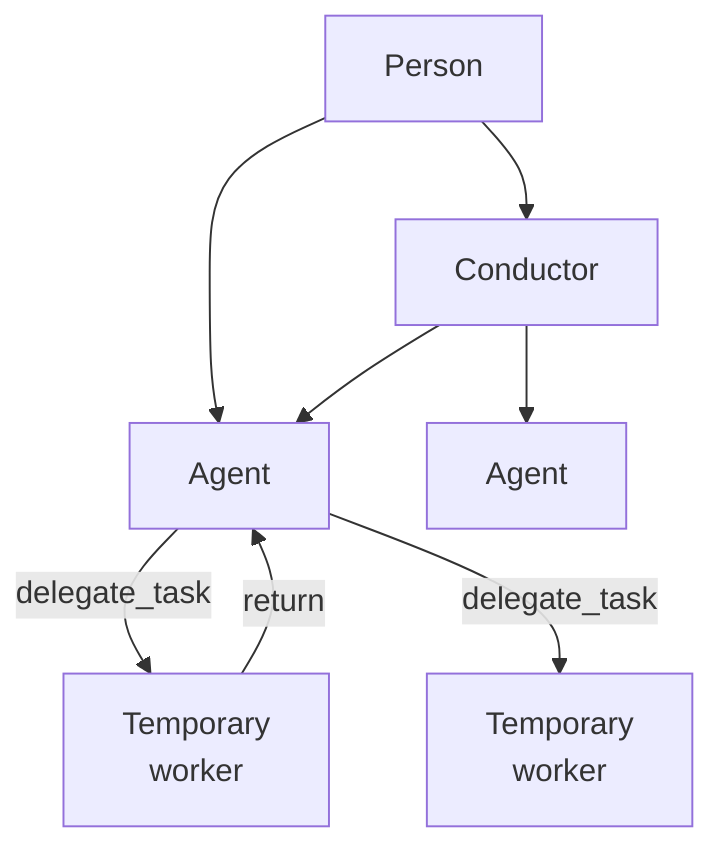

# Agents and threads

A thread is one conversation. An agent is a thread that has been given a standing responsibility. This page covers how the two relate, how a thread hands work to a worker, what limits apply, and what can go wrong.

## What it is

- **Thread:** a conversation with its own history, plan, model and skills. Every turn runs in a thread.
- **Agent:** a thread whose roster record is enabled and carries a responsibility. An agent is meant to outlive any one task and own an area of work.
- **Temporary worker:** a thread created to do one bounded task for a parent thread. It is hidden from the person and has its own plan; its return can be handled through that plan.
- **Roster:** the set of agents in a scope, with each one's responsibility, paths, domains, status and notes (`agent_roster` fields in `backend/core/agent_roster_mutations.py`).
- **Conductor:** the one designated coordinator of a scope. See [Scopes](scopes.md).

## Why it exists

A long-lived responsibility and a one-off task have different needs. A responsibility needs durable context and a stable identity so other threads can address it; a task needs a clean, small context and a clear return. Both use threads, with history, plans, tools and input delivery. Roster and delegation records give them their different roles.

## How it works

### Registering an agent

An agent is a thread with the roster fields set. Two paths change the roster: the person through the API, and the scope's designated conductor through a tool. Both go through one function, and the tool path requires the acting thread to be the live conductor of the same scope as the target (`backend/core/agent_roster_mutations.py`). Each change is journaled to every scope whose roster map it changed (`backend/infra/passive_changes.py`).

### Addressing another thread

`delegate_send` sends a message into another thread. Same-scope sends are the default; cross-scope sends are limited as described in [Scopes](scopes.md). A send is admitted through the same path as a person's message; see [Turns and delivery](turns-and-delivery.md).

### Delegating a task

`delegate_task` creates a hidden child thread and sends its first message. By default it also attempts to hand the child the parent's current plan task; the caller can name another task or request a chat return instead. The child may already be running if the handover fails, so the result reports that failure (`backend/tools/delegate_task.py`).

- **A model is required.** The caller names the model; there is no default. See [Models and harnesses](models-and-harnesses.md).
- **Confinement is `none` or `untrusted`.** `untrusted` limits the worker to file reads in directories the caller lists and its own confined working directory. It is for content neither the caller nor the person controls, such as outside contributors' code or mail from an unknown sender. The sandbox model is described in the security section: [Security](../security/README.md).
- **Completion returns to the parent.** For an unstructured child with a final reply, the reply can be admitted to the parent in the transaction that settles the completed turn. Structured delegation uses the plan's harvest path instead. A fenced parent, a rule-started worker, or a turn without a final reply also does not produce that completion message; an error does not send one this way (`backend/infra/thread_driver.py`, `backend/plans/delegation.py`).
- **Skills inherit down the ancestry.** A child sees its ancestors' thread-level skills; a skill in the child overrides the parent's of the same name (`backend/core/skill_resolution.py`).

### Limits on live processes

Claude Code runs as a separate process per thread. The backend caps how many are working at once, how long a finished one stays warm, and how many idle ones are kept. Defaults are seeded into settings at first start and can be changed there: 8 working, 600 seconds to retire, 8 idle (`backend/infra/subagent_caps.json`, `backend/infra/subagent_caps.py`). Only working processes count against the cap. At the cap, a new Claude Code spawn is refused with an error naming up to five working threads and a count of any others, rather than queueing or spawning more. A retired thread cold-resumes on its next input, as after a backend restart (`backend/subagents/cc_idle_retirement.py`).

## What can go wrong

- **Claude Code spawn refused at the cap.** The tool returns the error with working-thread details. The caller can wait or retry; the refused spawn is not queued.
- **A worker with no model.** `delegate_task` refuses without an explicit model. A model that is unavailable fails visibly; it is not replaced. See [Models and harnesses](models-and-harnesses.md).
- **Roster edits from the wrong place.** A tool edit from a thread that is not the live conductor of the target's scope is refused.
- **Parent and child drift.** A child is its own thread with its own history. It knows what its brief and its own context sources tell it; a brief that leaves out something the child needs produces work that misses it.

## Where it lives

| Part | Path |
|---|---|
| Roster changes | `backend/core/agent_roster_mutations.py`, `backend/infra/passive_changes.py` |
| Delegation tools | `backend/tools/delegate_task.py`, `backend/api/delegation.py` |
| Cross-scope rule | `backend/infra/delegation_scope.py` |
| Process caps | `backend/infra/subagent_caps.py`, `backend/infra/subagent_caps.json` |
| Claude Code process management | `backend/subagents/` |
| Skill ancestry | `backend/core/skill_resolution.py` |
