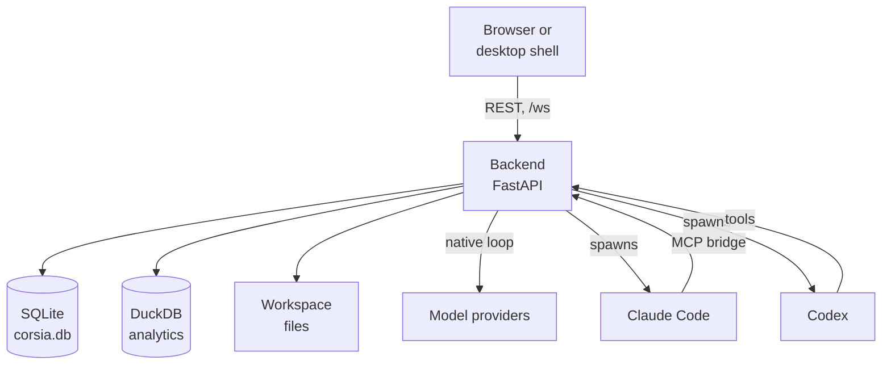

# Architecture

CORSIA is one backend process that owns all state, a browser UI it serves, and a set of agent loops it starts and supervises. This page covers the processes, where state lives, what happens at startup, and what can go wrong.

## What it is

- **One backend.** A FastAPI application serves REST routes, one WebSocket (`/ws`) for live chat, a browser-pane stream, and the built UI. It is the only writer of the database.
- **One UI.** A SvelteKit app built as a static site into `frontend/dist`. The backend serves those files and falls back to `index.html` for any non-file path, so the UI is client-routed. A path under `/api/` that matches no route returns a JSON 404, never the UI page.
- **A desktop shell, optional.** `desktop/src-tauri` is a Tauri shell that owns one local backend for its window's lifetime, shows startup progress, then opens the local UI. `desktop/launchd` holds the service definition for the packaged app. The backend also has its own entry point (`backend/main.py`), so the UI works from a browser without the shell.
- **Agent loops.** Each turn runs in one of three harnesses: CORSIA's native loop, Claude Code, or Codex. See [Models and harnesses](models-and-harnesses.md).



## Why it is shaped this way

- **One writer.** A single backend that admits every input, from a user, another agent or an external event, can order them and recover them after a crash. Delivery guarantees in [Turns and delivery](turns-and-delivery.md) depend on this.
- **Files for context, database for state.** Instructions, skills and shared documents are plain files in the workspace, so a person and an agent edit them the same way and version them with Git. Conversations, plans, routing and settings are rows, because they need transactions.
- **Agents reach CORSIA through tools.** Claude Code and Codex call back into the backend through its tool interface, so a plan update or a delegation goes through the same code whichever harness made it.

## How it works

### Where state lives

- **Workspace folder:** context files, skills, shared documents and project folders. See [Scopes](scopes.md).
- **State root, outside the workspace:** `corsia.db`, `analytics.duckdb` and `uploads/`. A separate `otel_logs.db` holds logs. Its location is the `CORSIA_STATE_DIR` environment variable when set; otherwise a folder under the user's application-support directory, one for a source install and a different one for the packaged app (`backend/infra/platform_paths.py`).
- **Database:** SQLite in WAL mode, with a busy timeout and `synchronous=NORMAL` (`backend/infra/database.py`).
- **Analytics:** DuckDB, optional. If the package is missing, analytics turn off and the backend starts anyway (`backend/infra/product_events.py`).

### Schema changes

The schema version is stored in the database (`PRAGMA user_version`) and compared with the code's version (`backend/infra/schema.py`) at every start.

- An empty database gets the current schema.
- An older database is migrated forward in place by registered steps (`backend/infra/database_migrations.py`).
- A database with no registered path to the current version, or written by a newer build, is refused with a named error rather than guessed at.

### Startup order

Startup runs in two stages, in the application's lifespan hook (`backend/app_lifecycle.py`).

1. **Synchronous init** (`backend/app_startup_init.py`): create runtime folders, initialize or migrate the database, repair moved paths, sweep leftover private launch files and key-store values, then recover interrupted durable writes and file relocations and initialize the workspace folders.
2. **Runtime start** (`backend/app_lifecycle.py`, `backend/app_startup_runtime.py`): reconcile in-flight turns from the previous run (see [Turns and delivery](turns-and-delivery.md)) before starting the runtime services, which include the background loops: plan liveness, presence sweep, GitHub notification polling, mail polling, skill-library refresh, owned-PR quiet watch, and nightly jobs.

Startup steps for local models are independent: each failure is logged with a reference and does not stop the app.

### Network exposure

The backend binds to one interface chosen at setup: `127.0.0.1` for "this computer only" or `0.0.0.0` for "reachable from other devices". A missing or inconsistent setting fails closed with the command that fixes it, except that a bootstrap file older than the choice keeps its earlier all-interface bind (`backend/infra/bind_host.py`). The default port is 1956 (`backend/infra/default_port.py`).

## What can go wrong

- **Startup refusal.** A database from a newer build is refused. Downgrading CORSIA over a newer state root does not work.
- **Single process.** One backend means one place to fail. Turns running when it dies are ended with a named reason on the next start; they are not resumed mid-turn.
- **Optional pieces degrade silently by design.** Missing DuckDB turns off analytics; a failed local-model resume is logged. Check the logs if a feature seems absent.
- **Platform.** The project README states the supported platform. The repository also contains a Linux sandbox path (`docs/linux-sandbox.md`, `scripts/install-linux-sandbox.sh`); read both before assuming either way.

## Where it lives

| Part | Path |
|---|---|
| Server entry, routes, static UI serving | `backend/main.py` |
| Startup and lifecycle | `backend/app_lifecycle.py`, `backend/app_startup_init.py`, `backend/app_startup_runtime.py` |
| Database, schema, migrations | `backend/infra/database.py`, `backend/infra/schema.py`, `backend/infra/database_migrations.py` |
| Live chat over WebSocket | `backend/ws/` |
| UI | `frontend/` (build output `frontend/dist`) |
| Desktop shell | `desktop/src-tauri/` |
| Code map | [ARCHITECTURE.md](../../ARCHITECTURE.md), [BACKEND.md](../../BACKEND.md), [FRONTEND.md](../../FRONTEND.md) |

## Check it yourself

The schema version and the migration entry point:

```sh
grep -n "SCHEMA_VERSION" backend/infra/schema.py
grep -n "def initialize_schema" backend/infra/database.py
```
