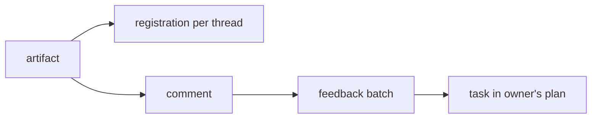

# Documents and artifacts

An artifact is a file, upload or pull request that CORSIA tracks, with an owner and a place in a thread's working set. This page covers how an artifact is registered, who owns it and when it drops out of view, how a live document is saved, how comments and suggested changes work, and how agents receive them.

## What it is

- **Artifact:** one registered thing, identified by an integration, a type and an external id. No two artifacts share all three (`artifact_identities`). A workspace file, an upload and a GitHub pull request are all artifacts.
- **Registration:** the link between an artifact and one thread. Each thread that touches an artifact gets its own registration, and the registration records whether that thread owns the artifact.
- **Retention:** `durable` or `ephemeral`. When an owning thread ends, only durable artifacts are handed on.
- **Pane:** the list of artifacts a thread shows. A registration decides whether an artifact appears there.
- **Document:** an artifact whose file is `.md`, `.txt`, `.markdown` or `.rst`. Other workspace files are typed as images or code, and skill files as skills.
- **Comment:** a note on a document or image, optionally anchored to quoted text or to a region of an image. A **suggestion** is a comment that carries replacement text. A reply points at its parent comment.

## Why it exists

A file in a folder says nothing about who is responsible for it, whether the person still needs it in front of them, or whether feedback on it reached the agent that owns it. Artifacts make those three things records. The owner is a row, not a convention. The working set has explicit rules for when a file leaves it. A comment becomes a task in the owner's plan, so it is tracked like any other commitment (see [Plans](plans.md)).

## How it works

### Registration

An artifact is registered in three ways:

- **By a write.** When an agent's `write_file`, `edit_file`, `multi_edit` or `NotebookEdit` call is confirmed, the file is registered under that thread.
- **By tool.** An agent can call `artifact_register`, optionally naming a retention.
- **By other sources.** An upload, and a GitHub pull request observed in an agent's work, are registered as artifacts too.

Only files inside the workspace, or inside a directory the thread is allowed to write to, are registered; a path outside both is refused. A file under a folder named `working` is ephemeral by default. When an ephemeral file is missing from disk, its artifact is tombstoned, which takes it out of the pane. An artifact whose type has no presentation is labelled "Unsupported" and shown disabled.

### Ownership

The first thread to register an artifact owns it. A later thread that registers the same artifact becomes a subscriber: it sees the artifact but does not own it. If the owner released it, a later registration still does not take ownership.

Ownership moves in two ways:

- **On request.** The current owner can hand an artifact to another thread, and the CORSIA agent or a project conductor can rehome or release one, each under a named authority.
- **When the owner goes away.** When an owning thread is archived, purged or deleted, or its agent is disabled, its durable artifacts move to another owner where the code finds one. For a shared document that is the project conductor or, when a temporary thread ends, the agent that started it, with the person as the last fallback. For any other artifact it is the nearest live thread that started this one. If there is none, ownership is released, except on delete, which drops the owner row. Ephemeral artifacts and files inside the thread's own folder are not moved.

Who may change an owned document follows ownership. The owner, the owner's temporary subagents, the conductor of the scope that holds the document and its temporary subagents, and the person can edit it. Every other agent can only suggest a change.

### Leaving the working set

The pane shows a registration while the artifact is active, the registration is visible, and the thread owns the artifact or subscribed to it recently. Four causes end that:

- The plan task the artifact was registered under is settled.
- The artifact itself ends: a pull request is merged or closed.
- The registration exists only because ownership moved.
- The artifact was registered under no task, and its thread has since completed a later one.

A retired registration is marked settled and leaves the pane. Registering the artifact again revives it. Three things keep an artifact in view: the person pinning it, a pull request that has not ended, and a durable workspace document the person has commented on. A comment from the person makes its document durable.

### Live documents

When a document is open in the app, it becomes a live document: one shared copy of its text that every viewer edits. The browser sends its changes over the WebSocket, and the server keeps each open document in a journal file under the state root, named by a hash of the artifact id.

Writes to the file of a live document, whether a save from the browser or an agent's file tool, go through one queue per document. The queue replaces the file on disk atomically, after checking that nobody else changed it in the meantime. If someone did, the write is run again on top of that change, up to three attempts. An agent's `write_file` or `edit_file` result says when its write was merged with live edits and tells it to read the document again.

A background publisher then registers the write, moves the document's comment anchors to their new positions and reports the write to the document's owner. If publishing fails three times, the document is blocked until someone retries explicitly. Publishing that was still owed when CORSIA stopped is picked up at the next start. Guidance files are not edited live; they are saved the ordinary way.

A document is limited to 1,000,000 bytes of text: a save larger than that is refused, and so is a live update that would push the text past it.

### Comments and suggested changes

A comment is one of these kinds:

| Kind | Shape |
|---|---|
| Anchored comment | Quotes the exact text it is about |
| Reply | Points at a parent comment; takes the parent's document |
| Review | A comment on the whole document, with no quote |
| Suggestion | A quote plus replacement text, or text to insert after the quote |
| Region comment | A box or point on an image |

An anchor is the quoted text, its position, and a little text before and after it. Positions are counted in UTF-16 units. When a document changes, an anchor is looked up again; an undecided comment whose quote can no longer be found is flagged as orphaned.

A suggestion is accepted or rejected, never simply resolved. Accepting writes the replacement into the document, and only someone who may edit the document can accept. A suggestion whose quoted text has changed is stale: it cannot be applied, and the choice is to reject it or ask for a new one. An accepted suggestion cannot be re-opened, because its edit is already in the text. A rejected one can be, which clears the decision. An agent can edit only the content of comments it wrote, and an agent cannot suggest over text that an open suggestion already covers, though the person can.

An image comment, or pin, stores a region as fractions of the image: x and y between 0 and 1, plus a width and height, or a width and height of 0 for a point. It records a hash of the image it was placed on, and pins are numbered per image. A pin is only ever a new top-level comment, never a reply, review or suggestion. On a document, the pin names the image by quoting its Markdown. When an agent reads an image comment, it gets back a marked-up PNG copy, written to the reading thread's `working` folder; the person's image is never changed.

A rendered Mermaid diagram is commented on as a whole. The comment anchors to the diagram's fenced source, because the rendered widget replaces that text in the editor.

### How agents receive comments

A comment does not reach an agent the moment it is written. It joins an open batch, and a batch is delivered as a task.

- **Batching.** Comments join one open batch per author, document, recipient and lane. A lane is how soon a batch closes: immediate, which closes after a 5-second pause (30 seconds after an edit), or held, which closes when the person sends it or after 120 seconds without a new comment. A person's image comments are always held. An agent's batch closes after 120 seconds without a new comment, when its turn ends, or when it calls `doc_feedback_send`.
- **Recipients.** A comment goes to the document's owner. A reply also goes to the author of its thread's first comment, unless that is the replier. When the recipient is the person, the batch is shown in the app and creates no task.
- **Delivery.** When a batch closes, it becomes a task in the recipient's plan, linked to the document, and the recipient gets a queued note that does not interrupt its turn. For comments, the task's acceptance is that every item is acknowledged, resolved or replied to. A person's comments set the task's intent and are framed as the person's intent; another agent's comments are framed as evidence to check.
- **Joining.** A reply in a comment thread that already has an open task can join that task instead of creating another. A finished task, or one that is waiting, does not take it.
- **Settling.** For comments an agent wrote, the task settles itself once every comment in it is resolved or its suggestion is decided, with a line per item as the evidence. If the task cannot settle itself, its owner closes it.

## What can go wrong

- **An undeliverable batch stays put.** If the owner is missing, archived, unavailable, cannot take input or has an unavailable model, the batch is marked undelivered, and an agent author is told to retry with `doc_feedback_send`. Nothing is dropped.
- **A journal that cannot be opened blocks editing.** If a document's journal cannot be opened right now, edits to it are refused until it clears. If the journal is damaged, the document stays editable without live editing. In both cases the text in an open tab is kept in that tab.
- **A stale suggestion cannot be applied.** Editing the quoted text turns a suggestion stale; accepting it is refused until it is rejected or replaced.
- **A comment can lose its anchor.** If the quoted text is gone, the comment is flagged orphaned, not deleted.
- **A document over 1,000,000 bytes cannot be saved.**
- **Publishing can stall.** After three failed attempts a live document stops publishing its writes until someone retries.
- **An agent that is not the owner cannot edit.** Its changes arrive as suggestions, and only the owner or another allowed editor can accept them.

## Where it lives

| Part | Path |
|---|---|
| Artifact identity, registration, ownership | `backend/registry/` |
| Artifact schema | `backend/infra/artifact_identity_schema.py` |
| Retirement and pane rules | `backend/registry/node_retirement.py`, `backend/registry/view.py` |
| Live document, queue and publisher | `backend/doceditor/live_runtime.py`, `backend/doceditor/live_lane.py`, `backend/doceditor/live_publisher.py` |
| Comments, anchors and suggestions | `backend/doceditor/comment_validation.py`, `backend/doceditor/comment_actions.py`, `backend/doceditor/comment_anchoring.py` |
| Image pins | `backend/doceditor/image_regions.py` |
| Feedback batches and delivery | `backend/doceditor/feedback_batches.py`, `backend/doceditor/feedback_delivery.py`, `backend/plans/feedback_nodes.py` |
| Comment and artifact tables | [Documents and artifacts data model](../reference/data-model/documents-and-artifacts.md) |

Checked against the code at `b33de1c7f`.
