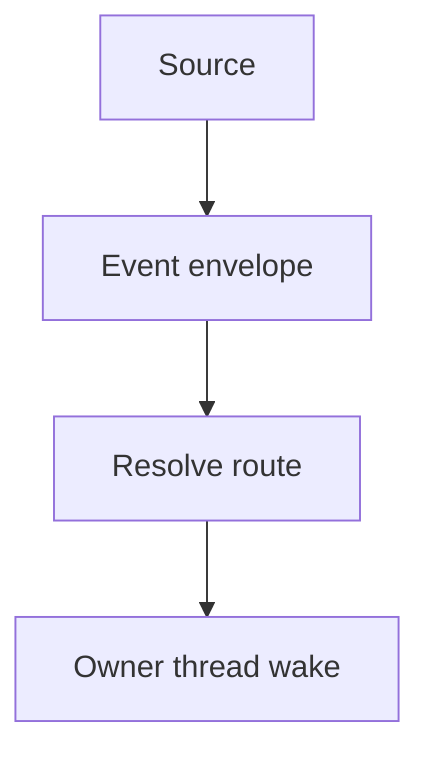

# Events and automations

Events describe occurrences that CORSIA can route to the thread responsible for an item. Automations schedule wakes or run a registered script, and event rules can act on matching events.

## From an event to a thread

A connector normalizes an occurrence using its declared event type. The resulting envelope carries an event ID, type, facts, relationships, an optional artifact reference, provenance and routing properties. GitHub activity and webhooks are sources; declared events can also be emitted by agents and scripts. Intake validates declared types and facts before delivery (`backend/events/envelope.py`, `backend/events/intake.py`).

For an event about a registered artifact, routing looks for its owner or triage registration. A declaration or connection rule can bind an unowned artifact. If no owner is found, an event marked as eligible for ownerless triage waits for a triage owner; otherwise it becomes a dead letter. An inactive owner is also a delivery problem. A declared event without an artifact routes to its declaring thread; a rule-run event on an artifact can route to the artifact owner. Routing chooses a wake or digest according to the event and relationship; not every event wakes a thread (`backend/events/resolve.py`, `backend/events/intake.py`, `backend/events/disposition.py`).

Intake records accepted event IDs and recognizes a repeated accepted ID as a duplicate. This is a deduplication boundary, not a guarantee that every outside occurrence is delivered exactly once. Delivery and thread admission are separate steps; see [Turns and delivery](turns-and-delivery.md).

## Event rules

Event rules match declared event types and their filterable facts. A routing rule can deliver or drop an event, start one of its writer's registered scripts, or start a worker using a reachable workflow that declares a result. Rule authoring validates the action and reports refusals. A script rule does not replace the event's normal route (`backend/events/rule_authoring.py`, `backend/events/rule_actions.py`). For workers and their threads, see [Agents and threads](agents-and-threads.md).

## Schedules and watches

An agent can schedule a clock wake for a future time or a cadence wake with a maximum run count. It can list or cancel its own schedules (`backend/tools/automations.py`, `backend/automation/schedules.py`).

A watch records a condition and, when applicable, an expected event on an artifact. A matching delivered event can resolve it; expiry routes a delivery failure to the owner or a live health sink. A watch resolves or expires at most once (`backend/automation/watches.py`, `backend/events/intake_routing.py`). For what a watch means to a task, see [Plans](plans.md).

## Standing scripts

An agent registers a readable file as a script schedule. Registration pins its SHA-256 hash and may set a cadence and declare the readings it can emit. A script without a cadence runs only when an event rule starts it. The registration tool does not itself request a separate human approval (`backend/tools/automations.py`, `backend/automation/script_schedules.py`).

Before a run, the runner checks the file against the pinned hash. A mismatch stops the schedule and is reported. Runs use the owner's protected shell envelope without a host-access lease and do not require a model turn. A scheduled run receives no standard input; a rule-started run receives the matching event as JSON. The script can print JSON readings or declared measure events. A rule-started run whose event names a repository also receives a GitHub read channel for that repository. A verified agents' GitHub account is made available to the script; otherwise it runs without that login. Bounds, failures and timeouts can wake the owner; `automation_list` reports the last status (`backend/automation/script_runner.py`, `backend/automation/script_sandbox.py`, `backend/tools/automations.py`).

## What can go wrong

- Unknown event types, malformed facts and other admission failures are refused with a reason (`backend/events/intake.py`).
- An unowned event can be parked for triage or dead-lettered; a delivery failure is distinct from a missing owner (`backend/events/resolve.py`).
- A changed or missing script fails its hash check. A script can also fail, time out or produce no data; the schedule exposes its status (`backend/automation/script_runner.py`, `backend/automation/script_schedules.py`).
- A non-deadline watch without an artifact and expected event is refused (`backend/automation/watches.py`).

## Where it lives in the code

| Part | Path |
|---|---|
| Envelope and admission | `backend/events/envelope.py`, `backend/events/intake.py` |
| Owner resolution and delivery | `backend/events/resolve.py`, `backend/events/delivery.py` |
| Event rules | `backend/events/rule_authoring.py`, `backend/events/rules.py` |
| Schedules and watches | `backend/automation/schedules.py`, `backend/automation/watches.py` |
| Script registration and execution | `backend/automation/script_schedules.py`, `backend/automation/script_runner.py`, `backend/automation/script_sandbox.py` |

Checked against the code at `7a8c55d84`.
