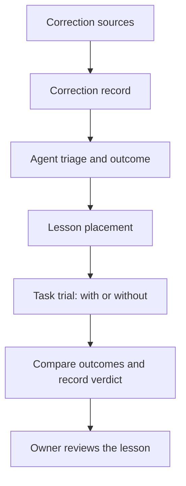

# Learning from corrections

CORSIA records corrections and can try a proposed lesson on later work. This page describes the records, comparisons and limits in that loop. For the measures and their presentation, see [Measuring work](measuring-work.md) and [Measurement](../measurement.md).

## What it is

- **Correction:** a recorded classification or plan-sourced fact identified by `measurement.correction` (`backend/core/corrections_recording.py`, `backend/core/sent_back_corrections.py`, `backend/core/self_caught_corrections.py`).
- **Triage:** the agent's recorded assessment of a correction and, when applicable, its cause and outcome (`backend/core/correction_learning.py`).
- **Lesson:** a proposed piece of guidance captured as a skill file, with a state and an owner review; a trial is an unproven lesson offered for a comparison (`backend/core/lesson_outcomes.py`, `backend/core/lesson_index.py`).
- **Verdict:** a comparison of outcomes with and without a lesson, or across workflow versions (`backend/core/lesson_trial_verdicts.py`, `backend/core/workflow_verdict_rules.py`).

## Why it exists

An agent saying it learned from a correction is not evidence that it did. These records tie each correction to what the agent did in response, and a trial compares later work with and without a proposed lesson before the owner promotes it (`backend/core/correction_learning.py`, `backend/core/lesson_outcomes.py`, `backend/core/lesson_trial_verdicts.py`). An offer or read of guidance shows exposure, not that the guidance was applied or helped (`backend/core/lesson_outcomes.py`).

## How it works

### Corrections and triage

A local classifier checks eligible person-authored messages, document comments, chat comments and plan decision answers. Its versioned facts include the label `correction`, `not_correction` or `unreadable`; they do not retain the message content. A newly recorded positive classification queues a note for the receiving chat (`backend/jobs/corrections_recording.py`, `backend/core/corrections_recording.py`, `backend/core/correction_notes.py`).

Plan review send-backs and self-caught corrections also produce `measurement.correction` facts. The source kinds are `message`, `doc_comment`, `chat_comment`, `plan_decision_answer`, `sent_back` and `self_caught`; the plan-sourced facts do not need a classifier judgment (`backend/core/corrections_recording.py`, `backend/core/sent_back_corrections.py`, `backend/core/self_caught_corrections.py`).

An agent records one triage per correction: `not_correction`, `instruction`, `note`, `miss` or `serious`. A miss or serious correction requires a cause: `wrong_rule`, `no_foundation`, `rule_gap`, `process_gap`, `not_delivered`, `not_followed` or `cant_be_done`. A detected outside or hard-to-undo effect proposes serious; lowering it requires a reason (`backend/core/correction_learning.py`, `backend/core/lesson_case.py`).

The agent can record one terminal outcome: `fixed`, `instruction`, `watch`, `lesson`, `workflow` or `dropped`. Dropping requires a reason (`backend/core/correction_learning.py`).

### Placement and trials

A continuity entry can be placed into an existing destination, queued as a proposal, or queued as a trial. A trial is written in its owner's skills and gets a review task; an incomplete or conflicting hypothesis can be held without being offered (`backend/tools/continuity_place.py`, `backend/core/lesson_outcomes.py`, `backend/core/lesson_admission.py`).

A trial is marked unproven and cannot replace an ordinary skill of the same name. To be offered it must be in its owner's skills, be in trial state, have a future review date and have an open review for that version (`backend/core/lesson_index.py`). The owner can retire, promote, extend or revise a trial; promotion writes the rule into its permanent home (`backend/core/lesson_outcomes.py`).

At task start CORSIA deterministically assigns an eligible trial to a with or without half and records the draw. The with half receives task-local guidance; an omitted or unrecordable delivery is not counted as without. A task start admits at most 40 trials and 1,500 trial tokens (`backend/core/lesson_delivery.py`).

The comparison excludes task revisions, prior exposure in the same checkpoint generation, tasks in the without half that read the lesson's own file before they finished, and omitted deliveries. It groups tasks by workflow step and compares the two halves (`backend/core/lesson_trial_verdicts.py`).

### Verdicts

A trial uses a workflow's declared deciding measures when they include a quality measure; otherwise send-backs and restarts decide, with cost as a tie-breaker. The default minimum is 20 eligible observations per half, with looks at 20, 40 and 80; a workflow's deciding measures can raise that minimum. A shared group needs at least 5 observations per side. The send-back and restart margins are the larger of 25% of the baseline or 0.02 (`backend/core/lesson_trial_verdicts.py`, `backend/core/workflow_verdicts.py`, `backend/core/workflow_verdict_looks.py`, `backend/core/workflow_verdict_rules.py`).

Workflow verdicts compare a version with a selected earlier baseline, using the same decision rules. The default confidence is 80%; a workflow's metadata can raise it to 90% or 95% with a stated reason. Lesson trials always use 80% (`backend/core/workflow_verdict_rules.py`, `backend/core/lesson_trial_verdicts.py`). The rules use a bootstrap interval and can return collecting or not enough data as well as keep or revert (`backend/core/workflow_verdict_rules.py`, `backend/core/workflow_verdicts.py`, `backend/core/workflow_verdict_looks.py`).

A daily job evaluates open workflow versions and delivered lesson trials. It records reached keep or revert verdicts and attempts to wake their owners; a refused wake is retried on a later run. For a lesson, the owner is resolved from the target file or the lesson's own location (`backend/jobs/workflow_verdicts.py`, `backend/core/workflow_verdict_evaluator.py`, `backend/core/lesson_trial_verdicts.py`). The verdict is evidence for the owner, not an automatic edit to the target (`backend/core/workflow_verdict_evaluator.py`, `backend/core/lesson_outcomes.py`).

Measurement serves correction series and a lesson report with offers, body reads and trial deliveries. These are scoped reads; see [Measuring work](measuring-work.md) and [Measurement](../measurement.md) for the measures and page (`backend/api/measurement.py`, `backend/core/lesson_report.py`).

## What can go wrong

- **Detection is imperfect.** A classifier can label an input unreadable, and correction counts depend on recorded sources (`backend/core/corrections_recording.py`, `backend/api/measurement_corrections.py`).
- **A trial may not be delivered.** Admission, review state, the task-start caps or receipt failures can keep it out of a comparison (`backend/core/lesson_index.py`, `backend/core/lesson_delivery.py`).
- **A comparison may not decide.** Too few shared observations, unconfirmed measures or non-comparable data can prevent a verdict (`backend/core/workflow_verdicts.py`, `backend/core/workflow_verdict_rules.py`).
- **Exposure is not benefit.** An indexed lesson or a file read does not establish that an agent used it or improved its work (`backend/core/lesson_outcomes.py`, `backend/core/lesson_report.py`).

## Where it lives

| Part | Path |
|---|---|
| Correction recording and notes | `backend/jobs/corrections_recording.py`, `backend/core/corrections_recording.py`, `backend/core/correction_notes.py` |
| Triage and outcomes | `backend/core/correction_learning.py`, `backend/tools/continuity_learning_schema.py` |
| Placement and lesson lifecycle | `backend/tools/continuity_place.py`, `backend/core/lesson_outcomes.py`, `backend/core/lesson_index.py` |
| Trial delivery and comparison | `backend/core/lesson_delivery.py`, `backend/core/lesson_trial_verdicts.py` |
| Verdict rules and daily job | `backend/core/workflow_verdict_rules.py`, `backend/core/workflow_verdicts.py`, `backend/jobs/workflow_verdicts.py` |
| Reports | `backend/core/lesson_report.py`, `backend/api/measurement_corrections.py`, `backend/api/measurement.py` |

Checked against the code at `1bb4fbfab`.
