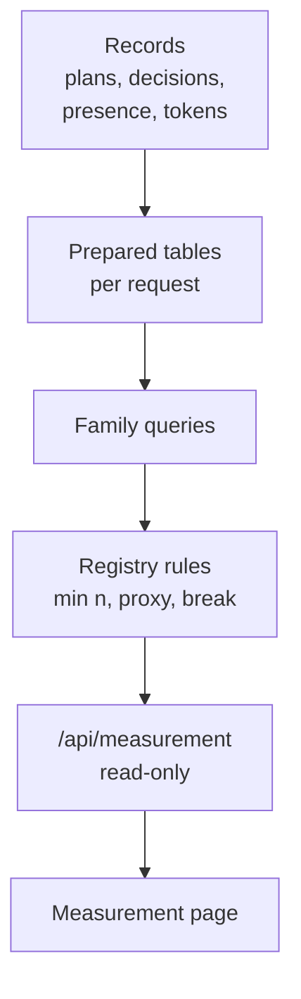

# Measuring work

CORSIA counts what its agents finished, how much of the person's time it took and what the models used. This page covers how those numbers are produced and what they refuse to claim. For how to read the Measurement page in the app, see [Measurement](../measurement.md).

## What it is

- **Series:** one named measurement over time, such as outcomes, first-try acceptance or fresh tokens per outcome. Each is defined once, server-side, in a registry (`backend/api/measurement_registry.py`).
- **Family:** the group of series that read the same source, such as outcomes, active time, decisions, corrections, tokens or limits.
- **Scope:** the slice measured: all work, one project, or one agent. A project and an agent can combine.
- **Outcome:** an eligible accepted plan task. Measurement excludes user-assigned tasks, correction nodes and tasks owned by spawned worker plans. See [Plans](plans.md).

## Why it exists

A platform that claims to save a person's time should show whether it does, and should not rely on the agents' own summaries. Measuring from the records the platform already keeps, plan acceptance, decision answers, presence, the token ledger, means the numbers do not need an agent to report them. The same numbers let a project compare one way of working with another; see [Coordination models](coordination-models.md), whose declared KPIs name registry series.

## How it works

### Sources are existing records

Series read from records the system already writes for other reasons (`backend/api/measurement_queries.py`):

- **Outcomes and first-try acceptance:** eligible accepted plan tasks, aggregated by the period in which they settled. **Rejections:** recorded review send-backs, grouped by when they happened.
- **Active time:** the person's recorded presence in the app on that scope.
- **Decisions and corrections:** raised decisions, how they were answered, and recorded corrections.
- **Tokens:** the retained usage ledger, with cache re-reads counted separately and excluded from "fresh" tokens.
- **Limits:** recorded usage-limit hits.
- **Size:** the newest size rating for an outcome, or its author's declared size when no rating exists. Retracted, malformed, stale, conflicting and unknown latest ratings are counted but not used; outcomes can also be unsized. See [size rating import](../size-rating-import.md).

The API is read-only. It serves series, an agents table, a models table and a lessons report (`backend/api/measurement.py`).

### Rules the registry applies

Each series carries rules that the API enforces, so no chart has to remember them:

- **Minimum sample.** A ratio is withheld, served with no value, until it has enough samples: 20 outcomes for most ratios, 10 answered decisions for the shares of how decisions were answered. The raw value is kept alongside so the cut-off is visible.
- **Not measured is not zero.** A period before a series' source existed is served as not measured. A chart is never given a zero to draw a baseline through.
- **Proxies are labeled.** A series that estimates something, such as active hours or asks per outcome, carries a proxy flag.
- **Comparability is marked.** Each series has a method version. The API also uses a stored source-start mark or derives one from records, includes definition-change marks, and marks periods as comparable or not (`backend/api/measurement_breaks.py`) instead of letting a chart draw one line across them.
- **Partial periods are marked.** A period still in progress is served with a partial flag, for fresh tokens and, on the Days view, for outcomes.
- **Token counts are lower bounds when records lack counts.** The series includes how many calls had no token count. A period where no call had one has no figure; it is never served as zero tokens.

### Cost

Cost is computed at read time. The token ledger is priced at each provider's published API prices (`backend/llm/api_equivalent.py`, `backend/api/measurement_cost.py`). That is an API-equivalent figure, not what was charged. It is a subtotal of the usage records that could be priced, reported with the count of those that could not and why: no maintained list price for the recorded model, no published rate for cached tokens, an unproven context tier, unreported or inconsistent token counts, or an unproven counting format. Actual spend is recorded separately and its completeness is reported with the figure. A series for dollars over time is declared in the registry as unavailable.

### Presence

Time is estimated from the person's presence in the app, recorded as visits, merged and closed on events such as navigating away, hiding the page or going idle (`backend/infra/presence.py`). Measurement uses focused spans when recorded, counts older visits without focus data in full, and shares overlapping time among active threads (`backend/api/measurement_presence.py`). A visit with no thread belongs to the project or all work, never to an agent.

## What can go wrong

- **Little data looks like no data.** A new install or a scope with few outcomes can show empty ratio charts because of the minimum-sample rule. Count series need not have the same threshold.
- **Only eligible plan work counts as outcomes.** Work done outside a plan task is not an outcome. Other records, such as token usage, can still be measured.
- **Proxies are estimates.** Active hours, asks per outcome and size-based hours are approximations and are marked so. Do not read a small difference as a result.
- **First-try rate depends on recorded work.** A send-back, certain failed or changed-requirement attempts, or a failed predecessor makes an outcome not first-try. It cannot see a rejection that happened in conversation and was never recorded on the plan.
- **API-equivalent is not the bill.** Subscriptions and plan limits change what a person actually pays.
- **Method changes break trends.** After a break, compare only within one side.
- **No model-quality claim.** The series describe how work flowed through the platform. They are not a benchmark of any model.

## Where it lives

| Part | Path |
|---|---|
| Metric registry and rules | `backend/api/measurement_registry.py` |
| Read-only API | `backend/api/measurement.py` |
| Source queries | `backend/api/measurement_queries.py`, `backend/api/measurement_prepared.py` |
| Scope handling | `backend/api/measurement_scope.py` |
| Presence time | `backend/api/measurement_presence.py`, `backend/infra/presence.py` |
| Cost | `backend/api/measurement_cost.py`, `backend/llm/api_equivalent.py` |
| Size series | `backend/api/measurement_size.py` |
| Comparability breaks | `backend/api/measurement_breaks.py` |
| In-app page and reading guide | [Measurement](../measurement.md) |
