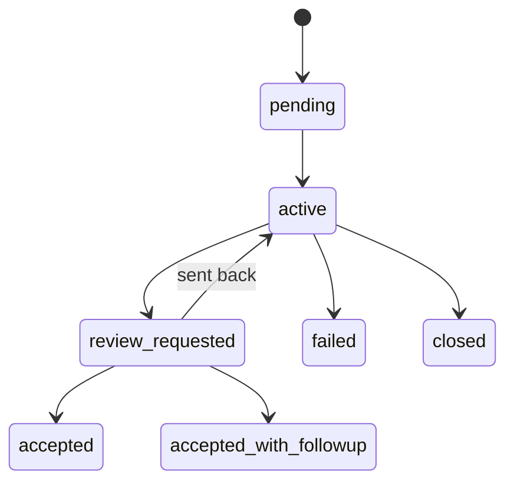

# Plans

A plan is a thread's structured record of what it has committed to do, what it is waiting on and what it has asked the person. This page covers the task lifecycle, waits, decisions and liveness, and what can go wrong.

## What it is

- **Plan:** one per thread. It is either active or paused.
- **Node:** one unit in a plan. A task is a node with acceptance criteria: the observable evidence that has to exist before it counts as done.
- **Decision:** a question for the person, recorded on the plan with options and a recommendation.
- **Wait:** a task set aside until a time, an event, another task or a milestone.
- **Hold:** a recorded reason a task cannot advance, with the party who can end it.

## Why it exists

Chat history is a poor record of commitments. A long conversation buries what was promised, an agent that stops mid-task leaves no trace of what remains, and "done" is whatever the last message claimed. A plan makes the commitment a separate, checkable object. Whether a task is accepted is a recorded state change, which is also what lets [Measuring work](measuring-work.md) count outcomes without reading transcripts.

## How it works

### Task lifecycle

A task moves through a fixed set of states, and some are terminal (`backend/plans/node_states.py`).

- `pending`, `active`: not yet started, or being worked.
- `review_requested`: the work is handed back with evidence, awaiting acceptance.
- `accepted`, `accepted_with_followup`: verified complete; the second records a required follow-up.
- `failed`: the objective could not be met, kept on the plan as that record.
- `closed`: no longer wanted. It stays on the plan but leaves the work.

`accepted`, `accepted_with_followup`, `failed` and `closed` have no way out. A task cannot be reopened; a new task is added instead. A reviewer sending work back returns it to `active`. A pending task whose delegated worker already returned can move straight to `review_requested`; only the delegation harvest writes that edge.

### Delegated work

A task handed to a worker appears in the worker's own plan. The worker returns evidence and the parent accepts or rejects it; see [Agents and threads](agents-and-threads.md).

### Pause and wait

- **Pause is the person's.** Only the person pauses or resumes a plan. An agent that wants to come back to a task later schedules it instead (`backend/plans/pause_authority.py`, `backend/plans/scheduled_wait.py`).
- **Waits are watches.** A task can wait on a deadline, an event, a milestone or another task (`backend/registry/attention.py`).
- **Every event wait ends.** An event wait is armed with a deadline: 24 hours by default, at most 7 days. When the deadline passes, the owner is woken with a note that the event did not arrive (`backend/plans/event_wait.py`). A scheduled task keeps whatever date the agent chose; a blocked wait refuses a date past 7 days.
- **Holds** record who can end a block: an external party, the system, another thread, or the person (`backend/plans/holds.py`).

### Decisions

A decision goes through draft, parent review, raised, then answered, or invalidated if it can no longer be answered (`backend/plans/decision_lifecycle.py`). It has two to four lettered options and an optional free-form "other", plus a recommendation; it can ask for one pick or any subset (`backend/plans/decision_fields.py`). A decision belongs to the plan, not to the agent that asked it:

- If the asking thread is archived, the question stays and still lands on the plan.
- If the owning plan goes away, or the task it came from is closed, the question is withdrawn as `invalidated` and not counted as a failure.

### Liveness

A thread with open work and no activity is woken so it does not stall silently. The first wake comes after 180 seconds and each later wake doubles the wait. A turn in progress is checked on a separate 600-second interval (`backend/automation/plan_liveness.py`). Wake state is derived from plan state, so a restart does not lose or duplicate wakes.

## What can go wrong

- **No plan, no outcome.** Work done without a plan task is not counted as an outcome and has no acceptance record.
- **Acceptance is only as good as the criteria.** The system records that criteria were stated and a task was accepted; it does not judge whether the criteria were the right ones.
- **A wait can end without its event.** The deadline is the guarantee that something looks at a stalled wait again. The wake says the event did not arrive; the owner still has to act.
- **A paused plan stops agent-driven work.** Agents cannot unpause it; anything automatic that arrives for a paused agent goes into a digest instead of starting a turn.
- **Terminal states are final.** A mistaken `closed` or `failed` cannot be undone; add a new task.

## Where it lives

| Part | Path |
|---|---|
| Node states and legal transitions | `backend/plans/node_states.py` |
| Closing, delegation, decisions | `backend/plans/closure.py`, `backend/plans/delegation.py`, `backend/plans/decisions.py` |
| Pause and scheduled waits | `backend/plans/pause_authority.py`, `backend/plans/scheduled_wait.py`, `backend/plans/event_wait.py` |
| Decision lifecycle | `backend/plans/decision_lifecycle.py` |
| Liveness wakes | `backend/automation/plan_liveness.py` |
| Holds and decision fields | `backend/plans/holds.py`, `backend/plans/decision_fields.py` |
| Plan tool an agent calls | `backend/tools/plans.py` |
