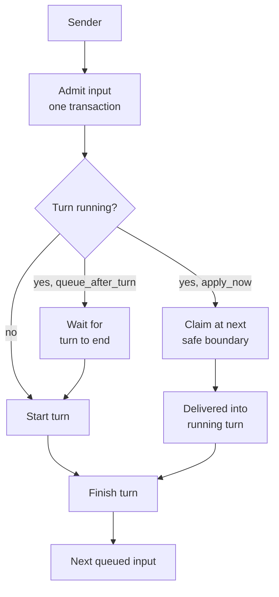

# Turns and delivery

A turn is one run of a thread's agent loop. This page covers how an input from a person, another agent or an external event becomes a turn, how inputs that arrive during a turn are handled, what survives a restart, and what can go wrong.

## What it is

- **Input:** one message addressed to a thread. Its source can be a person, another agent, a finished child, or a routed event.
- **Turn:** one execution of the thread's harness, from an admitted input until it finishes.
- **Input queue:** a first-in, first-out queue per thread. At most one turn runs per thread; later inputs wait in the queue.
- **Delivery intent:** `apply_now` or `queue_after_turn`, set by the sender (`backend/infra/input_admission.py`).

## Why it exists

Many things talk to one thread at once: a person typing, a worker finishing, a webhook arriving. If each started its own run, two turns could write to one conversation, a crash could lose or repeat an instruction, and a person's correction could sit unread behind a long run. A single admission path with a durable queue makes the order explicit and recoverable.

## How it works

### One way in

Every sender goes through one entry point, `send_thread_input` (`backend/infra/send_service.py`). It admits the input in a single database write transaction: the input is stored, ordered in the thread's queue, and, if the thread is idle, a turn is started for it (`backend/infra/thread_driver.py`). The input is durable before any provider sees it.

### When a turn is already running

- **`apply_now`:** the system asks the running turn to take the input at its next safe boundary. The native loop claims queued input between tool calls (`backend/core/turn_safe_boundary.py`). Codex accepts input into a running turn through its `turn/steer` request; Claude Code runs with a streaming input format. See [Models and harnesses](models-and-harnesses.md).
- **`queue_after_turn`:** the input waits and starts the next turn when this one settles.

In both cases the input keeps its place in the queue.

### Finishing

A turn ends through one function, `finish_turn`, which settles the turn and claims its successor in one transaction (`backend/infra/thread_driver.py`). When a worker thread's turn completes, its result is admitted to its parent in the same transaction that settles the worker's turn (see [Agents and threads](agents-and-threads.md)).

When a turn is stopped because a plan limit or a vendor usage limit was reached, one continue input is left behind so the work can resume once the limit allows it (`backend/infra/plan_limit_continue.py`).

### Surviving a restart

Recovery is a single pass at boot, not a periodic repair loop (`backend/infra/thread_recovery.py`).

- A turn recorded as running by an earlier boot is ended with the error "backend restarted while Turn was running". It is not resumed mid-turn.
- A provider write that had started but whose outcome was never recorded is marked **ambiguous**. It is not replayed, because replaying could repeat a side effect.
- Queued inputs that no turn had claimed start a new turn for their thread.

### Liveness

Plan-linked waiting uses a wake that retries with backoff, and a turn in progress is re-checked on a longer interval; see [Plans](plans.md). The backend's background loops are started at startup (see [Architecture](architecture.md)).

## What can go wrong

- **A crash mid-turn loses the turn's in-progress work.** What was already written to the conversation and to files stays. The turn is not continued. The thread's next turn starts from its stored history.
- **Ambiguous writes are not retried.** CORSIA prefers not repeating a provider write over risking a duplicate. A write marked ambiguous will not be sent again, and may not have arrived once.
- **`apply_now` is not immediate.** It waits for a safe boundary. A long tool call delays it.
- **One turn per thread.** A burst of inputs to one thread is serialized. Use a worker thread for parallel work.
- **Limits stop work.** A plan or usage limit ends a turn; the continue input resumes it only when an account can run it.

## Where it lives

| Part | Path |
|---|---|
| Entry point for every sender | `backend/infra/send_service.py` |
| Admission, queue and turn state | `backend/infra/input_admission.py`, `backend/infra/thread_driver.py`, `backend/infra/thread_inputs.py` |
| Native safe-boundary claim | `backend/core/turn_safe_boundary.py` |
| Restart recovery | `backend/infra/thread_recovery.py` |
| Limit continue | `backend/infra/plan_limit_continue.py` |
| WebSocket ingress for the UI | `backend/ws/ingress.py`, `backend/ws/message_dispatch.py` |
