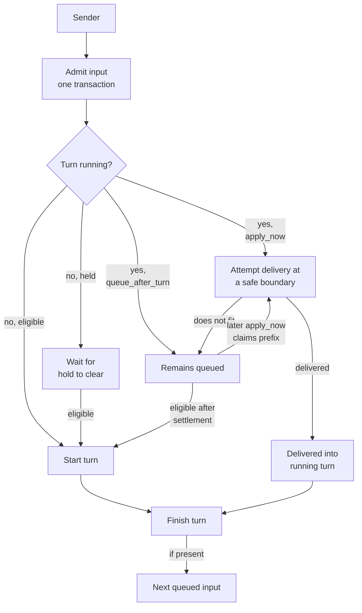

# Turns and delivery

A turn is one run of a thread's agent loop. This page covers how an input from a person, another agent or an external event becomes a turn, how inputs that arrive during a turn are handled, what survives a restart, and what can go wrong.

## What it is

- **Input:** one message addressed to a thread. Its source can be a person, another agent, a finished child, or a routed event.
- **Turn:** one execution of the thread's harness, from an admitted input until it finishes.
- **Input queue:** a first-in, first-out queue per thread. At most one turn runs per thread; later inputs wait in the queue.
- **Delivery intent:** `apply_now` or `queue_after_turn`, set by the sender (`backend/infra/input_admission.py`).

## Why it exists

Many things talk to one thread at once: a person typing, a worker finishing, a webhook arriving. If each started its own run, two turns could write to one conversation, a crash could lose or repeat an instruction, and a person's correction could sit unread behind a long run. A single admission path with a durable queue makes the order explicit and recoverable.

## How it works

### One way in

The `send_thread_input` entry point admits ordinary sends through a single database write transaction: the input is stored, ordered in the thread's queue, and, if eligible and idle, a turn is claimed for it (`backend/infra/send_service.py`, `backend/infra/thread_driver.py`). Some system inputs and child completions use the lower-level admission path inside their own transactions. The input is durable before any provider sees it.

### When a turn is already running

- **`apply_now`:** the system attempts to deliver the input to the running turn at a safe boundary. The native loop can claim queued input after a tool batch (`backend/core/turn_iteration.py`, `backend/core/turn_safe_boundary.py`). Codex accepts input into a running turn through its `turn/steer` request; Claude Code runs with a streaming input format. A live input that does not fit is released back to the queue (`backend/infra/input_render.py`). See [Models and harnesses](models-and-harnesses.md).
- **`queue_after_turn`:** the input normally waits until this turn settles, then can start a later turn when admission permits. A later `apply_now` input can bring an earlier queued input along in the FIFO prefix claimed at a safe boundary (`backend/infra/thread_inputs.py`).

In both cases the input keeps its place in the queue.

### Finishing

A turn ends through `finish_turn`, which settles the turn and attempts to claim eligible successor work in the same transaction. A hold can leave input queued, and failed admission can fail it visibly (`backend/infra/thread_driver.py`). An unstructured worker's final reply can be admitted to its parent in the transaction that settles the worker's completed turn; structured delegation returns through the plan (see [Agents and threads](agents-and-threads.md)).

When a turn is stopped by a plan limit or vendor usage limit, the system can queue a continue input so work can resume when the limit allows it. It does not add one when other queued input will restart the thread, and repeated vendor refusals can stop the continuation chain (`backend/infra/plan_limit_continue.py`).

### Surviving a restart

Recovery is a single pass at boot, not a periodic repair loop (`backend/infra/thread_recovery.py`).

- A turn recorded as running by an earlier boot is ended with the error "backend restarted while Turn was running". It is not resumed mid-turn.
- A queued input whose provider write started but whose outcome was never recorded for the interrupted turn is marked **ambiguous**. It is not replayed, because replaying could repeat a side effect.
- Recovery attempts to start a new turn for threads with unclaimed queued inputs; normal admission and hold rules still apply.

### Liveness

Actionable plan work can receive a liveness wake with backoff; a wake delivered to a running turn uses a longer interval. Delivery can fail and leave the wake stalled; see [Plans](plans.md). The backend's background loops are started at startup (see [Architecture](architecture.md)).

## What can go wrong

- **A crash mid-turn loses the turn's in-progress work.** What was already written to the conversation and to files stays. The turn is not continued. The thread's next turn starts from its stored history.
- **Ambiguous writes are not retried.** CORSIA prefers not repeating a provider write over risking a duplicate. A write marked ambiguous will not be sent again, and may not have arrived once.
- **`apply_now` is not immediate or guaranteed within the running turn.** A long tool call delays a safe boundary; input that cannot fit can remain queued for later.
- **One turn per thread.** A burst of inputs to one thread is serialized. Use a worker thread for parallel work.
- **Limits stop work.** A plan or usage limit can end a turn. A queued continuation needs an account that can run it; repeated vendor refusals can leave the thread stopped.

## Where it lives

| Part | Path |
|---|---|
| Send entry point | `backend/infra/send_service.py` |
| Admission, queue and turn state | `backend/infra/input_admission.py`, `backend/infra/thread_driver.py`, `backend/infra/thread_inputs.py` |
| Native safe-boundary claim | `backend/core/turn_safe_boundary.py` |
| Restart recovery | `backend/infra/thread_recovery.py` |
| Limit continue | `backend/infra/plan_limit_continue.py` |
| WebSocket ingress for the UI | `backend/ws/ingress.py`, `backend/ws/message_dispatch.py` |
