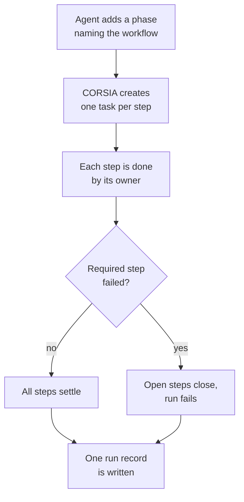

# Workflows

A workflow is a reusable sequence of steps for one kind of work. This page covers how a run of a workflow becomes steps on a plan, who does each step, how a step closes, how workflows nest, and why runs of the same workflow can be compared.

## What it is

- **Workflow:** a skill whose CORSIA data file (`corsia.yaml`) declares a list of steps. The skill's `SKILL.md` carries the instructions the steps point to.
- **Step:** one entry in that list: an id, a title, a `check` (the evidence that has to exist before the step counts as done), and optional fields such as `required`, `by`, `after`, `difficulty`, `instruction` and `workflow`.
- **Run:** one use of a workflow. A run is a phase on a plan whose children are the steps, in definition order. See [Plans](plans.md) for phases, tasks and their states.
- **Version:** the content of the workflow when the run started, recorded on the run.

## Why it exists

Work of one kind repeats, and agents repeat it differently each time: one skips the check, another forgets the person's sign-off. Writing the sequence once, as steps with checks, makes the sequence a plan every time instead of a habit. Because every run has the same steps, runs can be set side by side: the workflow verdict job compares one version's runs with another's (`backend/jobs/workflow_verdicts.py`, reading through `backend/core/workflow_verdict_read.py`).

## How it works

### Starting a run

An agent starts a run by adding a phase to its plan and naming the workflow (`workflow_ref`). CORSIA, not the agent, then creates the steps. Each step is a child task whose acceptance criteria are the step's `check` (or `Done: <step title>` when it has none) and whose description is the instruction section it points to. The reply lists the steps and their ids. Steps need a difficulty (`routine`, `standard` or `hard`), taken from the step's default or else the run's. A step with a `hard_if` question is rated at its default; the agent re-rates it when the answer is yes (`backend/plans/workflow_fields.py`).

`after` orders steps: a step lists the steps that must be done before it can start.

### Who does a step

The `by` field says who does a step (`backend/core/skill_workflow_validation.py`).

| `by` | Who | How it closes |
|---|---|---|
| `agent` (default) | The agent that started the run | The agent closes it with evidence, or hands work back for review when a worker did it |
| `reviewer` | A separate worker | The agent cannot mark it done itself. It hands the step to a worker with `delegate_task`, then accepts or sends back what returns |
| `person` | The person | The step is assigned to them with its instruction and check. A person step that comes after others reaches them only once those are done |

A person step's instruction and check must together fit 400 characters.

### Required and optional steps

- A `required` step must have a `check`. It cannot be closed or archived as not done: the plan refuses and names the step.
- An optional step can be skipped with `close_node` and a reason.
- If a required step fails, or ends without being done, CORSIA closes the run's other open work with a reason naming that step. A step never started is recorded as `not_run`, and a started one as `stopped`. A step whose delegated worker still has open work stays open until that settles.

### How a step closes

A step is a task, so it ends in the task states described in [Plans](plans.md): accepted, failed or closed. A reviewer that sends work back creates another round of the same step, under the same rules. When the last open work under a run settles, CORSIA writes one `workflow_run_ended` event on the phase (`backend/plans/run_end.py`). It records the run's outcome, `completed` only when every required step was done, and for each step its state, whether it was required, who did it, rounds, skip reason, working and waiting time, and cost. The reply that settled the last step carries a one-line summary.

### Nested workflows

A step with a `workflow` field runs that workflow as a child phase, built the same way and stamped with its own version. A nested step cannot set `by` or `gate`; those belong to the inner workflow's own steps. A workflow cannot name itself, and a step cannot name a workflow that already runs above it in the same nesting; the refusal names the chain. A required nested run that fails fails the outer run too.

### Acceptance gates

A step with `gate: acceptance` is where the person approves the result. CORSIA counts a gate by the person's first answer in each run, and only Approve is clean. After 8 clean runs in a row on the current version, CORSIA offers the person four answers: hand the review to an agent with spot checks, hand it off with none, drop the review, or keep reviewing. A handed-off gate becomes a reviewer step. With spot checks, some runs are drawn (1 in 5, then 1 in 10, then 1 in 20 as clean spot checks accumulate, then none) to stay with the person. Dropping the review closes that step in later runs. A correction on the run's work, or a failed spot check, hands the gate back and restarts the count (`backend/plans/gate_handoff.py`).

### Why runs are comparable

Every run of a workflow has the same step ids, checks, required flags and owners. The run records the workflow's version: for a workflow kept in a workspace, the last Git commit of its files, marked when edited locally; for a shipped System workflow, its package version and file digest (`backend/tools/workflow_task_fields.py`). A change to the definition therefore shows up as a new version in the runs that follow it.

## What can go wrong

- **The version can be missing.** Without a Git repository or a readable commit, the run records `null` and the add reply says so; such runs cannot be tied to one definition.
- **A bad definition fails validation.** An unknown key, a required step without a `check`, or an `after` naming an unknown step is an error. A run whose step names an unavailable nested workflow or a missing instruction heading is refused.
- **Checks are recorded, not judged.** A step is accepted when the evidence is recorded; CORSIA does not decide whether the `check` was a good one.
- **A skipped optional step makes runs differ.** Runs that skip different optional steps are the same workflow but not the same work; the record shows each skip and its reason.

## Where it lives

| Part | Path |
|---|---|
| Definition format and checks | `backend/core/skill_workflow_validation.py` |
| Resolving a definition, its version and nested runs | `backend/tools/workflow_task_fields.py` |
| Building a run's steps and closing rules | `backend/plans/workflow_fields.py`, `backend/plans/node_creation.py` |
| Run end and run record | `backend/plans/run_end.py` |
| Acceptance gate handoff | `backend/plans/gate_handoff.py` |

Checked against the code at `7a8c55d84`.
