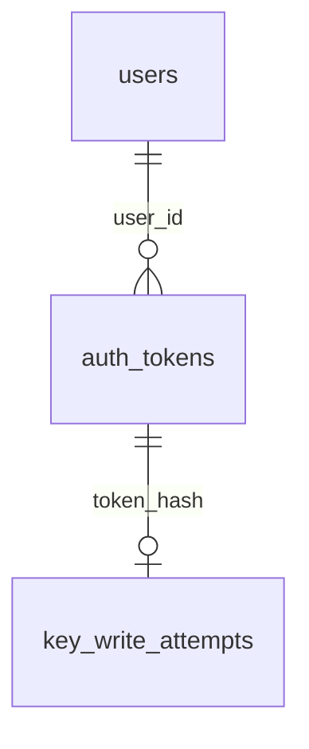
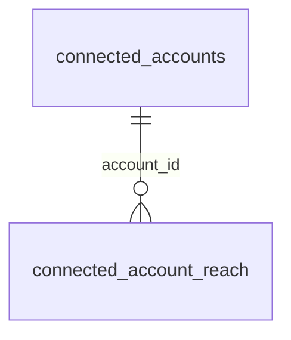
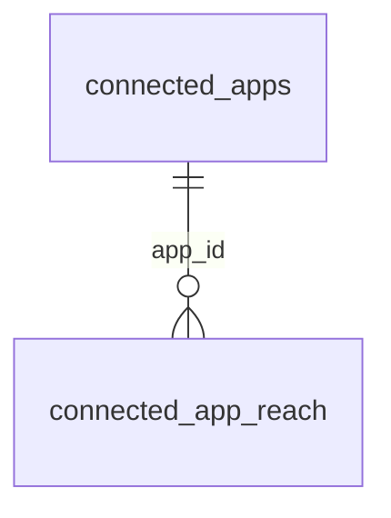
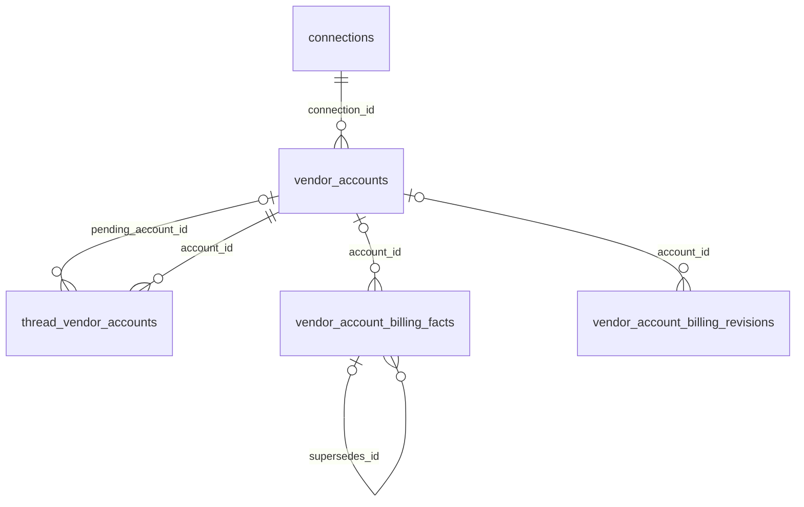

# Accounts and connections

These tables store accounts, credentials, connections and connected apps.

## Relationships

## Tables

### `action_drafts`

Source: `backend/infra/action_drafts_schema.py`.

| Column | Type | Primary key | NOT NULL | Default | References |
|---|---|---|---|---|---|
| `id` | TEXT | Yes | No | — | — |
| `thread_id` | TEXT | No | Yes | — | threads.id |
| `kind` | TEXT | No | Yes | — | — |
| `path` | TEXT | No | Yes | — | — |
| `target_json` | TEXT | No | Yes | '{}' | — |
| `state` | TEXT | No | Yes | 'open' | — |
| `recorded_revision` | TEXT | No | Yes | — | — |
| `recorded_at` | TEXT | No | Yes | — | — |
| `created_at` | TEXT | No | Yes | — | — |
| `sent_at` | TEXT | No | No | — | — |
| `external_id` | TEXT | No | No | — | — |

Indexes: `idx_action_drafts_kind_path` (kind, path), `sqlite_autoindex_action_drafts_1` (id, unique).

### `auth_tokens`

Source: `backend/infra/accounts_schema.py`.

| Column | Type | Primary key | NOT NULL | Default | References |
|---|---|---|---|---|---|
| `token_hash` | TEXT | Yes | No | — | — |
| `user_id` | TEXT | No | Yes | — | users.id |
| `kind` | TEXT | No | Yes | — | — |
| `label` | TEXT | No | No | — | — |
| `created_at` | TEXT | No | Yes | — | — |
| `expires_at` | TEXT | No | No | — | — |

Indexes: `idx_auth_tokens_expiry` (expires_at), `idx_auth_tokens_user` (user_id, created_at), `sqlite_autoindex_auth_tokens_1` (token_hash, unique).

### `connected_account_audit`

Source: `backend/infra/connected_accounts_schema.py`.

| Column | Type | Primary key | NOT NULL | Default | References |
|---|---|---|---|---|---|
| `id` | INTEGER | Yes | No | — | — |
| `created_at` | TEXT | No | Yes | — | — |
| `account_id` | TEXT | No | Yes | — | — |
| `actor_kind` | TEXT | No | Yes | — | — |
| `actor_id` | TEXT | No | Yes | — | — |
| `action` | TEXT | No | Yes | — | — |
| `revocation_cause` | TEXT | No | No | — | — |

Indexes: `idx_connected_account_audit_account` (account_id, id).

### `connected_account_reach`

Source: `backend/infra/connected_accounts_schema.py`.

| Column | Type | Primary key | NOT NULL | Default | References |
|---|---|---|---|---|---|
| `account_id` | TEXT | Yes | Yes | — | connected_accounts.id |
| `project_id` | TEXT | Yes | Yes | — | projects.id |

Indexes: `idx_connected_account_reach_project` (project_id, account_id), `sqlite_autoindex_connected_account_reach_1` (account_id, project_id, unique).

### `connected_accounts`

Source: `backend/infra/connected_accounts_schema.py`.

| Column | Type | Primary key | NOT NULL | Default | References |
|---|---|---|---|---|---|
| `id` | TEXT | Yes | No | — | — |
| `provider` | TEXT | No | Yes | — | — |
| `provider_subject` | TEXT | No | No | — | — |
| `account_kind` | TEXT | No | No | — | — |
| `state_cause` | TEXT | No | No | — | — |
| `address` | TEXT | No | Yes | — | — |
| `capabilities_json` | TEXT | No | Yes | — | — |
| `state` | TEXT | No | Yes | — | — |
| `reach_mode` | TEXT | No | Yes | — | — |
| `outside_projects` | INTEGER | No | Yes | 0 | — |
| `credential_key` | TEXT | No | Yes | — | — |
| `cursor_json` | TEXT | No | No | — | — |
| `created_by_kind` | TEXT | No | Yes | — | — |
| `created_by_id` | TEXT | No | Yes | — | — |
| `signed_in_by_kind` | TEXT | No | No | — | — |
| `signed_in_by_id` | TEXT | No | No | — | — |
| `created_at` | TEXT | No | Yes | — | — |
| `updated_at` | TEXT | No | Yes | — | — |
| `endpoints_json` | TEXT | No | No | — | — |

Indexes: `idx_connected_accounts_provider` (provider, state), `sqlite_autoindex_connected_accounts_1` (id, unique), `sqlite_autoindex_connected_accounts_2` (credential_key, unique), `sqlite_autoindex_connected_accounts_3` (provider, provider_subject, unique).

### `connected_app_audit`

Source: `backend/infra/connected_apps_schema.py`.

| Column | Type | Primary key | NOT NULL | Default | References |
|---|---|---|---|---|---|
| `id` | INTEGER | Yes | No | — | — |
| `created_at` | TEXT | No | Yes | — | — |
| `actor_kind` | TEXT | No | Yes | — | — |
| `actor_id` | TEXT | No | Yes | — | — |
| `app_id` | TEXT | No | Yes | — | — |
| `action` | TEXT | No | Yes | — | — |
| `reach_from_json` | TEXT | No | No | — | — |
| `reach_to_json` | TEXT | No | No | — | — |

Indexes: `idx_connected_app_audit_app` (app_id, id).

### `connected_app_reach`

Source: `backend/infra/connected_apps_schema.py`.

| Column | Type | Primary key | NOT NULL | Default | References |
|---|---|---|---|---|---|
| `app_id` | TEXT | Yes | Yes | — | connected_apps.id |
| `project_id` | TEXT | Yes | Yes | — | projects.id |

Indexes: `idx_connected_app_reach_project` (project_id, app_id), `sqlite_autoindex_connected_app_reach_1` (app_id, project_id, unique).

### `connected_apps`

Source: `backend/infra/connected_apps_schema.py`.

| Column | Type | Primary key | NOT NULL | Default | References |
|---|---|---|---|---|---|
| `id` | TEXT | Yes | No | — | — |
| `name` | TEXT | No | Yes | — | — |
| `config_json` | TEXT | No | Yes | — | — |
| `state` | TEXT | No | Yes | 'disconnected' | — |
| `state_since` | TEXT | No | Yes | — | — |
| `reach_mode` | TEXT | No | Yes | — | — |
| `outside_projects` | INTEGER | No | Yes | 0 | — |
| `revision` | INTEGER | No | Yes | 1 | — |
| `created_by_thread_id` | TEXT | No | No | — | — |
| `pending_config_json` | TEXT | No | No | — | — |
| `pending_previous_state` | TEXT | No | No | — | — |
| `pending_actor_thread_id` | TEXT | No | No | — | — |
| `created_at` | TEXT | No | Yes | — | — |
| `updated_at` | TEXT | No | Yes | — | — |

Indexes: `idx_connected_apps_name` (name), `sqlite_autoindex_connected_apps_1` (id, unique).

### `connection_rules`

Source: `backend/infra/connection_schema.py`.

| Column | Type | Primary key | NOT NULL | Default | References |
|---|---|---|---|---|---|
| `id` | TEXT | Yes | No | — | — |
| `scope` | TEXT | No | Yes | 'global' | — |
| `connector` | TEXT | No | Yes | — | — |
| `fact` | TEXT | No | Yes | — | — |
| `value` | TEXT | No | Yes | — | — |
| `destination_thread_id` | TEXT | No | Yes | — | — |
| `precedence` | INTEGER | No | Yes | 100 | — |
| `enabled` | INTEGER | No | Yes | 1 | — |
| `created_at` | TEXT | No | Yes | — | — |
| `updated_at` | TEXT | No | Yes | — | — |

Indexes: `idx_connection_rules_match` (connector, enabled, precedence, created_at), `sqlite_autoindex_connection_rules_1` (id, unique).

### `connections`

Source: `backend/infra/connection_schema.py`.

| Column | Type | Primary key | NOT NULL | Default | References |
|---|---|---|---|---|---|
| `id` | TEXT | Yes | No | — | — |
| `type` | TEXT | No | Yes | — | — |
| `provider` | TEXT | No | Yes | — | — |
| `config` | TEXT | No | No | — | — |
| `status` | TEXT | No | Yes | 'available' | — |
| `scope` | TEXT | No | Yes | 'global' | — |
| `created_at` | TEXT | No | Yes | — | — |
| `updated_at` | TEXT | No | Yes | — | — |

Indexes: `idx_connections_status` (type, status), `sqlite_autoindex_connections_1` (id, unique), `sqlite_autoindex_connections_2` (provider, unique).

### `email_screens`

Source: `backend/infra/email_screens_schema.py`.

| Column | Type | Primary key | NOT NULL | Default | References |
|---|---|---|---|---|---|
| `account` | TEXT | Yes | Yes | — | — |
| `message_id` | TEXT | Yes | Yes | — | — |
| `status` | TEXT | No | Yes | — | — |
| `kind` | TEXT | No | No | — | — |
| `needs_person` | TEXT | No | No | — | — |
| `injection` | INTEGER | No | No | — | — |
| `injection_rule` | TEXT | No | No | — | — |
| `model_id` | TEXT | No | No | — | — |
| `screened_at` | TEXT | No | Yes | — | — |
| `attempts` | INTEGER | No | Yes | 1 | — |

Indexes: `sqlite_autoindex_email_screens_1` (account, message_id, unique).

### `key_store_entries`

Source: `backend/infra/key_store_schema.py`.

| Column | Type | Primary key | NOT NULL | Default | References |
|---|---|---|---|---|---|
| `name` | TEXT | Yes | No | — | — |
| `label` | TEXT | No | No | — | — |
| `description` | TEXT | No | No | — | — |
| `added_by_thread_id` | TEXT | No | No | — | — |
| `added_by_name` | TEXT | No | No | — | — |
| `created_at` | TEXT | No | Yes | — | — |
| `set_at` | TEXT | No | No | — | — |
| `value_ref` | TEXT | No | No | — | — |

Indexes: `sqlite_autoindex_key_store_entries_1` (name, unique).

### `key_write_attempts`

Source: `backend/infra/key_store_schema.py`.

| Column | Type | Primary key | NOT NULL | Default | References |
|---|---|---|---|---|---|
| `token_hash` | TEXT | Yes | No | — | auth_tokens.token_hash |
| `failures` | INTEGER | No | Yes | 0 | — |
| `updated_at` | TEXT | No | Yes | — | — |

Indexes: `sqlite_autoindex_key_write_attempts_1` (token_hash, unique).

### `thread_vendor_accounts`

Source: `backend/infra/vendor_account_schema.py`.

| Column | Type | Primary key | NOT NULL | Default | References |
|---|---|---|---|---|---|
| `thread_id` | TEXT | Yes | Yes | — | threads.id |
| `provider` | TEXT | Yes | Yes | — | — |
| `account_id` | TEXT | No | Yes | — | vendor_accounts.id |
| `pending_account_id` | TEXT | No | No | — | vendor_accounts.id |
| `deferred_move` | TEXT | No | No | — | — |

Indexes: `sqlite_autoindex_thread_vendor_accounts_1` (thread_id, provider, unique).

### `users`

Source: `backend/infra/accounts_schema.py`.

| Column | Type | Primary key | NOT NULL | Default | References |
|---|---|---|---|---|---|
| `id` | TEXT | Yes | No | — | — |
| `password_hash` | TEXT | No | Yes | — | — |
| `created_at` | TEXT | No | Yes | — | — |
| `password_changed_at` | TEXT | No | Yes | — | — |

Indexes: `sqlite_autoindex_users_1` (id, unique).

### `vendor_account_billing_facts`

Source: `backend/infra/vendor_account_schema.py`.

| Column | Type | Primary key | NOT NULL | Default | References |
|---|---|---|---|---|---|
| `id` | TEXT | Yes | No | — | — |
| `account_id` | TEXT | No | No | — | vendor_accounts.id |
| `network_server_id` | TEXT | No | No | — | network_servers.id |
| `kind` | TEXT | No | Yes | — | — |
| `amount_cents` | INTEGER | No | Yes | — | — |
| `start_date` | TEXT | No | Yes | — | — |
| `end_date` | TEXT | No | Yes | — | — |
| `charge_day` | INTEGER | No | No | — | — |
| `provenance` | TEXT | No | Yes | 'user_recorded' | — |
| `account_revision` | INTEGER | No | No | — | — |
| `receipt_revision` | INTEGER | No | No | — | — |
| `receipt_login_seq` | INTEGER | No | No | — | — |
| `supersedes_id` | TEXT | No | No | — | vendor_account_billing_facts.id |
| `created_at` | TEXT | No | Yes | — | — |

Indexes: `idx_vendor_account_billing_facts_account` (account_id, kind, start_date, end_date, created_at), `idx_vendor_account_billing_facts_server` (network_server_id, kind, start_date, end_date, created_at), `idx_vendor_account_billing_facts_supersedes` (supersedes_id, partial unique), `sqlite_autoindex_vendor_account_billing_facts_1` (id, unique).

### `vendor_account_billing_revisions`

Source: `backend/infra/vendor_account_schema.py`.

| Column | Type | Primary key | NOT NULL | Default | References |
|---|---|---|---|---|---|
| `account_id` | TEXT | No | No | — | vendor_accounts.id |
| `network_server_id` | TEXT | No | No | — | network_servers.id |
| `revision` | INTEGER | No | Yes | 0 | — |

Indexes: `idx_vendor_account_billing_revisions_account` (account_id, partial unique), `idx_vendor_account_billing_revisions_server` (network_server_id, partial unique).

### `vendor_accounts`

Source: `backend/infra/vendor_account_schema.py`.

| Column | Type | Primary key | NOT NULL | Default | References |
|---|---|---|---|---|---|
| `id` | TEXT | Yes | No | — | — |
| `connection_id` | TEXT | No | Yes | — | connections.id |
| `name` | TEXT | No | Yes | — | — |
| `source_home` | TEXT | No | No | — | — |
| `runtime_home` | TEXT | No | No | — | — |
| `is_default` | INTEGER | No | Yes | 0 | — |
| `state` | TEXT | No | Yes | 'signed_out' | — |
| `revision` | INTEGER | No | Yes | 0 | — |
| `identity_json` | TEXT | No | Yes | '{}' | — |
| `auth_cleanup_json` | TEXT | No | No | — | — |
| `discovery_json` | TEXT | No | No | — | — |
| `usage_json` | TEXT | No | No | — | — |
| `created_at` | TEXT | No | Yes | — | — |
| `updated_at` | TEXT | No | Yes | — | — |
| `removed_at` | TEXT | No | No | — | — |

Indexes: `idx_vendor_accounts_connection` (connection_id, created_at), `idx_vendor_accounts_default` (connection_id, partial unique), `sqlite_autoindex_vendor_accounts_1` (id, unique).
