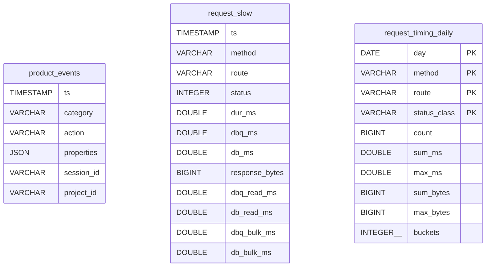

# Analytics Db

Tables in the analytics store created by `backend/infra/analytics_db.py`.

## Tables 1–3

### `product_events`

| Column | Type | Primary key | NOT NULL | Default | References ||---|---|---|---|---|---|
| `ts` | TIMESTAMP | No | Yes | — | — |
| `category` | VARCHAR | No | Yes | — | — |
| `action` | VARCHAR | No | Yes | — | — |
| `properties` | JSON | No | No | — | — |
| `session_id` | VARCHAR | No | No | — | — |
| `project_id` | VARCHAR | No | No | — | — |

Indexes: `idx_pe_cat_act_ts` ([category, '"action"', ts]), `idx_pe_proj_ts` ([project_id, ts]).

### `request_slow`

| Column | Type | Primary key | NOT NULL | Default | References ||---|---|---|---|---|---|
| `ts` | TIMESTAMP | No | Yes | — | — |
| `method` | VARCHAR | No | Yes | — | — |
| `route` | VARCHAR | No | Yes | — | — |
| `status` | INTEGER | No | Yes | — | — |
| `dur_ms` | DOUBLE | No | Yes | — | — |
| `dbq_ms` | DOUBLE | No | Yes | — | — |
| `db_ms` | DOUBLE | No | Yes | — | — |
| `response_bytes` | BIGINT | No | No | — | — |
| `dbq_read_ms` | DOUBLE | No | No | — | — |
| `db_read_ms` | DOUBLE | No | No | — | — |
| `dbq_bulk_ms` | DOUBLE | No | No | — | — |
| `db_bulk_ms` | DOUBLE | No | No | — | — |

Indexes: `idx_request_slow_ts` ([ts]).

### `request_timing_daily`

| Column | Type | Primary key | NOT NULL | Default | References ||---|---|---|---|---|---|
| `day` | DATE | Yes | Yes | — | — |
| `method` | VARCHAR | Yes | Yes | — | — |
| `route` | VARCHAR | Yes | Yes | — | — |
| `status_class` | VARCHAR | Yes | Yes | — | — |
| `count` | BIGINT | No | Yes | — | — |
| `sum_ms` | DOUBLE | No | Yes | — | — |
| `max_ms` | DOUBLE | No | Yes | — | — |
| `sum_bytes` | BIGINT | No | No | — | — |
| `max_bytes` | BIGINT | No | No | — | — |
| `buckets` | INTEGER[] | No | Yes | — | — |

Indexes: None.
