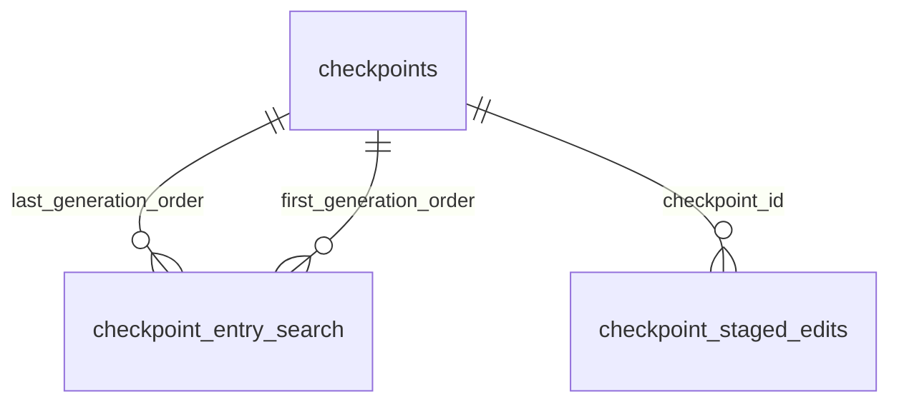

# Context and memory

These tables store checkpoints, continuity, context changes and extracted facts.

## Relationships

## Tables

### `checkpoint_entry_search`

Source: `backend/infra/checkpoint_schema.py`.

| Column | Type | Primary key | NOT NULL | Default | References |
|---|---|---|---|---|---|
| `thread_id` | TEXT | Yes | Yes | — | threads.id |
| `history_epoch` | INTEGER | Yes | Yes | — | — |
| `entry_id` | INTEGER | Yes | Yes | — | — |
| `revision` | INTEGER | Yes | Yes | — | — |
| `field` | TEXT | No | Yes | — | — |
| `search_text` | TEXT | No | Yes | — | — |
| `first_generation_order` | INTEGER | No | Yes | — | checkpoints.generation_order |
| `last_generation_order` | INTEGER | No | Yes | — | checkpoints.generation_order |

Indexes: `checkpoint_entry_search_identity` (thread_id, history_epoch, entry_id), `sqlite_autoindex_checkpoint_entry_search_1` (thread_id, history_epoch, entry_id, revision, unique).

### `checkpoint_staged_edits`

Source: `backend/infra/continuity_staging.py`.

| Column | Type | Primary key | NOT NULL | Default | References |
|---|---|---|---|---|---|
| `checkpoint_id` | TEXT | Yes | Yes | — | checkpoints.id |
| `edit_order` | INTEGER | Yes | Yes | — | — |
| `operation` | TEXT | No | Yes | — | — |
| `entry_id` | INTEGER | No | Yes | — | — |
| `field` | TEXT | No | Yes | — | — |
| `body` | TEXT | No | No | — | — |
| `reason` | TEXT | No | No | — | — |
| `source_ref` | TEXT | No | No | — | — |
| `base_entry_revision` | INTEGER | No | No | — | — |
| `outcome` | TEXT | No | Yes | 'pending' | — |
| `outcome_detail` | TEXT | No | No | — | — |
| `created_at` | TEXT | No | Yes | CURRENT_TIMESTAMP | — |
| `resolved_at` | TEXT | No | No | — | — |

Indexes: `checkpoint_staged_edits_target` (checkpoint_id, entry_id, edit_order), `sqlite_autoindex_checkpoint_staged_edits_1` (checkpoint_id, edit_order, unique).

### `checkpoints`

Source: `backend/infra/checkpoint_schema.py`.

| Column | Type | Primary key | NOT NULL | Default | References |
|---|---|---|---|---|---|
| `generation_order` | INTEGER | Yes | No | — | — |
| `id` | TEXT | No | Yes | — | — |
| `thread_id` | TEXT | No | Yes | — | threads.id |
| `history_epoch` | INTEGER | No | Yes | — | — |
| `previous_generation_id` | TEXT | No | No | — | — |
| `through_seq` | INTEGER | No | Yes | — | — |
| `through_message_id` | TEXT | No | Yes | — | — |
| `trigger` | TEXT | No | Yes | — | — |
| `mode` | TEXT | No | Yes | — | — |
| `status` | TEXT | No | Yes | — | — |
| `source_harness` | TEXT | No | Yes | — | — |
| `source_model` | TEXT | No | Yes | — | — |
| `writer_harness` | TEXT | No | Yes | — | — |
| `writer_model` | TEXT | No | Yes | — | — |
| `originating_turn_id` | TEXT | No | No | — | — |
| `first_included_seq` | INTEGER | No | No | — | — |
| `continuity_base_revision` | INTEGER | No | Yes | — | — |
| `continuity_base_snapshot_json` | TEXT | No | Yes | — | — |
| `raw_result` | TEXT | No | No | — | — |
| `continuity_snapshot_json` | TEXT | No | No | — | — |
| `usage_json` | TEXT | No | No | — | — |
| `error` | TEXT | No | No | — | — |
| `started_at` | TEXT | No | Yes | — | — |
| `captured_at` | TEXT | No | No | — | — |
| `installed_at` | TEXT | No | No | — | — |
| `ended_at` | TEXT | No | No | — | — |
| `artifact_snapshot_json` | TEXT | No | No | — | — |
| `plan_status_snapshot_json` | TEXT | No | No | — | — |
| `through_at` | TEXT | No | No | — | — |
| `adopted_input_tokens` | INTEGER | No | No | — | — |

Indexes: `checkpoints_current` (thread_id, history_epoch, status, generation_order), `checkpoints_idle_boundary` (thread_id, history_epoch, through_message_id), `checkpoints_listing` (thread_id, generation_order), `checkpoints_one_live` (thread_id, partial unique), `sqlite_autoindex_checkpoints_1` (id, unique).

### `context_bootloader_events`

Source: `backend/infra/schema.py`.

| Column | Type | Primary key | NOT NULL | Default | References |
|---|---|---|---|---|---|
| `id` | TEXT | Yes | No | — | — |
| `actor_user_id` | TEXT | No | No | — | — |
| `actor_thread_id` | TEXT | No | No | — | threads.id |
| `scope` | TEXT | No | Yes | — | — |
| `target_id` | TEXT | No | Yes | — | — |
| `action` | TEXT | No | Yes | — | — |
| `files_json` | TEXT | No | Yes | — | — |
| `created_at` | TEXT | No | Yes | — | — |

Indexes: `idx_context_bootloader_events_target` (scope, target_id, created_at), `sqlite_autoindex_context_bootloader_events_1` (id, unique).

### `context_change_journal`

Source: `backend/infra/context_change_schema.py`.

| Column | Type | Primary key | NOT NULL | Default | References |
|---|---|---|---|---|---|
| `seq` | INTEGER | Yes | No | — | — |
| `object_kind` | TEXT | No | Yes | — | — |
| `object_id` | TEXT | No | Yes | — | — |
| `change_kind` | TEXT | No | Yes | — | — |
| `summary` | TEXT | No | Yes | — | — |
| `details_json` | TEXT | No | No | — | — |
| `actor_thread_id` | TEXT | No | No | — | — |
| `created_at` | TEXT | No | Yes | — | — |

Indexes: `idx_context_changes_object` (object_kind, object_id, seq).

### `continuity_entries`

Source: `backend/infra/continuity_schema.py`.

| Column | Type | Primary key | NOT NULL | Default | References |
|---|---|---|---|---|---|
| `thread_id` | TEXT | Yes | Yes | — | threads.id |
| `history_epoch` | INTEGER | Yes | Yes | — | — |
| `entry_id` | INTEGER | Yes | Yes | — | — |
| `field` | TEXT | No | Yes | — | — |
| `body` | TEXT | No | Yes | — | — |
| `revision` | INTEGER | No | Yes | 1 | — |
| `state` | TEXT | No | Yes | 'active' | — |
| `retired_reason` | TEXT | No | No | — | — |
| `retired_source_ref` | TEXT | No | No | — | — |
| `created_at` | TEXT | No | Yes | — | — |
| `updated_at` | TEXT | No | Yes | — | — |
| `placement_state` | TEXT | No | No | — | — |
| `placement_revision` | INTEGER | No | No | — | — |
| `placement_detail` | TEXT | No | No | — | — |
| `reviewed_at` | TEXT | No | No | — | — |

Indexes: `idx_continuity_entries_active` (thread_id, history_epoch, field, state), `sqlite_autoindex_continuity_entries_1` (thread_id, history_epoch, entry_id, unique).

### `continuity_store`

Source: `backend/infra/continuity_schema.py`.

| Column | Type | Primary key | NOT NULL | Default | References |
|---|---|---|---|---|---|
| `thread_id` | TEXT | Yes | Yes | — | threads.id |
| `history_epoch` | INTEGER | Yes | Yes | — | — |
| `revision` | INTEGER | No | Yes | 0 | — |
| `next_entry_id` | INTEGER | No | Yes | 1 | — |
| `updated_at` | TEXT | No | Yes | — | — |

Indexes: `sqlite_autoindex_continuity_store_1` (thread_id, history_epoch, unique).

### `fact_extraction_runs`

Source: `backend/infra/fact_extraction_schema.py`.

| Column | Type | Primary key | NOT NULL | Default | References |
|---|---|---|---|---|---|
| `run_date` | TEXT | Yes | No | — | — |
| `status` | TEXT | No | Yes | 'ok' | — |
| `result_json` | TEXT | No | No | — | — |
| `ran_at` | TEXT | No | Yes | — | — |

Indexes: `sqlite_autoindex_fact_extraction_runs_1` (run_date, unique).

### `lesson_placement_checks`

Source: `backend/infra/lesson_placement_check_schema.py`.

| Column | Type | Primary key | NOT NULL | Default | References |
|---|---|---|---|---|---|
| `thread_id` | TEXT | Yes | Yes | — | threads.id |
| `history_epoch` | INTEGER | Yes | Yes | — | — |
| `entry_id` | INTEGER | Yes | Yes | — | — |
| `revision` | INTEGER | Yes | Yes | — | — |
| `check_name` | TEXT | Yes | Yes | — | — |
| `flag` | TEXT | Yes | Yes | — | — |
| `override_reason` | TEXT | No | No | — | — |
| `created_at` | TEXT | No | Yes | — | — |

Indexes: `idx_lesson_placement_checks_thread` (thread_id, check_name), `sqlite_autoindex_lesson_placement_checks_1` (thread_id, history_epoch, entry_id, revision, check_name, flag, unique).
