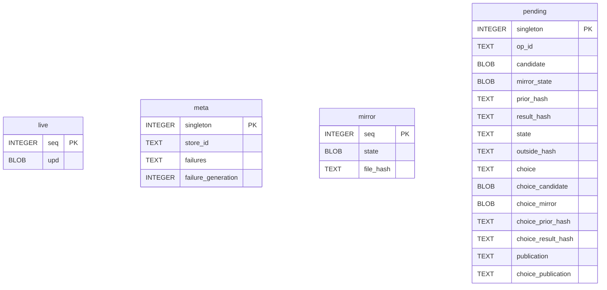
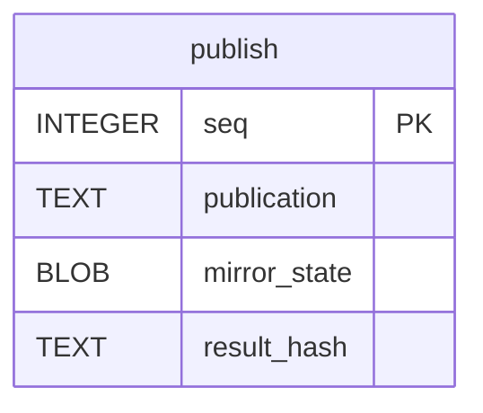

# Live Store

Tables in the document store created by `backend/doceditor/live_store.py`.

## Tables 1–4

### `live`

| Column | Type | Primary key | NOT NULL | Default | References ||---|---|---|---|---|---|
| `seq` | INTEGER | Yes | No | — | — |
| `upd` | BLOB | No | Yes | — | — |

Indexes: None.

### `meta`

| Column | Type | Primary key | NOT NULL | Default | References ||---|---|---|---|---|---|
| `singleton` | INTEGER | Yes | No | — | — |
| `store_id` | TEXT | No | Yes | — | — |
| `failures` | TEXT | No | Yes | '{}' | — |
| `failure_generation` | INTEGER | No | Yes | 0 | — |

Indexes: None.

### `mirror`

| Column | Type | Primary key | NOT NULL | Default | References ||---|---|---|---|---|---|
| `seq` | INTEGER | Yes | No | — | — |
| `state` | BLOB | No | Yes | — | — |
| `file_hash` | TEXT | No | Yes | — | — |

Indexes: None.

### `pending`

| Column | Type | Primary key | NOT NULL | Default | References ||---|---|---|---|---|---|
| `singleton` | INTEGER | Yes | No | — | — |
| `op_id` | TEXT | No | Yes | — | — |
| `candidate` | BLOB | No | Yes | — | — |
| `mirror_state` | BLOB | No | Yes | — | — |
| `prior_hash` | TEXT | No | Yes | — | — |
| `result_hash` | TEXT | No | Yes | — | — |
| `state` | TEXT | No | Yes | — | — |
| `outside_hash` | TEXT | No | No | — | — |
| `choice` | TEXT | No | No | — | — |
| `choice_candidate` | BLOB | No | No | — | — |
| `choice_mirror` | BLOB | No | No | — | — |
| `choice_prior_hash` | TEXT | No | No | — | — |
| `choice_result_hash` | TEXT | No | No | — | — |
| `publication` | TEXT | No | No | — | — |
| `choice_publication` | TEXT | No | No | — | — |

Indexes: `sqlite_autoindex_pending_1` (op_id, unique).

## Tables 5–5

### `publish`

| Column | Type | Primary key | NOT NULL | Default | References ||---|---|---|---|---|---|
| `seq` | INTEGER | Yes | No | — | — |
| `publication` | TEXT | No | Yes | — | — |
| `mirror_state` | BLOB | No | Yes | — | — |
| `result_hash` | TEXT | No | Yes | — | — |

Indexes: None.
