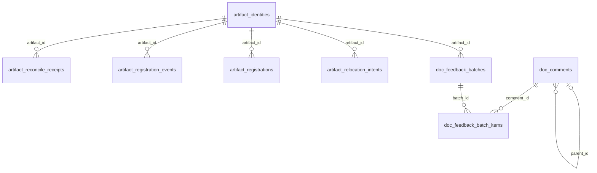
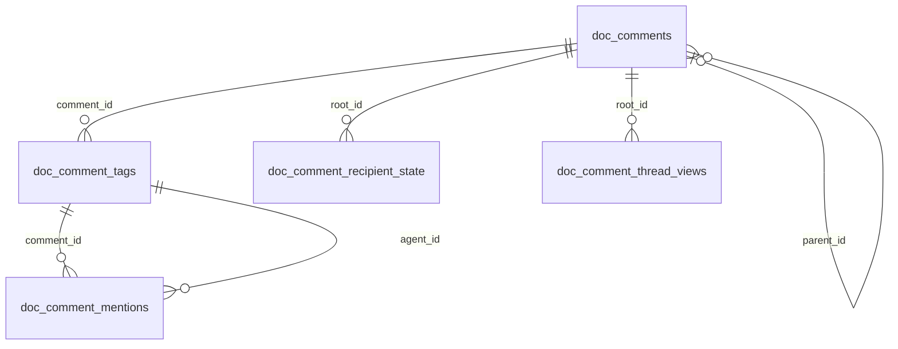
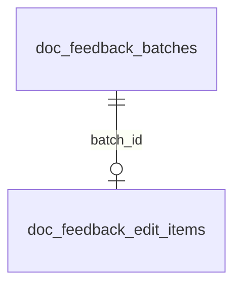
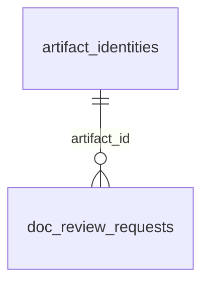

# Documents and artifacts

These tables store artifact registrations, identities, comments and document feedback.

## Relationships

## Tables

### `artifact_identities`

Source: `backend/infra/artifact_identity_schema.py`.

| Column | Type | Primary key | NOT NULL | Default | References |
|---|---|---|---|---|---|
| `id` | TEXT | Yes | No | — | — |
| `integration` | TEXT | No | Yes | — | — |
| `type` | TEXT | No | Yes | — | — |
| `external_id` | TEXT | No | Yes | — | — |
| `title` | TEXT | No | No | — | — |
| `description` | TEXT | No | No | — | — |
| `path` | TEXT | No | No | — | — |
| `state` | TEXT | No | Yes | 'active' | — |
| `retention` | TEXT | No | Yes | 'durable' | — |
| `metadata` | TEXT | No | No | — | — |
| `created_at` | TEXT | No | Yes | — | — |
| `updated_at` | TEXT | No | Yes | — | — |

Indexes: `idx_artifact_identities_decision_source` (expression), `idx_artifact_identities_upload_path` (path), `idx_measurement_decisions_answered` (expression), `idx_measurement_decisions_raised` (expression), `idx_measurement_decisions_thread` (expression), `sqlite_autoindex_artifact_identities_1` (id, unique), `sqlite_autoindex_artifact_identities_2` (integration, type, external_id, unique).

### `artifact_reconcile_receipts`

Source: `backend/infra/schema.py`.

| Column | Type | Primary key | NOT NULL | Default | References |
|---|---|---|---|---|---|
| `id` | TEXT | Yes | No | — | — |
| `artifact_id` | TEXT | No | Yes | — | artifact_identities.id |
| `identity_version` | TEXT | No | Yes | — | — |
| `thread_id` | TEXT | No | Yes | — | — |
| `action` | TEXT | No | Yes | — | — |
| `status` | TEXT | No | Yes | — | — |
| `reason` | TEXT | No | No | — | — |
| `created_at` | TEXT | No | Yes | — | — |

Indexes: `idx_artifact_reconcile_receipts_session` (thread_id, created_at), `sqlite_autoindex_artifact_reconcile_receipts_1` (id, unique), `sqlite_autoindex_artifact_reconcile_receipts_2` (artifact_id, identity_version, thread_id, unique).

### `artifact_registration_events`

Source: `backend/infra/schema.py`.

| Column | Type | Primary key | NOT NULL | Default | References |
|---|---|---|---|---|---|
| `id` | TEXT | Yes | No | — | — |
| `artifact_id` | TEXT | No | Yes | — | artifact_identities.id |
| `event_type` | TEXT | No | Yes | — | — |
| `actor_thread_id` | TEXT | No | No | — | — |
| `authority` | TEXT | No | No | — | — |
| `reason` | TEXT | No | No | — | — |
| `source_path` | TEXT | No | No | — | — |
| `causal_event_id` | TEXT | No | No | — | — |
| `affected_thread_id` | TEXT | No | No | — | — |
| `old_owner_thread_id` | TEXT | No | No | — | — |
| `new_owner_thread_id` | TEXT | No | No | — | — |
| `old_relationship_state` | TEXT | No | No | — | — |
| `new_relationship_state` | TEXT | No | No | — | — |
| `metadata` | TEXT | No | No | — | — |
| `created_at` | TEXT | No | Yes | — | — |

Indexes: `idx_artifact_registration_events_artifact` (artifact_id, created_at), `idx_artifact_registration_events_thread` (affected_thread_id, created_at), `sqlite_autoindex_artifact_registration_events_1` (id, unique).

### `artifact_registrations`

Source: `backend/infra/schema.py`.

| Column | Type | Primary key | NOT NULL | Default | References |
|---|---|---|---|---|---|
| `id` | TEXT | Yes | No | — | — |
| `artifact_id` | TEXT | No | Yes | — | artifact_identities.id |
| `parent_thread_id` | TEXT | No | Yes | — | — |
| `relationship_state` | TEXT | No | Yes | 'owner-active' | — |
| `tmp` | INTEGER | No | Yes | 0 | — |
| `surfacing` | TEXT | No | Yes | 'visible' | — |
| `origin_plan_node_id` | TEXT | No | No | — | — |
| `retired_at` | TEXT | No | No | — | — |
| `metadata` | TEXT | No | No | — | — |
| `created_at` | TEXT | No | Yes | — | — |
| `updated_at` | TEXT | No | Yes | — | — |

Indexes: `idx_artifact_registrations_artifact` (artifact_id, relationship_state), `idx_artifact_registrations_thread` (parent_thread_id, updated_at), `sqlite_autoindex_artifact_registrations_1` (id, unique), `sqlite_autoindex_artifact_registrations_2` (artifact_id, parent_thread_id, unique).

### `artifact_relocation_intents`

Source: `backend/infra/artifact_relocation_schema.py`.

| Column | Type | Primary key | NOT NULL | Default | References |
|---|---|---|---|---|---|
| `id` | TEXT | Yes | No | — | — |
| `artifact_id` | TEXT | No | Yes | — | artifact_identities.id |
| `actor_thread_id` | TEXT | No | Yes | — | — |
| `source_path` | TEXT | No | Yes | — | — |
| `target_path` | TEXT | No | Yes | — | — |
| `source_external_id` | TEXT | No | Yes | — | — |
| `target_external_id` | TEXT | No | Yes | — | — |
| `target_type` | TEXT | No | No | — | — |
| `target_title` | TEXT | No | No | — | — |
| `phase` | TEXT | No | Yes | — | — |
| `created_at` | TEXT | No | Yes | — | — |
| `updated_at` | TEXT | No | Yes | — | — |

Indexes: `sqlite_autoindex_artifact_relocation_intents_1` (id, unique).

### `doc_comment_mentions`

Source: `backend/infra/doc_comments_schema.py`.

| Column | Type | Primary key | NOT NULL | Default | References |
|---|---|---|---|---|---|
| `comment_id` | TEXT | No | Yes | — | doc_comment_tags.comment_id |
| `agent_id` | TEXT | No | Yes | — | doc_comment_tags.agent_id |
| `start_offset` | INTEGER | No | Yes | — | — |
| `end_offset` | INTEGER | No | Yes | — | — |

Indexes: `idx_doc_comment_mentions_comment` (comment_id, agent_id).

### `doc_comment_recipient_state`

Source: `backend/infra/doc_comments_schema.py`.

| Column | Type | Primary key | NOT NULL | Default | References |
|---|---|---|---|---|---|
| `root_id` | TEXT | Yes | Yes | — | doc_comments.id |
| `agent_id` | TEXT | Yes | Yes | — | threads.id |
| `left_thread` | INTEGER | No | Yes | 0 | — |
| `notifications` | INTEGER | No | Yes | 0 | — |

Indexes: `sqlite_autoindex_doc_comment_recipient_state_1` (root_id, agent_id, unique).

### `doc_comment_tags`

Source: `backend/infra/doc_comments_schema.py`.

| Column | Type | Primary key | NOT NULL | Default | References |
|---|---|---|---|---|---|
| `comment_id` | TEXT | Yes | Yes | — | doc_comments.id |
| `agent_id` | TEXT | Yes | Yes | — | — |
| `agent_name` | TEXT | No | Yes | — | — |

Indexes: `sqlite_autoindex_doc_comment_tags_1` (comment_id, agent_id, unique).

### `doc_comment_thread_views`

Source: `backend/infra/doc_feedback_schema.py`.

| Column | Type | Primary key | NOT NULL | Default | References |
|---|---|---|---|---|---|
| `user_id` | TEXT | Yes | Yes | — | — |
| `root_id` | TEXT | Yes | Yes | — | doc_comments.id |
| `seen_at` | TEXT | No | Yes | — | — |
| `seen_reply_id` | TEXT | No | Yes | — | — |

Indexes: `sqlite_autoindex_doc_comment_thread_views_1` (user_id, root_id, unique).

### `doc_comments`

Source: `backend/infra/doc_comments_schema.py`.

| Column | Type | Primary key | NOT NULL | Default | References |
|---|---|---|---|---|---|
| `id` | TEXT | Yes | No | — | — |
| `artifact_id` | TEXT | No | Yes | — | — |
| `parent_id` | TEXT | No | No | — | doc_comments.id |
| `author` | TEXT | No | Yes | — | — |
| `author_kind` | TEXT | No | Yes | 'user' | — |
| `author_thread_id` | TEXT | No | No | — | — |
| `body` | TEXT | No | Yes | — | — |
| `anchor_text` | TEXT | No | No | — | — |
| `from_off` | INTEGER | No | No | — | — |
| `to_off` | INTEGER | No | No | — | — |
| `anchor_prefix` | TEXT | No | No | — | — |
| `anchor_suffix` | TEXT | No | No | — | — |
| `review` | INTEGER | No | Yes | 0 | — |
| `resolved` | INTEGER | No | Yes | 0 | — |
| `acked` | INTEGER | No | Yes | 0 | — |
| `replacement` | TEXT | No | No | — | — |
| `decision` | TEXT | No | No | — | — |
| `decided_by` | TEXT | No | No | — | — |
| `decided_by_thread_id` | TEXT | No | No | — | — |
| `decided_at` | TEXT | No | No | — | — |
| `decision_event_id` | TEXT | No | No | — | — |
| `created_at` | TEXT | No | Yes | — | — |
| `updated_at` | TEXT | No | Yes | — | — |
| `region_x` | REAL | No | No | — | — |
| `region_y` | REAL | No | No | — | — |
| `region_w` | REAL | No | No | — | — |
| `region_h` | REAL | No | No | — | — |
| `region_number` | INTEGER | No | No | — | — |
| `image_rev` | TEXT | No | No | — | — |
| `image_src` | TEXT | No | No | — | — |
| `stranded_notified_at` | TEXT | No | No | — | — |
| `decided_in_bulk` | INTEGER | No | No | — | — |
| `insert_after` | INTEGER | No | Yes | 0 | — |

Indexes: `idx_doc_comments_artifact` (artifact_id, created_at), `idx_doc_comments_decision_event` (decision_event_id), `idx_doc_comments_region_number` (artifact_id, expression, region_number, partial unique), `idx_doc_comments_user_created` (created_at, id), `sqlite_autoindex_doc_comments_1` (id, unique).

### `doc_feedback_batch_items`

Source: `backend/infra/doc_feedback_schema.py`.

| Column | Type | Primary key | NOT NULL | Default | References |
|---|---|---|---|---|---|
| `batch_id` | TEXT | Yes | Yes | — | doc_feedback_batches.id |
| `comment_id` | TEXT | Yes | Yes | — | doc_comments.id |
| `event` | TEXT | No | No | — | — |
| `event_at` | TEXT | No | No | — | — |
| `event_by` | TEXT | No | No | — | — |

Indexes: `idx_doc_feedback_batch_items_comment` (comment_id), `sqlite_autoindex_doc_feedback_batch_items_1` (batch_id, comment_id, unique).

### `doc_feedback_batches`

Source: `backend/infra/doc_feedback_schema.py`.

| Column | Type | Primary key | NOT NULL | Default | References |
|---|---|---|---|---|---|
| `id` | TEXT | Yes | No | — | — |
| `artifact_id` | TEXT | No | Yes | — | artifact_identities.id |
| `author_kind` | TEXT | No | Yes | — | — |
| `author_id` | TEXT | No | Yes | — | — |
| `recipient_id` | TEXT | No | Yes | — | — |
| `delivery_policy` | TEXT | No | Yes | 'immediate' | — |
| `state` | TEXT | No | Yes | 'open' | — |
| `opened_at` | TEXT | No | Yes | — | — |
| `last_item_at` | TEXT | No | Yes | — | — |
| `closes_at` | TEXT | No | Yes | — | — |
| `closed_reason` | TEXT | No | No | — | — |
| `item_count` | INTEGER | No | Yes | 0 | — |
| `delivered_node_id` | TEXT | No | No | — | plan_nodes.id |
| `delivery_outcome` | TEXT | No | No | — | — |
| `undelivered_reason` | TEXT | No | No | — | — |
| `attempts` | INTEGER | No | Yes | 0 | — |
| `author_result_notified_at` | TEXT | No | No | — | — |
| `created_at` | TEXT | No | Yes | — | — |
| `updated_at` | TEXT | No | Yes | — | — |

Indexes: `idx_doc_feedback_batches_author` (author_kind, author_id, state, updated_at), `idx_doc_feedback_batches_due` (state, closes_at), `idx_doc_feedback_batches_open` (author_kind, author_id, artifact_id, recipient_id, delivery_policy, partial unique), `idx_doc_feedback_batches_recipient_open` (recipient_id, author_kind, author_id, delivery_policy, state), `sqlite_autoindex_doc_feedback_batches_1` (id, unique).

### `doc_feedback_edit_items`

Source: `backend/infra/doc_feedback_schema.py`.

| Column | Type | Primary key | NOT NULL | Default | References |
|---|---|---|---|---|---|
| `batch_id` | TEXT | Yes | No | — | doc_feedback_batches.id |
| `actor_display` | TEXT | No | Yes | — | — |
| `prior_segments_diff` | TEXT | No | Yes | '' | — |
| `baseline_sha256` | TEXT | No | Yes | — | — |
| `baseline_text` | TEXT | No | Yes | — | — |
| `latest_sha256` | TEXT | No | Yes | — | — |
| `latest_text` | TEXT | No | Yes | — | — |
| `save_count` | INTEGER | No | Yes | — | — |
| `first_at` | TEXT | No | Yes | — | — |
| `last_at` | TEXT | No | Yes | — | — |

Indexes: `sqlite_autoindex_doc_feedback_edit_items_1` (batch_id, unique).

### `doc_review_requests`

Source: `backend/infra/doc_review_schema.py`.

| Column | Type | Primary key | NOT NULL | Default | References |
|---|---|---|---|---|---|
| `id` | TEXT | Yes | No | — | — |
| `artifact_id` | TEXT | No | Yes | — | artifact_identities.id |
| `requester_kind` | TEXT | No | Yes | — | — |
| `requester_id` | TEXT | No | Yes | — | — |
| `reviewer_thread_id` | TEXT | No | Yes | — | threads.id |
| `note` | TEXT | No | No | — | — |
| `client_ids` | TEXT | No | Yes | — | — |
| `fork_id` | TEXT | No | No | — | — |
| `state` | TEXT | No | Yes | 'handed_back' | — |
| `state_changed_at` | TEXT | No | No | — | — |
| `reason` | TEXT | No | No | — | — |
| `node_id` | TEXT | No | No | — | plan_nodes.id |
| `requesting_node_id` | TEXT | No | No | — | plan_nodes.id |
| `created_at` | TEXT | No | Yes | — | — |

Indexes: `idx_doc_review_requests_reviewer` (reviewer_thread_id, created_at), `idx_doc_review_reviewer` (artifact_id, reviewer_thread_id, created_at), `sqlite_autoindex_doc_review_requests_1` (id, unique).

### `durable_write_intents`

Source: `backend/infra/schema.py`.

| Column | Type | Primary key | NOT NULL | Default | References |
|---|---|---|---|---|---|
| `id` | TEXT | Yes | No | — | — |
| `operation` | TEXT | No | Yes | — | — |
| `phase` | TEXT | No | Yes | — | — |
| `actor_thread_id` | TEXT | No | Yes | — | — |
| `artifact_type` | TEXT | No | Yes | — | — |
| `external_id` | TEXT | No | Yes | — | — |
| `target_path` | TEXT | No | Yes | — | — |
| `stage_path` | TEXT | No | Yes | — | — |
| `backup_path` | TEXT | No | No | — | — |
| `source_path` | TEXT | No | No | — | — |
| `description` | TEXT | No | No | — | — |
| `content_sha256` | TEXT | No | Yes | — | — |
| `created_parent` | INTEGER | No | Yes | 0 | — |
| `undoing` | INTEGER | No | Yes | 0 | — |
| `created_at` | TEXT | No | Yes | — | — |
| `updated_at` | TEXT | No | Yes | — | — |

Indexes: `sqlite_autoindex_durable_write_intents_1` (id, unique), `sqlite_autoindex_durable_write_intents_2` (target_path, unique).
