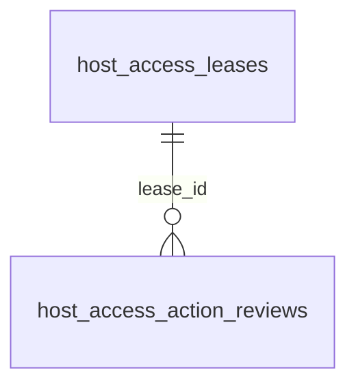

# Host access

These tables store host access leases and action reviews.

## Relationships

## Tables

### `host_access_action_reviews`

Source: `backend/infra/host_access_schema.py`.

| Column | Type | Primary key | NOT NULL | Default | References |
|---|---|---|---|---|---|
| `id` | TEXT | Yes | No | — | — |
| `lease_id` | TEXT | No | Yes | — | host_access_leases.id |
| `lease_revision` | INTEGER | No | Yes | — | — |
| `thread_id` | TEXT | No | Yes | — | threads.id |
| `tool_name` | TEXT | No | Yes | — | — |
| `action_hash` | TEXT | No | Yes | — | — |
| `redacted_descriptor` | TEXT | No | Yes | — | — |
| `reviewer_model` | TEXT | No | Yes | — | — |
| `verdict` | TEXT | No | Yes | — | — |
| `reason` | TEXT | No | Yes | — | — |
| `permit_id` | TEXT | No | No | — | — |
| `permit_expires_at` | TEXT | No | No | — | — |
| `permit_consumed_at` | TEXT | No | No | — | — |
| `created_at` | TEXT | No | Yes | — | — |

Indexes: `idx_host_access_action_reviews_action` (lease_id, action_hash, created_at), `idx_host_access_action_reviews_lease` (lease_id, created_at), `idx_host_access_action_reviews_permit` (permit_id, unique), `sqlite_autoindex_host_access_action_reviews_1` (id, unique).

### `host_access_leases`

Source: `backend/infra/host_access_schema.py`.

| Column | Type | Primary key | NOT NULL | Default | References |
|---|---|---|---|---|---|
| `id` | TEXT | Yes | No | — | — |
| `root_thread_id` | TEXT | No | Yes | — | threads.id |
| `user_id` | TEXT | No | Yes | — | — |
| `state` | TEXT | No | Yes | — | — |
| `purpose` | TEXT | No | Yes | — | — |
| `plan` | TEXT | No | Yes | — | — |
| `requested_duration_seconds` | INTEGER | No | Yes | — | — |
| `expected_resources` | TEXT | No | No | — | — |
| `persistent_effects` | TEXT | No | No | — | — |
| `rollback_plan` | TEXT | No | No | — | — |
| `forbidden_effects` | TEXT | No | No | — | — |
| `requesting_project_id` | TEXT | No | No | — | — |
| `repo_policy_snapshot` | TEXT | No | Yes | '[]' | — |
| `repo_policy_hash` | TEXT | No | Yes | 'ae3e2aca0c674a9150813698f7e5f14cd135a0dcd9324ead8044b85cd95ec70e' | — |
| `requested_policy_exceptions` | TEXT | No | Yes | '[]' | — |
| `application_hash` | TEXT | No | Yes | — | — |
| `revision` | INTEGER | No | Yes | 1 | — |
| `reviewer_model` | TEXT | No | No | — | — |
| `application_review_result` | TEXT | No | No | — | — |
| `application_reviewed_at` | TEXT | No | No | — | — |
| `user_decision` | TEXT | No | No | — | — |
| `user_decided_at` | TEXT | No | No | — | — |
| `activated_at` | TEXT | No | No | — | — |
| `activation_wake_delivered_at` | TEXT | No | No | — | — |
| `expires_at` | TEXT | No | No | — | — |
| `terminal_reason` | TEXT | No | No | — | — |
| `created_at` | TEXT | No | Yes | — | — |
| `updated_at` | TEXT | No | Yes | — | — |

Indexes: `idx_host_access_leases_one_nonterminal` (root_thread_id, unique), `idx_host_access_leases_root_state` (root_thread_id, state), `idx_host_access_leases_state_expiry` (state, expires_at), `sqlite_autoindex_host_access_leases_1` (id, unique).
