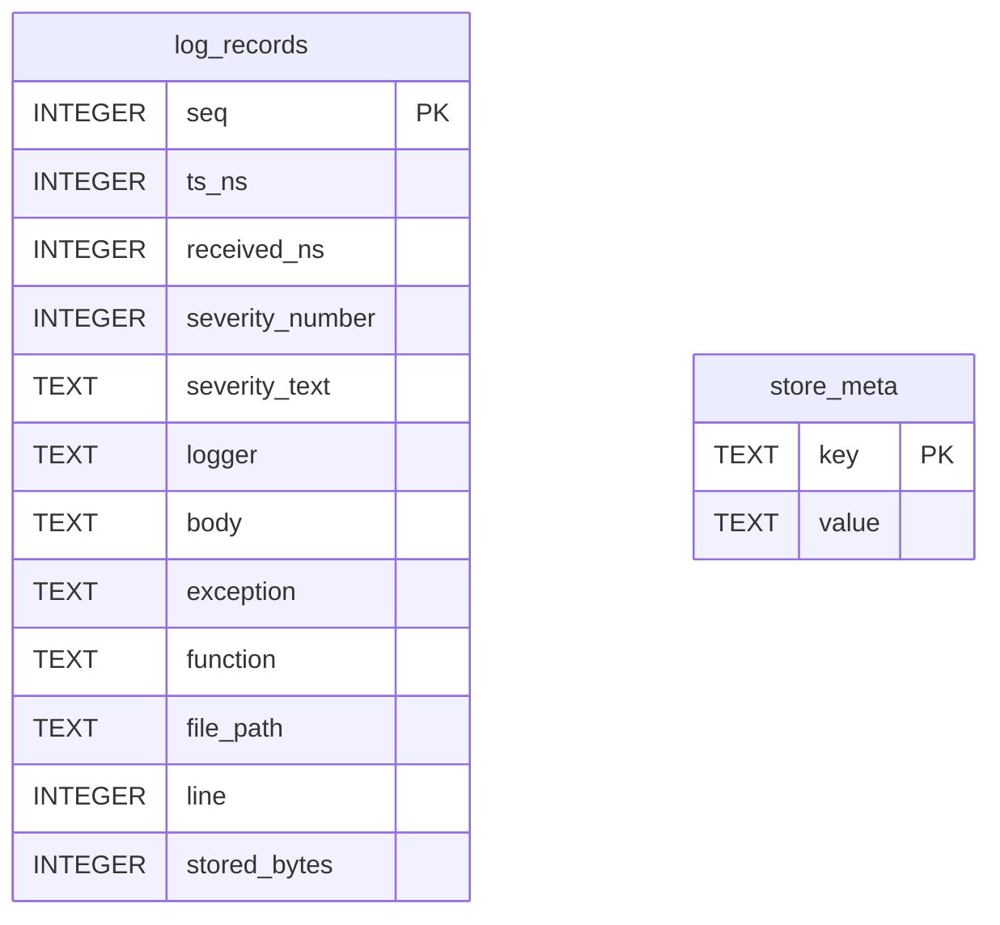

# Store

Tables in the logs store created by `backend/infra/otel_logs/store.py`.

## Tables 1–2

### `log_records`

| Column | Type | Primary key | NOT NULL | Default | References ||---|---|---|---|---|---|
| `seq` | INTEGER | Yes | No | — | — |
| `ts_ns` | INTEGER | No | Yes | — | — |
| `received_ns` | INTEGER | No | Yes | — | — |
| `severity_number` | INTEGER | No | Yes | — | — |
| `severity_text` | TEXT | No | Yes | — | — |
| `logger` | TEXT | No | Yes | — | — |
| `body` | TEXT | No | Yes | — | — |
| `exception` | TEXT | No | No | — | — |
| `function` | TEXT | No | No | — | — |
| `file_path` | TEXT | No | No | — | — |
| `line` | INTEGER | No | No | — | — |
| `stored_bytes` | INTEGER | No | Yes | — | — |

Indexes: `ix_lr_received` (received_ns), `ix_lr_ts` (ts_ns, seq).

### `store_meta`

| Column | Type | Primary key | NOT NULL | Default | References ||---|---|---|---|---|---|
| `key` | TEXT | Yes | No | — | — |
| `value` | TEXT | No | Yes | — | — |

Indexes: `sqlite_autoindex_store_meta_1` (key, unique).
