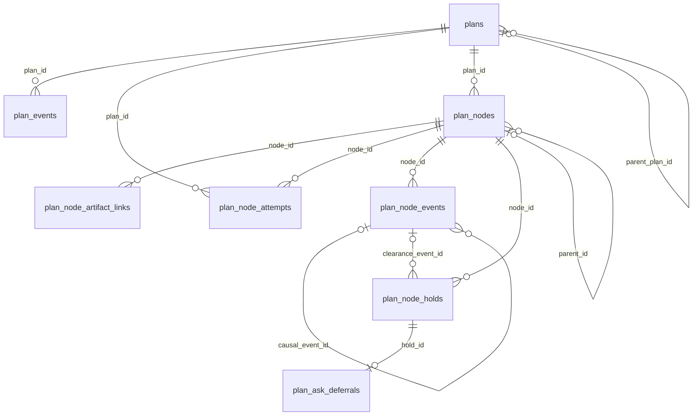
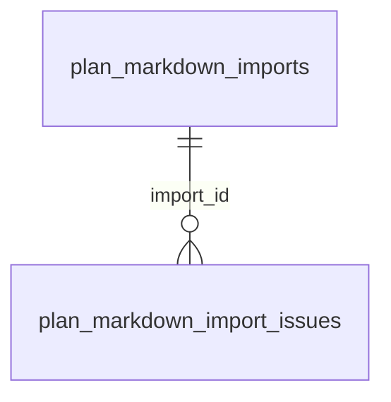
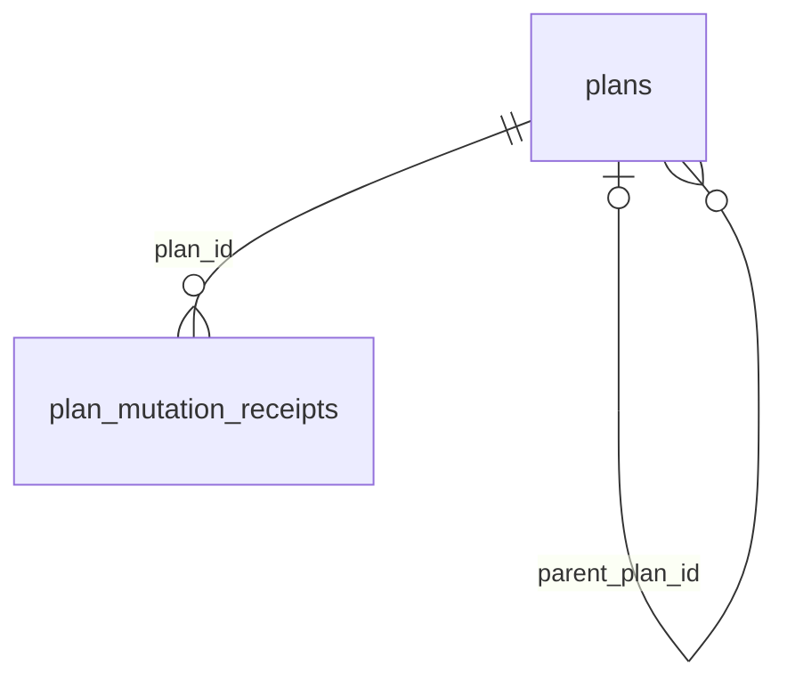
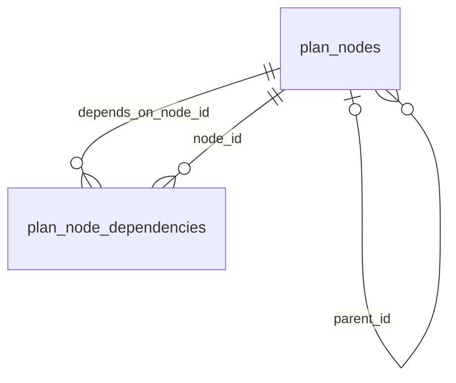
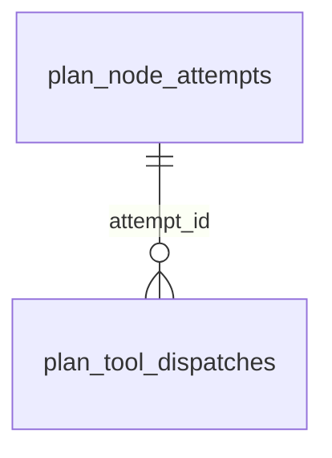

# Plans

These tables store plans, their nodes, events, dependencies and execution state.

## Relationships

## Tables

### `plan_ask_deferrals`

Source: `backend/infra/plan_schema.py`.

| Column | Type | Primary key | NOT NULL | Default | References |
|---|---|---|---|---|---|
| `hold_id` | TEXT | Yes | No | — | plan_node_holds.id |
| `deferred_at` | TEXT | No | Yes | — | — |

Indexes: `sqlite_autoindex_plan_ask_deferrals_1` (hold_id, unique).

### `plan_events`

Source: `backend/infra/plan_events_schema.py`.

| Column | Type | Primary key | NOT NULL | Default | References |
|---|---|---|---|---|---|
| `id` | TEXT | Yes | No | — | — |
| `plan_id` | TEXT | No | Yes | — | plans.id |
| `actor_id` | TEXT | No | No | — | — |
| `provenance` | TEXT | No | Yes | — | — |
| `event` | TEXT | No | Yes | — | — |
| `prior_state` | TEXT | No | No | — | — |
| `new_state` | TEXT | No | No | — | — |
| `payload_json` | TEXT | No | No | — | — |
| `created_at` | TEXT | No | Yes | — | — |

Indexes: `idx_plan_events_plan` (plan_id, created_at), `sqlite_autoindex_plan_events_1` (id, unique).

### `plan_liveness_wakes`

Source: `backend/infra/plan_liveness_schema.py`.

| Column | Type | Primary key | NOT NULL | Default | References |
|---|---|---|---|---|---|
| `id` | TEXT | Yes | No | — | — |
| `thread_id` | TEXT | No | Yes | — | — |
| `status` | TEXT | No | Yes | 'armed' | — |
| `deadline` | TEXT | No | Yes | — | — |
| `provider_reset_at` | TEXT | No | No | — | — |
| `provider_reset_turn_id` | TEXT | No | No | — | — |
| `cycle` | INTEGER | No | Yes | 0 | — |
| `last_open_count` | INTEGER | No | Yes | 0 | — |
| `last_signal_hash` | TEXT | No | Yes | '' | — |
| `last_settled_events` | INTEGER | No | Yes | 0 | — |
| `wakes_in_window` | INTEGER | No | Yes | 0 | — |
| `window_started_at` | TEXT | No | No | — | — |
| `armed_at` | TEXT | No | Yes | — | — |
| `fired_at` | TEXT | No | No | — | — |
| `updated_at` | TEXT | No | Yes | — | — |

Indexes: `idx_plan_liveness_thread_status` (thread_id, status), `sqlite_autoindex_plan_liveness_wakes_1` (id, unique), `sqlite_autoindex_plan_liveness_wakes_2` (thread_id, unique).

### `plan_markdown_import_issues`

Source: `backend/infra/plan_markdown_import_schema.py`.

| Column | Type | Primary key | NOT NULL | Default | References |
|---|---|---|---|---|---|
| `id` | TEXT | Yes | No | — | — |
| `import_id` | TEXT | No | Yes | — | plan_markdown_imports.id |
| `issue_order` | INTEGER | No | Yes | — | — |
| `code` | TEXT | No | Yes | — | — |
| `message` | TEXT | No | Yes | — | — |
| `source_line` | INTEGER | No | No | — | — |
| `detail_json` | TEXT | No | No | — | — |
| `created_at` | TEXT | No | Yes | — | — |

Indexes: `idx_plan_markdown_import_issues_import` (import_id, issue_order), `sqlite_autoindex_plan_markdown_import_issues_1` (id, unique), `sqlite_autoindex_plan_markdown_import_issues_2` (import_id, issue_order, unique).

### `plan_markdown_imports`

Source: `backend/infra/plan_markdown_import_schema.py`.

| Column | Type | Primary key | NOT NULL | Default | References |
|---|---|---|---|---|---|
| `id` | TEXT | Yes | No | — | — |
| `artifact_id` | TEXT | No | Yes | — | artifact_identities.id |
| `observed_owner_thread_id` | TEXT | No | No | — | — |
| `owner_thread_id` | TEXT | No | No | — | threads.id |
| `registration_id` | TEXT | No | No | — | — |
| `plan_id` | TEXT | No | No | — | — |
| `integration` | TEXT | No | Yes | — | — |
| `artifact_type` | TEXT | No | Yes | — | — |
| `external_id` | TEXT | No | Yes | — | — |
| `source_path` | TEXT | No | Yes | — | — |
| `artifact_updated_at` | TEXT | No | Yes | — | — |
| `registration_updated_at` | TEXT | No | No | — | — |
| `registration_state` | TEXT | No | No | — | — |
| `source_sha256` | TEXT | No | No | — | — |
| `parser_version` | TEXT | No | No | — | — |
| `manifest_json` | TEXT | No | No | — | — |
| `source_map_json` | TEXT | No | No | — | — |
| `status` | TEXT | No | Yes | — | — |
| `applied_plan_hash` | TEXT | No | No | — | — |
| `wake_snapshot_json` | TEXT | No | No | — | — |
| `discovered_at` | TEXT | No | Yes | — | — |
| `updated_at` | TEXT | No | Yes | — | — |
| `imported_at` | TEXT | No | No | — | — |
| `rolled_back_at` | TEXT | No | No | — | — |

Indexes: `idx_plan_markdown_imports_owner` (owner_thread_id, partial unique), `idx_plan_markdown_imports_status` (status), `sqlite_autoindex_plan_markdown_imports_1` (id, unique), `sqlite_autoindex_plan_markdown_imports_2` (artifact_id, unique), `sqlite_autoindex_plan_markdown_imports_3` (plan_id, unique).

### `plan_mutation_receipts`

Source: `backend/infra/plan_schema.py`.

| Column | Type | Primary key | NOT NULL | Default | References |
|---|---|---|---|---|---|
| `plan_id` | TEXT | Yes | Yes | — | plans.id |
| `mutation_id` | TEXT | Yes | Yes | — | — |
| `actor_id` | TEXT | No | Yes | — | — |
| `operation` | TEXT | No | Yes | — | — |
| `request_fingerprint` | TEXT | No | Yes | — | — |
| `result_json` | TEXT | No | Yes | — | — |
| `created_at` | TEXT | No | Yes | — | — |

Indexes: `sqlite_autoindex_plan_mutation_receipts_1` (plan_id, mutation_id, unique).

### `plan_node_artifact_links`

Source: `backend/infra/plan_schema.py`.

| Column | Type | Primary key | NOT NULL | Default | References |
|---|---|---|---|---|---|
| `node_id` | TEXT | Yes | Yes | — | plan_nodes.id |
| `artifact_id` | TEXT | Yes | Yes | — | artifact_identities.id |
| `role` | TEXT | Yes | Yes | — | — |
| `actor_id` | TEXT | No | No | — | — |
| `provenance` | TEXT | No | Yes | — | — |
| `source_event_id` | TEXT | No | No | — | — |
| `created_at` | TEXT | No | Yes | — | — |

Indexes: `idx_plan_node_artifact_links_artifact` (artifact_id, node_id), `sqlite_autoindex_plan_node_artifact_links_1` (node_id, artifact_id, role, unique).

### `plan_node_attempts`

Source: `backend/infra/plan_schema.py`.

| Column | Type | Primary key | NOT NULL | Default | References |
|---|---|---|---|---|---|
| `id` | TEXT | Yes | No | — | — |
| `plan_id` | TEXT | No | Yes | — | plans.id |
| `node_id` | TEXT | No | Yes | — | plan_nodes.id |
| `executor_thread_id` | TEXT | No | Yes | — | threads.id |
| `requirements_revision` | INTEGER | No | Yes | — | — |
| `attempt_ordinal` | INTEGER | No | Yes | — | — |
| `selected_by_actor_id` | TEXT | No | No | — | — |
| `provenance` | TEXT | No | Yes | — | — |
| `selected_at` | TEXT | No | Yes | — | — |
| `released_at` | TEXT | No | No | — | — |
| `release_reason` | TEXT | No | No | — | — |

Indexes: `idx_plan_attempt_commitment` (node_id, selected_at), `idx_plan_attempt_open_executor` (plan_id, executor_thread_id, partial unique), `idx_plan_attempt_open_node` (node_id, partial unique), `idx_plan_node_attempts_released` (released_at), `idx_plan_node_attempts_selected` (selected_at), `sqlite_autoindex_plan_node_attempts_1` (id, unique), `sqlite_autoindex_plan_node_attempts_2` (node_id, attempt_ordinal, unique).

### `plan_node_dependencies`

Source: `backend/infra/plan_schema.py`.

| Column | Type | Primary key | NOT NULL | Default | References |
|---|---|---|---|---|---|
| `node_id` | TEXT | Yes | Yes | — | plan_nodes.id |
| `depends_on_node_id` | TEXT | Yes | Yes | — | plan_nodes.id |
| `created_at` | TEXT | No | Yes | — | — |

Indexes: `idx_plan_node_dependencies_target` (depends_on_node_id), `sqlite_autoindex_plan_node_dependencies_1` (node_id, depends_on_node_id, unique).

### `plan_node_events`

Source: `backend/infra/plan_schema.py`.

| Column | Type | Primary key | NOT NULL | Default | References |
|---|---|---|---|---|---|
| `id` | TEXT | Yes | No | — | — |
| `node_id` | TEXT | No | Yes | — | plan_nodes.id |
| `actor_id` | TEXT | No | No | — | — |
| `provenance` | TEXT | No | Yes | — | — |
| `event` | TEXT | No | Yes | — | — |
| `prior_state` | TEXT | No | No | — | — |
| `new_state` | TEXT | No | No | — | — |
| `verification_result` | TEXT | No | No | — | — |
| `causal_event_id` | TEXT | No | No | — | plan_node_events.id |
| `payload_json` | TEXT | No | No | — | — |
| `created_at` | TEXT | No | Yes | — | — |

Indexes: `idx_measurement_accepted_node` (node_id, created_at), `idx_measurement_accepted_time` (created_at), `idx_measurement_corrections_node` (node_id), `idx_measurement_rejected_node` (node_id), `idx_measurement_rejections_time` (created_at, node_id), `idx_plan_node_events_created` (created_at), `idx_plan_node_events_node` (node_id, created_at), `sqlite_autoindex_plan_node_events_1` (id, unique).

### `plan_node_holds`

Source: `backend/infra/plan_schema.py`.

| Column | Type | Primary key | NOT NULL | Default | References |
|---|---|---|---|---|---|
| `id` | TEXT | Yes | No | — | — |
| `node_id` | TEXT | No | Yes | — | plan_nodes.id |
| `kind` | TEXT | No | Yes | — | — |
| `reason_key` | TEXT | No | Yes | — | — |
| `reason` | TEXT | No | Yes | — | — |
| `owner_kind` | TEXT | No | Yes | — | — |
| `owner_id` | TEXT | No | No | — | — |
| `created_by_actor_id` | TEXT | No | No | — | — |
| `provenance` | TEXT | No | Yes | — | — |
| `created_at` | TEXT | No | Yes | — | — |
| `cleared_by_actor_id` | TEXT | No | No | — | — |
| `cleared_at` | TEXT | No | No | — | — |
| `clearance_event_id` | TEXT | No | No | — | plan_node_events.id |

Indexes: `idx_plan_holds_active_node` (node_id, kind), `idx_plan_holds_one_pause` (node_id, partial unique), `sqlite_autoindex_plan_node_holds_1` (id, unique).

### `plan_nodes`

Source: `backend/infra/plan_schema.py`.

| Column | Type | Primary key | NOT NULL | Default | References |
|---|---|---|---|---|---|
| `id` | TEXT | Yes | No | — | — |
| `plan_id` | TEXT | No | Yes | — | plans.id |
| `parent_id` | TEXT | No | No | — | plan_nodes.id |
| `order_key` | INTEGER | No | Yes | — | — |
| `kind` | TEXT | No | Yes | — | — |
| `title` | TEXT | No | Yes | — | — |
| `description` | TEXT | No | No | — | — |
| `intent` | TEXT | No | No | — | — |
| `intent_node_id` | TEXT | No | No | — | plan_nodes.id |
| `workflow_ref` | TEXT | No | No | — | — |
| `workflow_version` | TEXT | No | No | — | — |
| `workflow_step` | TEXT | No | No | — | — |
| `difficulty` | TEXT | No | No | — | — |
| `size` | TEXT | No | No | — | — |
| `acceptance_criteria` | TEXT | No | Yes | — | — |
| `checkpoint_exception` | INTEGER | No | Yes | 0 | — |
| `later` | INTEGER | No | Yes | 0 | — |
| `state` | TEXT | No | Yes | 'pending' | — |
| `assignee` | TEXT | No | No | — | — |
| `spawn_kind` | TEXT | No | No | — | — |
| `owner_thread_id` | TEXT | No | No | — | threads.id |
| `executor_thread_id` | TEXT | No | No | — | threads.id |
| `spawned_thread_id` | TEXT | No | No | — | threads.id |
| `follow_up_of` | TEXT | No | No | — | plan_nodes.id |
| `requirements_revision` | INTEGER | No | Yes | 1 | — |
| `commitment_id` | TEXT | No | Yes | — | plan_nodes.id |
| `watchdog_budget_seconds` | INTEGER | No | No | — | — |
| `revision` | INTEGER | No | Yes | 1 | — |
| `created_at` | TEXT | No | Yes | — | — |
| `updated_at` | TEXT | No | Yes | — | — |
| `archived_at` | TEXT | No | No | — | — |
| `sent_back` | INTEGER | No | Yes | 0 | — |
| `own_last_changed` | TEXT | No | No | — | — |
| `listed` | INTEGER | No | Yes | 0 | — |
| `child_in_work` | INTEGER | No | Yes | 0 | — |
| `own_in_work` | INTEGER | No | Yes | 0 | — |
| `sub_open` | INTEGER | No | Yes | 0 | — |
| `sub_done` | INTEGER | No | Yes | 0 | — |
| `sub_failed` | INTEGER | No | Yes | 0 | — |
| `sub_closed` | INTEGER | No | Yes | 0 | — |
| `sub_in_work` | INTEGER | No | Yes | 0 | — |
| `prop_open` | INTEGER | No | Yes | 0 | — |
| `prop_done` | INTEGER | No | Yes | 0 | — |
| `prop_failed` | INTEGER | No | Yes | 0 | — |
| `prop_closed` | INTEGER | No | Yes | 0 | — |
| `prop_in_work` | INTEGER | No | Yes | 0 | — |
| `folded` | INTEGER | No | Yes | 0 | — |
| `folded_at` | TEXT | No | No | — | — |
| `fold_bucket` | TEXT | No | No | — | — |
| `child_folded_done` | INTEGER | No | Yes | 0 | — |
| `child_folded_failed` | INTEGER | No | Yes | 0 | — |
| `child_folded_closed` | INTEGER | No | Yes | 0 | — |

Indexes: `idx_plan_nodes_commitment` (commitment_id, created_at), `idx_plan_nodes_executor_thread` (executor_thread_id), `idx_plan_nodes_folded` (plan_id, parent_id, folded_at, id), `idx_plan_nodes_follow_up` (follow_up_of), `idx_plan_nodes_intent_node` (intent_node_id), `idx_plan_nodes_last_changed` (parent_id, own_last_changed), `idx_plan_nodes_open` (plan_id, parent_id, order_key), `idx_plan_nodes_recent` (plan_id, own_last_changed), `idx_plan_nodes_spawned_thread` (spawned_thread_id), `idx_plan_nodes_stale` (plan_id), `idx_plan_nodes_tree` (plan_id, parent_id, order_key), `idx_plan_nodes_updated` (updated_at), `idx_plan_nodes_user_failed` (plan_id, own_last_changed), `idx_plan_nodes_workflow_ref` (workflow_ref), `sqlite_autoindex_plan_nodes_1` (id, unique).

### `plan_pane_views`

Source: `backend/infra/plan_pane_views_schema.py`.

| Column | Type | Primary key | NOT NULL | Default | References |
|---|---|---|---|---|---|
| `user_id` | TEXT | Yes | Yes | — | — |
| `thread_id` | TEXT | Yes | Yes | — | threads.id |
| `seen_through` | TEXT | No | Yes | — | — |
| `updated_at` | TEXT | No | Yes | — | — |

Indexes: `sqlite_autoindex_plan_pane_views_1` (user_id, thread_id, unique).

### `plan_status_dirty`

Source: `backend/infra/plan_status_schema.py`.

| Column | Type | Primary key | NOT NULL | Default | References |
|---|---|---|---|---|---|
| `dirty_seq` | INTEGER | Yes | No | — | — |
| `plan_id` | TEXT | No | Yes | — | — |

Indexes: `sqlite_autoindex_plan_status_dirty_1` (plan_id, unique).

### `plan_tool_dispatches`

Source: `backend/infra/plan_schema.py`.

| Column | Type | Primary key | NOT NULL | Default | References |
|---|---|---|---|---|---|
| `id` | TEXT | Yes | No | — | — |
| `attempt_id` | TEXT | No | Yes | — | plan_node_attempts.id |
| `turn_id` | TEXT | No | Yes | — | — |
| `tool_name` | TEXT | No | Yes | — | — |
| `started_at` | TEXT | No | Yes | — | — |
| `settled_at` | TEXT | No | No | — | — |
| `outcome` | TEXT | No | No | — | — |
| `result_message_id` | TEXT | No | No | — | — |

Indexes: `idx_plan_tool_dispatch_open_attempt` (attempt_id), `idx_plan_tool_dispatch_turn` (turn_id, started_at), `sqlite_autoindex_plan_tool_dispatches_1` (id, unique).

### `plan_unattributed_dispatches`

Source: `backend/infra/unattributed_dispatch_schema.py`.

| Column | Type | Primary key | NOT NULL | Default | References |
|---|---|---|---|---|---|
| `turn_id` | TEXT | Yes | No | — | — |
| `thread_id` | TEXT | No | Yes | — | — |
| `call_count` | INTEGER | No | Yes | — | — |
| `plan_state` | TEXT | No | Yes | — | — |
| `created_at` | TEXT | No | Yes | — | — |

Indexes: `idx_plan_unattributed_dispatches_thread` (thread_id, created_at), `sqlite_autoindex_plan_unattributed_dispatches_1` (turn_id, unique).

### `plans`

Source: `backend/infra/plan_schema.py`.

| Column | Type | Primary key | NOT NULL | Default | References |
|---|---|---|---|---|---|
| `id` | TEXT | Yes | No | — | — |
| `owner_kind` | TEXT | No | Yes | — | — |
| `owner_id` | TEXT | No | Yes | — | — |
| `parent_plan_id` | TEXT | No | No | — | plans.id |
| `state` | TEXT | No | Yes | 'active' | — |
| `revision` | INTEGER | No | Yes | 1 | — |
| `created_at` | TEXT | No | Yes | — | — |
| `updated_at` | TEXT | No | Yes | — | — |
| `archived_at` | TEXT | No | No | — | — |
| `top_open` | INTEGER | No | Yes | 0 | — |
| `top_done` | INTEGER | No | Yes | 0 | — |
| `top_failed` | INTEGER | No | Yes | 0 | — |
| `top_closed` | INTEGER | No | Yes | 0 | — |
| `top_in_work` | INTEGER | No | Yes | 0 | — |
| `top_roots` | INTEGER | No | Yes | 0 | — |
| `top_folded_done` | INTEGER | No | Yes | 0 | — |
| `top_folded_failed` | INTEGER | No | Yes | 0 | — |
| `top_folded_closed` | INTEGER | No | Yes | 0 | — |
| `settled_events` | INTEGER | No | Yes | 0 | — |
| `later_review_at` | TEXT | No | No | — | — |

Indexes: `idx_plans_parent` (parent_plan_id), `sqlite_autoindex_plans_1` (id, unique), `sqlite_autoindex_plans_2` (owner_kind, owner_id, unique).
