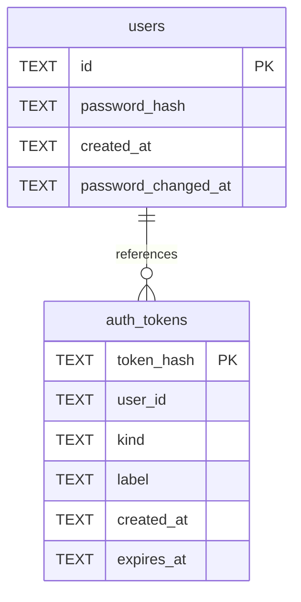

# Accounts Schema

Tables in the primary store created by `backend/infra/accounts_schema.py`.

## Tables 1–2

### `auth_tokens`

| Column | Type | Primary key | NOT NULL | Default | References ||---|---|---|---|---|---|
| `token_hash` | TEXT | Yes | No | — | — |
| `user_id` | TEXT | No | Yes | — | users.id |
| `kind` | TEXT | No | Yes | — | — |
| `label` | TEXT | No | No | — | — |
| `created_at` | TEXT | No | Yes | — | — |
| `expires_at` | TEXT | No | No | — | — |

Indexes: `idx_auth_tokens_expiry` (expires_at), `idx_auth_tokens_user` (user_id, created_at), `sqlite_autoindex_auth_tokens_1` (token_hash, unique).

### `users`

| Column | Type | Primary key | NOT NULL | Default | References ||---|---|---|---|---|---|
| `id` | TEXT | Yes | No | — | — |
| `password_hash` | TEXT | No | Yes | — | — |
| `created_at` | TEXT | No | Yes | — | — |
| `password_changed_at` | TEXT | No | Yes | — | — |

Indexes: `sqlite_autoindex_users_1` (id, unique).
