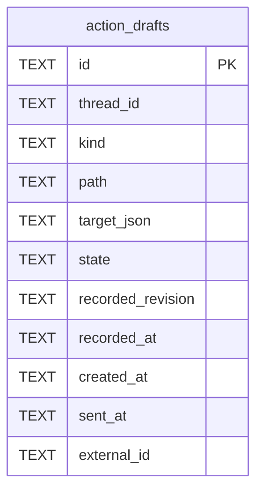

# Action Drafts Schema

Tables in the primary store created by `backend/infra/action_drafts_schema.py`.

## Tables 1–1

### `action_drafts`

| Column | Type | Primary key | NOT NULL | Default | References ||---|---|---|---|---|---|
| `id` | TEXT | Yes | No | — | — |
| `thread_id` | TEXT | No | Yes | — | threads.id |
| `kind` | TEXT | No | Yes | — | — |
| `path` | TEXT | No | Yes | — | — |
| `target_json` | TEXT | No | Yes | '{}' | — |
| `state` | TEXT | No | Yes | 'open' | — |
| `recorded_revision` | TEXT | No | Yes | — | — |
| `recorded_at` | TEXT | No | Yes | — | — |
| `created_at` | TEXT | No | Yes | — | — |
| `sent_at` | TEXT | No | No | — | — |
| `external_id` | TEXT | No | No | — | — |

Indexes: `sqlite_autoindex_action_drafts_1` (id, unique).
