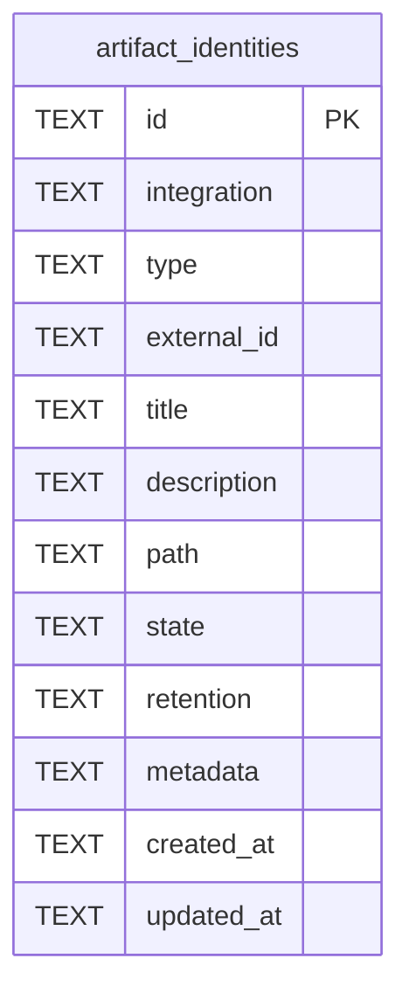

# Artifact Identity Schema

Tables in the primary store created by `backend/infra/artifact_identity_schema.py`.

## Tables 1–1

### `artifact_identities`

| Column | Type | Primary key | NOT NULL | Default | References ||---|---|---|---|---|---|
| `id` | TEXT | Yes | No | — | — |
| `integration` | TEXT | No | Yes | — | — |
| `type` | TEXT | No | Yes | — | — |
| `external_id` | TEXT | No | Yes | — | — |
| `title` | TEXT | No | No | — | — |
| `description` | TEXT | No | No | — | — |
| `path` | TEXT | No | No | — | — |
| `state` | TEXT | No | Yes | 'active' | — |
| `retention` | TEXT | No | Yes | 'durable' | — |
| `metadata` | TEXT | No | No | — | — |
| `created_at` | TEXT | No | Yes | — | — |
| `updated_at` | TEXT | No | Yes | — | — |

Indexes: `idx_artifact_identities_decision_source` (expression), `idx_artifact_identities_upload_path` (path), `idx_measurement_decisions_answered` (expression), `idx_measurement_decisions_raised` (expression), `idx_measurement_decisions_thread` (expression), `sqlite_autoindex_artifact_identities_1` (id, unique), `sqlite_autoindex_artifact_identities_2` (integration, type, external_id, unique).
