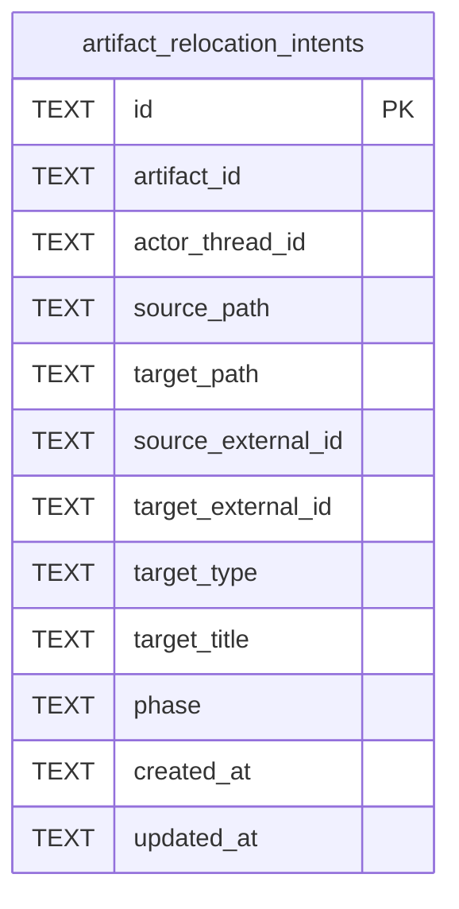

# Artifact Relocation Schema

Tables in the primary store created by `backend/infra/artifact_relocation_schema.py`.

## Tables 1–1

### `artifact_relocation_intents`

| Column | Type | Primary key | NOT NULL | Default | References ||---|---|---|---|---|---|
| `id` | TEXT | Yes | No | — | — |
| `artifact_id` | TEXT | No | Yes | — | artifact_identities.id |
| `actor_thread_id` | TEXT | No | Yes | — | — |
| `source_path` | TEXT | No | Yes | — | — |
| `target_path` | TEXT | No | Yes | — | — |
| `source_external_id` | TEXT | No | Yes | — | — |
| `target_external_id` | TEXT | No | Yes | — | — |
| `target_type` | TEXT | No | No | — | — |
| `target_title` | TEXT | No | No | — | — |
| `phase` | TEXT | No | Yes | — | — |
| `created_at` | TEXT | No | Yes | — | — |
| `updated_at` | TEXT | No | Yes | — | — |

Indexes: `sqlite_autoindex_artifact_relocation_intents_1` (id, unique).
