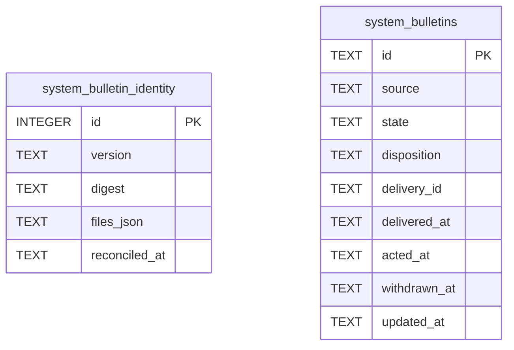

# Bulletin Schema

Tables in the primary store created by `backend/infra/bulletin_schema.py`.

## Tables 1–2

### `system_bulletin_identity`

| Column | Type | Primary key | NOT NULL | Default | References ||---|---|---|---|---|---|
| `id` | INTEGER | Yes | No | — | — |
| `version` | TEXT | No | Yes | — | — |
| `digest` | TEXT | No | Yes | — | — |
| `files_json` | TEXT | No | Yes | — | — |
| `reconciled_at` | TEXT | No | No | — | — |

Indexes: None.

### `system_bulletins`

| Column | Type | Primary key | NOT NULL | Default | References ||---|---|---|---|---|---|
| `id` | TEXT | Yes | No | — | — |
| `source` | TEXT | No | Yes | — | — |
| `state` | TEXT | No | Yes | — | — |
| `disposition` | TEXT | No | No | — | — |
| `delivery_id` | TEXT | No | No | — | — |
| `delivered_at` | TEXT | No | No | — | — |
| `acted_at` | TEXT | No | No | — | — |
| `withdrawn_at` | TEXT | No | No | — | — |
| `updated_at` | TEXT | No | Yes | — | — |

Indexes: `sqlite_autoindex_system_bulletins_1` (id, unique).
