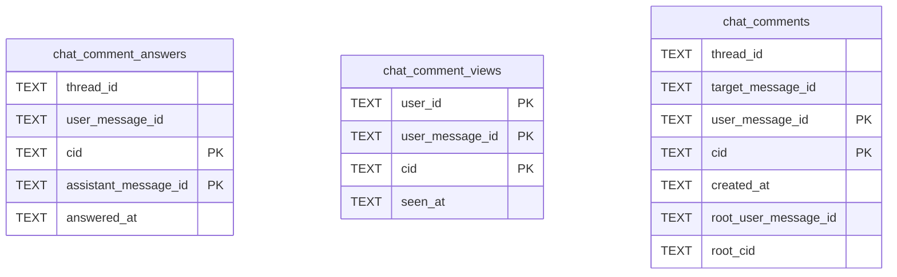

# Chat Comment Schema

Tables in the primary store created by `backend/infra/chat_comment_schema.py`.

## Tables 1–3

### `chat_comment_answers`

| Column | Type | Primary key | NOT NULL | Default | References ||---|---|---|---|---|---|
| `thread_id` | TEXT | No | Yes | — | — |
| `user_message_id` | TEXT | No | Yes | — | — |
| `cid` | TEXT | Yes | Yes | — | — |
| `assistant_message_id` | TEXT | Yes | Yes | — | — |
| `answered_at` | TEXT | No | Yes | — | — |

Indexes: `idx_chat_comment_answers_comment` (thread_id, user_message_id, cid), `idx_chat_comment_answers_thread_time` (thread_id, answered_at), `sqlite_autoindex_chat_comment_answers_1` (assistant_message_id, cid, unique).

### `chat_comment_views`

| Column | Type | Primary key | NOT NULL | Default | References ||---|---|---|---|---|---|
| `user_id` | TEXT | Yes | Yes | — | — |
| `user_message_id` | TEXT | Yes | Yes | — | — |
| `cid` | TEXT | Yes | Yes | — | — |
| `seen_at` | TEXT | No | Yes | — | — |

Indexes: `sqlite_autoindex_chat_comment_views_1` (user_message_id, cid, user_id, unique).

### `chat_comments`

| Column | Type | Primary key | NOT NULL | Default | References ||---|---|---|---|---|---|
| `thread_id` | TEXT | No | Yes | — | — |
| `target_message_id` | TEXT | No | Yes | — | — |
| `user_message_id` | TEXT | Yes | Yes | — | — |
| `cid` | TEXT | Yes | Yes | — | — |
| `created_at` | TEXT | No | Yes | — | — |
| `root_user_message_id` | TEXT | No | No | — | — |
| `root_cid` | TEXT | No | No | — | — |

Indexes: `idx_chat_comments_target` (thread_id, target_message_id), `sqlite_autoindex_chat_comments_1` (user_message_id, cid, unique).
