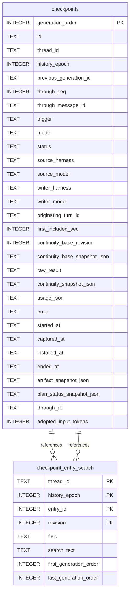

# Checkpoint Schema

Tables in the primary store created by `backend/infra/checkpoint_schema.py`.

## Tables 1–2

### `checkpoint_entry_search`

| Column | Type | Primary key | NOT NULL | Default | References ||---|---|---|---|---|---|
| `thread_id` | TEXT | Yes | Yes | — | threads.id |
| `history_epoch` | INTEGER | Yes | Yes | — | — |
| `entry_id` | INTEGER | Yes | Yes | — | — |
| `revision` | INTEGER | Yes | Yes | — | — |
| `field` | TEXT | No | Yes | — | — |
| `search_text` | TEXT | No | Yes | — | — |
| `first_generation_order` | INTEGER | No | Yes | — | checkpoints.generation_order |
| `last_generation_order` | INTEGER | No | Yes | — | checkpoints.generation_order |

Indexes: `checkpoint_entry_search_identity` (thread_id, history_epoch, entry_id), `sqlite_autoindex_checkpoint_entry_search_1` (thread_id, history_epoch, entry_id, revision, unique).

### `checkpoints`

| Column | Type | Primary key | NOT NULL | Default | References ||---|---|---|---|---|---|
| `generation_order` | INTEGER | Yes | No | — | — |
| `id` | TEXT | No | Yes | — | — |
| `thread_id` | TEXT | No | Yes | — | threads.id |
| `history_epoch` | INTEGER | No | Yes | — | — |
| `previous_generation_id` | TEXT | No | No | — | — |
| `through_seq` | INTEGER | No | Yes | — | — |
| `through_message_id` | TEXT | No | Yes | — | — |
| `trigger` | TEXT | No | Yes | — | — |
| `mode` | TEXT | No | Yes | — | — |
| `status` | TEXT | No | Yes | — | — |
| `source_harness` | TEXT | No | Yes | — | — |
| `source_model` | TEXT | No | Yes | — | — |
| `writer_harness` | TEXT | No | Yes | — | — |
| `writer_model` | TEXT | No | Yes | — | — |
| `originating_turn_id` | TEXT | No | No | — | — |
| `first_included_seq` | INTEGER | No | No | — | — |
| `continuity_base_revision` | INTEGER | No | Yes | — | — |
| `continuity_base_snapshot_json` | TEXT | No | Yes | — | — |
| `raw_result` | TEXT | No | No | — | — |
| `continuity_snapshot_json` | TEXT | No | No | — | — |
| `usage_json` | TEXT | No | No | — | — |
| `error` | TEXT | No | No | — | — |
| `started_at` | TEXT | No | Yes | — | — |
| `captured_at` | TEXT | No | No | — | — |
| `installed_at` | TEXT | No | No | — | — |
| `ended_at` | TEXT | No | No | — | — |
| `artifact_snapshot_json` | TEXT | No | No | — | — |
| `plan_status_snapshot_json` | TEXT | No | No | — | — |
| `through_at` | TEXT | No | No | — | — |
| `adopted_input_tokens` | INTEGER | No | No | — | — |

Indexes: `checkpoints_current` (thread_id, history_epoch, status, generation_order), `checkpoints_idle_boundary` (thread_id, history_epoch, through_message_id), `checkpoints_listing` (thread_id, generation_order), `checkpoints_one_live` (thread_id, unique), `sqlite_autoindex_checkpoints_1` (id, unique).
