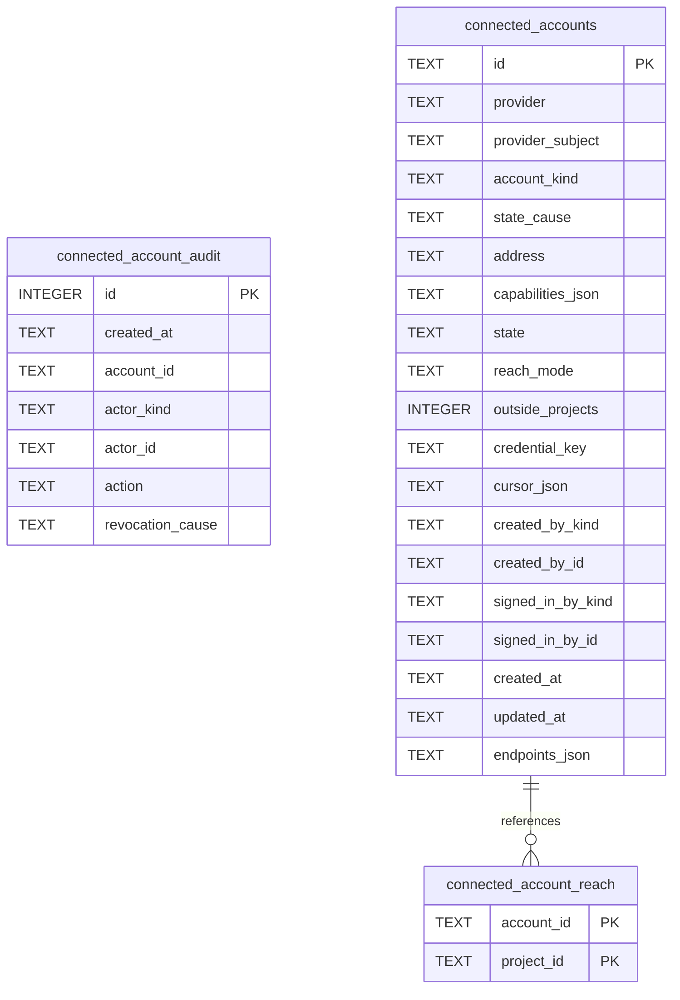

# Connected Accounts Schema

Tables in the primary store created by `backend/infra/connected_accounts_schema.py`.

## Tables 1–3

### `connected_account_audit`

| Column | Type | Primary key | NOT NULL | Default | References ||---|---|---|---|---|---|
| `id` | INTEGER | Yes | No | — | — |
| `created_at` | TEXT | No | Yes | — | — |
| `account_id` | TEXT | No | Yes | — | — |
| `actor_kind` | TEXT | No | Yes | — | — |
| `actor_id` | TEXT | No | Yes | — | — |
| `action` | TEXT | No | Yes | — | — |
| `revocation_cause` | TEXT | No | No | — | — |

Indexes: `idx_connected_account_audit_account` (account_id, id).

### `connected_account_reach`

| Column | Type | Primary key | NOT NULL | Default | References ||---|---|---|---|---|---|
| `account_id` | TEXT | Yes | Yes | — | connected_accounts.id |
| `project_id` | TEXT | Yes | Yes | — | projects.id |

Indexes: `idx_connected_account_reach_project` (project_id, account_id), `sqlite_autoindex_connected_account_reach_1` (account_id, project_id, unique).

### `connected_accounts`

| Column | Type | Primary key | NOT NULL | Default | References ||---|---|---|---|---|---|
| `id` | TEXT | Yes | No | — | — |
| `provider` | TEXT | No | Yes | — | — |
| `provider_subject` | TEXT | No | No | — | — |
| `account_kind` | TEXT | No | No | — | — |
| `state_cause` | TEXT | No | No | — | — |
| `address` | TEXT | No | Yes | — | — |
| `capabilities_json` | TEXT | No | Yes | — | — |
| `state` | TEXT | No | Yes | — | — |
| `reach_mode` | TEXT | No | Yes | — | — |
| `outside_projects` | INTEGER | No | Yes | 0 | — |
| `credential_key` | TEXT | No | Yes | — | — |
| `cursor_json` | TEXT | No | No | — | — |
| `created_by_kind` | TEXT | No | Yes | — | — |
| `created_by_id` | TEXT | No | Yes | — | — |
| `signed_in_by_kind` | TEXT | No | No | — | — |
| `signed_in_by_id` | TEXT | No | No | — | — |
| `created_at` | TEXT | No | Yes | — | — |
| `updated_at` | TEXT | No | Yes | — | — |
| `endpoints_json` | TEXT | No | No | — | — |

Indexes: `idx_connected_accounts_provider` (provider, state), `sqlite_autoindex_connected_accounts_1` (id, unique), `sqlite_autoindex_connected_accounts_2` (credential_key, unique), `sqlite_autoindex_connected_accounts_3` (provider, provider_subject, unique).
