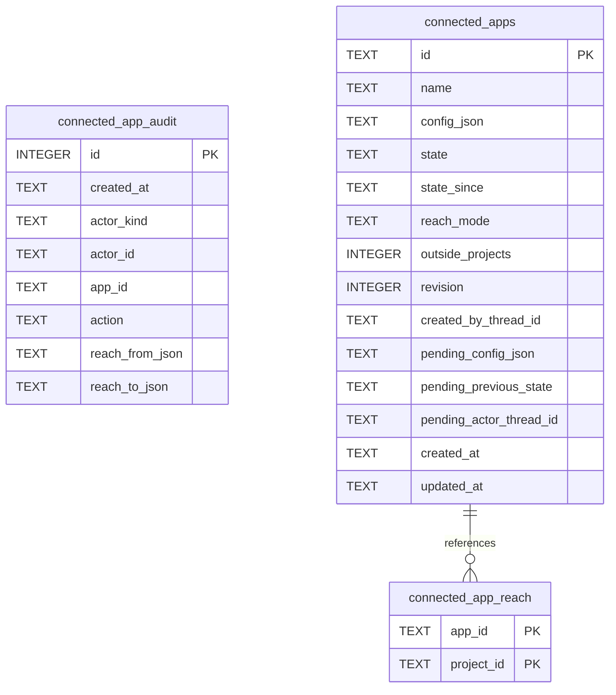

# Connected Apps Schema

Tables in the primary store created by `backend/infra/connected_apps_schema.py`.

## Tables 1–3

### `connected_app_audit`

| Column | Type | Primary key | NOT NULL | Default | References ||---|---|---|---|---|---|
| `id` | INTEGER | Yes | No | — | — |
| `created_at` | TEXT | No | Yes | — | — |
| `actor_kind` | TEXT | No | Yes | — | — |
| `actor_id` | TEXT | No | Yes | — | — |
| `app_id` | TEXT | No | Yes | — | — |
| `action` | TEXT | No | Yes | — | — |
| `reach_from_json` | TEXT | No | No | — | — |
| `reach_to_json` | TEXT | No | No | — | — |

Indexes: `idx_connected_app_audit_app` (app_id, id).

### `connected_app_reach`

| Column | Type | Primary key | NOT NULL | Default | References ||---|---|---|---|---|---|
| `app_id` | TEXT | Yes | Yes | — | connected_apps.id |
| `project_id` | TEXT | Yes | Yes | — | projects.id |

Indexes: `idx_connected_app_reach_project` (project_id, app_id), `sqlite_autoindex_connected_app_reach_1` (app_id, project_id, unique).

### `connected_apps`

| Column | Type | Primary key | NOT NULL | Default | References ||---|---|---|---|---|---|
| `id` | TEXT | Yes | No | — | — |
| `name` | TEXT | No | Yes | — | — |
| `config_json` | TEXT | No | Yes | — | — |
| `state` | TEXT | No | Yes | 'disconnected' | — |
| `state_since` | TEXT | No | Yes | — | — |
| `reach_mode` | TEXT | No | Yes | — | — |
| `outside_projects` | INTEGER | No | Yes | 0 | — |
| `revision` | INTEGER | No | Yes | 1 | — |
| `created_by_thread_id` | TEXT | No | No | — | — |
| `pending_config_json` | TEXT | No | No | — | — |
| `pending_previous_state` | TEXT | No | No | — | — |
| `pending_actor_thread_id` | TEXT | No | No | — | — |
| `created_at` | TEXT | No | Yes | — | — |
| `updated_at` | TEXT | No | Yes | — | — |

Indexes: `idx_connected_apps_name` (name), `sqlite_autoindex_connected_apps_1` (id, unique).
