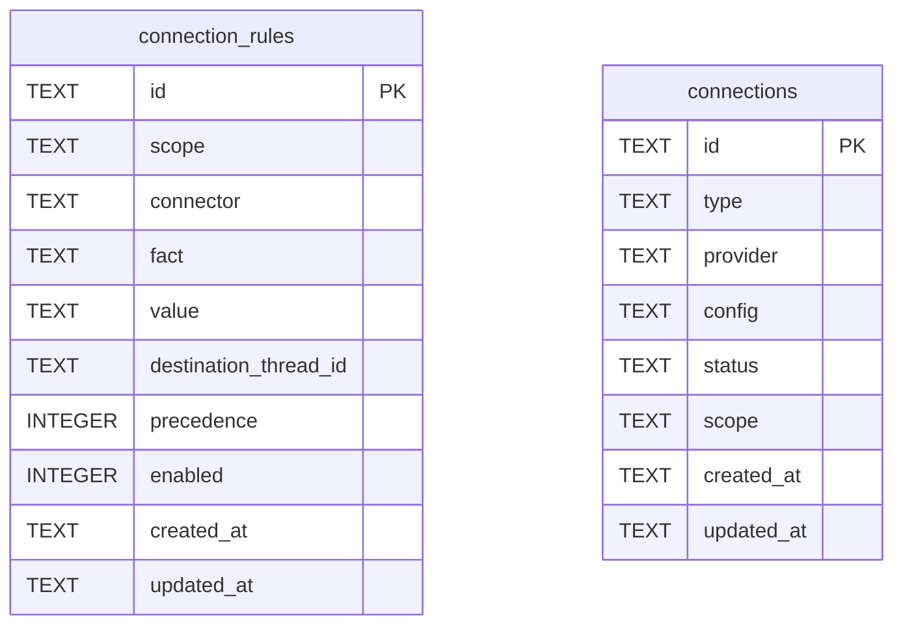

# Connection Schema

Tables in the primary store created by `backend/infra/connection_schema.py`.

## Tables 1–2

### `connection_rules`

| Column | Type | Primary key | NOT NULL | Default | References ||---|---|---|---|---|---|
| `id` | TEXT | Yes | No | — | — |
| `scope` | TEXT | No | Yes | 'global' | — |
| `connector` | TEXT | No | Yes | — | — |
| `fact` | TEXT | No | Yes | — | — |
| `value` | TEXT | No | Yes | — | — |
| `destination_thread_id` | TEXT | No | Yes | — | — |
| `precedence` | INTEGER | No | Yes | 100 | — |
| `enabled` | INTEGER | No | Yes | 1 | — |
| `created_at` | TEXT | No | Yes | — | — |
| `updated_at` | TEXT | No | Yes | — | — |

Indexes: `idx_connection_rules_match` (connector, enabled, precedence, created_at), `sqlite_autoindex_connection_rules_1` (id, unique).

### `connections`

| Column | Type | Primary key | NOT NULL | Default | References ||---|---|---|---|---|---|
| `id` | TEXT | Yes | No | — | — |
| `type` | TEXT | No | Yes | — | — |
| `provider` | TEXT | No | Yes | — | — |
| `config` | TEXT | No | No | — | — |
| `status` | TEXT | No | Yes | 'available' | — |
| `scope` | TEXT | No | Yes | 'global' | — |
| `created_at` | TEXT | No | Yes | — | — |
| `updated_at` | TEXT | No | Yes | — | — |

Indexes: `idx_connections_status` (type, status), `sqlite_autoindex_connections_1` (id, unique), `sqlite_autoindex_connections_2` (provider, unique).
