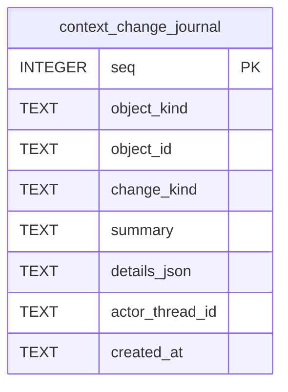

# Context Change Schema

Tables in the primary store created by `backend/infra/context_change_schema.py`.

## Tables 1–1

### `context_change_journal`

| Column | Type | Primary key | NOT NULL | Default | References ||---|---|---|---|---|---|
| `seq` | INTEGER | Yes | No | — | — |
| `object_kind` | TEXT | No | Yes | — | — |
| `object_id` | TEXT | No | Yes | — | — |
| `change_kind` | TEXT | No | Yes | — | — |
| `summary` | TEXT | No | Yes | — | — |
| `details_json` | TEXT | No | No | — | — |
| `actor_thread_id` | TEXT | No | No | — | — |
| `created_at` | TEXT | No | Yes | — | — |

Indexes: `idx_context_changes_object` (object_kind, object_id, seq).
