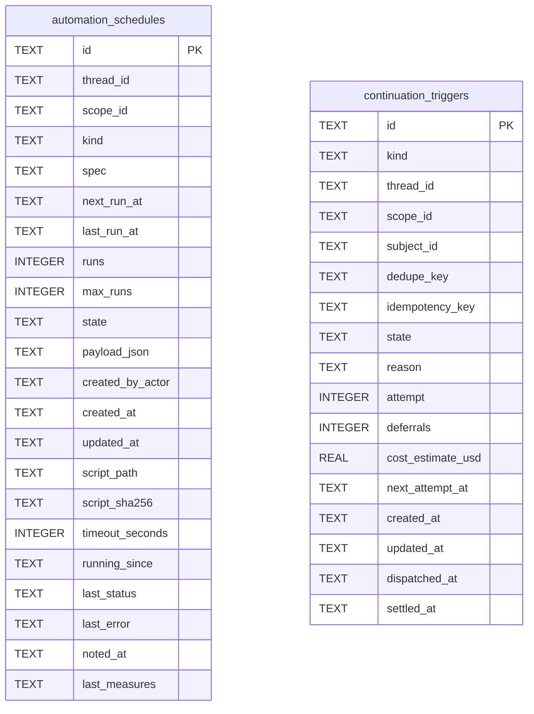

# Continuation Schema

Tables in the primary store created by `backend/infra/continuation_schema.py`.

## Tables 1–2

### `automation_schedules`

| Column | Type | Primary key | NOT NULL | Default | References ||---|---|---|---|---|---|
| `id` | TEXT | Yes | No | — | — |
| `thread_id` | TEXT | No | Yes | — | threads.id |
| `scope_id` | TEXT | No | Yes | — | — |
| `kind` | TEXT | No | Yes | — | — |
| `spec` | TEXT | No | Yes | — | — |
| `next_run_at` | TEXT | No | No | — | — |
| `last_run_at` | TEXT | No | No | — | — |
| `runs` | INTEGER | No | Yes | 0 | — |
| `max_runs` | INTEGER | No | Yes | — | — |
| `state` | TEXT | No | Yes | 'active' | — |
| `payload_json` | TEXT | No | No | — | — |
| `created_by_actor` | TEXT | No | Yes | — | — |
| `created_at` | TEXT | No | Yes | — | — |
| `updated_at` | TEXT | No | Yes | — | — |
| `script_path` | TEXT | No | No | — | — |
| `script_sha256` | TEXT | No | No | — | — |
| `timeout_seconds` | INTEGER | No | No | — | — |
| `running_since` | TEXT | No | No | — | — |
| `last_status` | TEXT | No | No | — | — |
| `last_error` | TEXT | No | No | — | — |
| `noted_at` | TEXT | No | No | — | — |
| `last_measures` | TEXT | No | No | — | — |

Indexes: `idx_automation_schedules_due` (state, next_run_at), `idx_automation_schedules_scope` (scope_id, next_run_at), `sqlite_autoindex_automation_schedules_1` (id, unique).

### `continuation_triggers`

| Column | Type | Primary key | NOT NULL | Default | References ||---|---|---|---|---|---|
| `id` | TEXT | Yes | No | — | — |
| `kind` | TEXT | No | Yes | — | — |
| `thread_id` | TEXT | No | Yes | — | threads.id |
| `scope_id` | TEXT | No | Yes | — | — |
| `subject_id` | TEXT | No | No | — | — |
| `dedupe_key` | TEXT | No | Yes | — | — |
| `idempotency_key` | TEXT | No | No | — | — |
| `state` | TEXT | No | Yes | 'pending' | — |
| `reason` | TEXT | No | No | — | — |
| `attempt` | INTEGER | No | Yes | 0 | — |
| `deferrals` | INTEGER | No | Yes | 0 | — |
| `cost_estimate_usd` | REAL | No | Yes | 0.0 | — |
| `next_attempt_at` | TEXT | No | No | — | — |
| `created_at` | TEXT | No | Yes | — | — |
| `updated_at` | TEXT | No | Yes | — | — |
| `dispatched_at` | TEXT | No | No | — | — |
| `settled_at` | TEXT | No | No | — | — |

Indexes: `idx_continuation_triggers_live` (dedupe_key, unique), `idx_continuation_triggers_scope` (scope_id, created_at), `idx_continuation_triggers_state` (state, next_attempt_at), `sqlite_autoindex_continuation_triggers_1` (id, unique).
