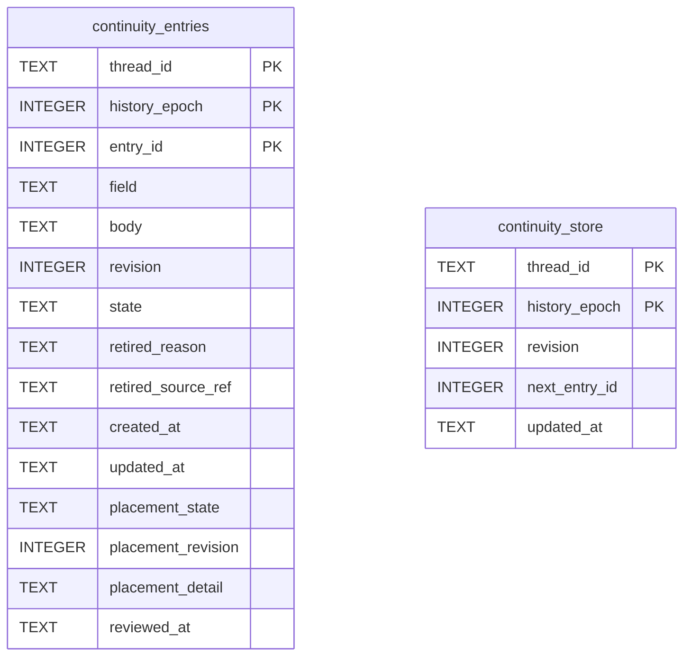

# Continuity Schema

Tables in the primary store created by `backend/infra/continuity_schema.py`.

## Tables 1–2

### `continuity_entries`

| Column | Type | Primary key | NOT NULL | Default | References ||---|---|---|---|---|---|
| `thread_id` | TEXT | Yes | Yes | — | threads.id |
| `history_epoch` | INTEGER | Yes | Yes | — | — |
| `entry_id` | INTEGER | Yes | Yes | — | — |
| `field` | TEXT | No | Yes | — | — |
| `body` | TEXT | No | Yes | — | — |
| `revision` | INTEGER | No | Yes | 1 | — |
| `state` | TEXT | No | Yes | 'active' | — |
| `retired_reason` | TEXT | No | No | — | — |
| `retired_source_ref` | TEXT | No | No | — | — |
| `created_at` | TEXT | No | Yes | — | — |
| `updated_at` | TEXT | No | Yes | — | — |
| `placement_state` | TEXT | No | No | — | — |
| `placement_revision` | INTEGER | No | No | — | — |
| `placement_detail` | TEXT | No | No | — | — |
| `reviewed_at` | TEXT | No | No | — | — |

Indexes: `idx_continuity_entries_active` (thread_id, history_epoch, field, state), `sqlite_autoindex_continuity_entries_1` (thread_id, history_epoch, entry_id, unique).

### `continuity_store`

| Column | Type | Primary key | NOT NULL | Default | References ||---|---|---|---|---|---|
| `thread_id` | TEXT | Yes | Yes | — | threads.id |
| `history_epoch` | INTEGER | Yes | Yes | — | — |
| `revision` | INTEGER | No | Yes | 0 | — |
| `next_entry_id` | INTEGER | No | Yes | 1 | — |
| `updated_at` | TEXT | No | Yes | — | — |

Indexes: `sqlite_autoindex_continuity_store_1` (thread_id, history_epoch, unique).
