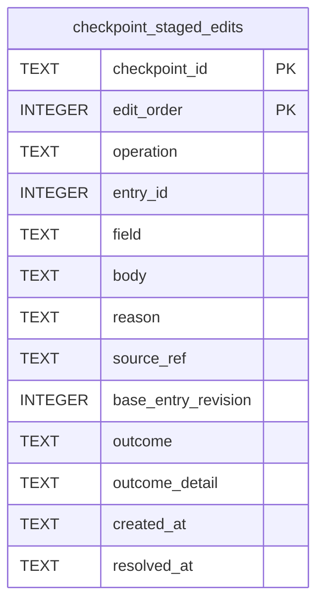

# Continuity Staging

Tables in the primary store created by `backend/infra/continuity_staging.py`.

## Tables 1–1

### `checkpoint_staged_edits`

| Column | Type | Primary key | NOT NULL | Default | References ||---|---|---|---|---|---|
| `checkpoint_id` | TEXT | Yes | Yes | — | checkpoints.id |
| `edit_order` | INTEGER | Yes | Yes | — | — |
| `operation` | TEXT | No | Yes | — | — |
| `entry_id` | INTEGER | No | Yes | — | — |
| `field` | TEXT | No | Yes | — | — |
| `body` | TEXT | No | No | — | — |
| `reason` | TEXT | No | No | — | — |
| `source_ref` | TEXT | No | No | — | — |
| `base_entry_revision` | INTEGER | No | No | — | — |
| `outcome` | TEXT | No | Yes | 'pending' | — |
| `outcome_detail` | TEXT | No | No | — | — |
| `created_at` | TEXT | No | Yes | CURRENT_TIMESTAMP | — |
| `resolved_at` | TEXT | No | No | — | — |

Indexes: `checkpoint_staged_edits_target` (checkpoint_id, entry_id, edit_order), `sqlite_autoindex_checkpoint_staged_edits_1` (checkpoint_id, edit_order, unique).
