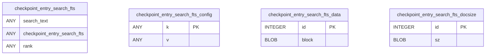
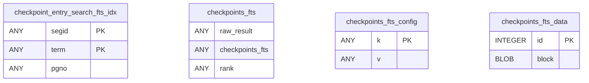
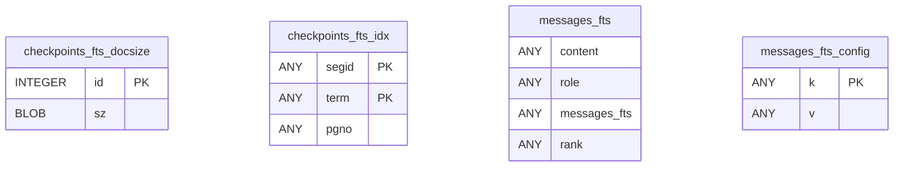
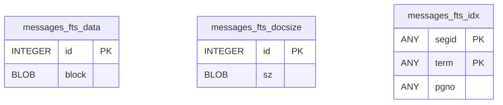

# Db Fts

Tables in the primary store created by `backend/infra/db_fts.py`.

## Tables 1–4

### `checkpoint_entry_search_fts`

| Column | Type | Primary key | NOT NULL | Default | References ||---|---|---|---|---|---|
| `search_text` |  | No | No | — | — |
| `checkpoint_entry_search_fts` |  | No | No | — | — |
| `rank` |  | No | No | — | — |

Indexes: None.

### `checkpoint_entry_search_fts_config`

| Column | Type | Primary key | NOT NULL | Default | References ||---|---|---|---|---|---|
| `k` |  | Yes | Yes | — | — |
| `v` |  | No | No | — | — |

Indexes: `sqlite_autoindex_checkpoint_entry_search_fts_config_1` (k, unique).

### `checkpoint_entry_search_fts_data`

| Column | Type | Primary key | NOT NULL | Default | References ||---|---|---|---|---|---|
| `id` | INTEGER | Yes | No | — | — |
| `block` | BLOB | No | No | — | — |

Indexes: None.

### `checkpoint_entry_search_fts_docsize`

| Column | Type | Primary key | NOT NULL | Default | References ||---|---|---|---|---|---|
| `id` | INTEGER | Yes | No | — | — |
| `sz` | BLOB | No | No | — | — |

Indexes: None.

## Tables 5–8

### `checkpoint_entry_search_fts_idx`

| Column | Type | Primary key | NOT NULL | Default | References ||---|---|---|---|---|---|
| `segid` |  | Yes | Yes | — | — |
| `term` |  | Yes | Yes | — | — |
| `pgno` |  | No | No | — | — |

Indexes: `sqlite_autoindex_checkpoint_entry_search_fts_idx_1` (segid, term, unique).

### `checkpoints_fts`

| Column | Type | Primary key | NOT NULL | Default | References ||---|---|---|---|---|---|
| `raw_result` |  | No | No | — | — |
| `checkpoints_fts` |  | No | No | — | — |
| `rank` |  | No | No | — | — |

Indexes: None.

### `checkpoints_fts_config`

| Column | Type | Primary key | NOT NULL | Default | References ||---|---|---|---|---|---|
| `k` |  | Yes | Yes | — | — |
| `v` |  | No | No | — | — |

Indexes: `sqlite_autoindex_checkpoints_fts_config_1` (k, unique).

### `checkpoints_fts_data`

| Column | Type | Primary key | NOT NULL | Default | References ||---|---|---|---|---|---|
| `id` | INTEGER | Yes | No | — | — |
| `block` | BLOB | No | No | — | — |

Indexes: None.

## Tables 9–12

### `checkpoints_fts_docsize`

| Column | Type | Primary key | NOT NULL | Default | References ||---|---|---|---|---|---|
| `id` | INTEGER | Yes | No | — | — |
| `sz` | BLOB | No | No | — | — |

Indexes: None.

### `checkpoints_fts_idx`

| Column | Type | Primary key | NOT NULL | Default | References ||---|---|---|---|---|---|
| `segid` |  | Yes | Yes | — | — |
| `term` |  | Yes | Yes | — | — |
| `pgno` |  | No | No | — | — |

Indexes: `sqlite_autoindex_checkpoints_fts_idx_1` (segid, term, unique).

### `messages_fts`

| Column | Type | Primary key | NOT NULL | Default | References ||---|---|---|---|---|---|
| `content` |  | No | No | — | — |
| `role` |  | No | No | — | — |
| `messages_fts` |  | No | No | — | — |
| `rank` |  | No | No | — | — |

Indexes: None.

### `messages_fts_config`

| Column | Type | Primary key | NOT NULL | Default | References ||---|---|---|---|---|---|
| `k` |  | Yes | Yes | — | — |
| `v` |  | No | No | — | — |

Indexes: `sqlite_autoindex_messages_fts_config_1` (k, unique).

## Tables 13–15

### `messages_fts_data`

| Column | Type | Primary key | NOT NULL | Default | References ||---|---|---|---|---|---|
| `id` | INTEGER | Yes | No | — | — |
| `block` | BLOB | No | No | — | — |

Indexes: None.

### `messages_fts_docsize`

| Column | Type | Primary key | NOT NULL | Default | References ||---|---|---|---|---|---|
| `id` | INTEGER | Yes | No | — | — |
| `sz` | BLOB | No | No | — | — |

Indexes: None.

### `messages_fts_idx`

| Column | Type | Primary key | NOT NULL | Default | References ||---|---|---|---|---|---|
| `segid` |  | Yes | Yes | — | — |
| `term` |  | Yes | Yes | — | — |
| `pgno` |  | No | No | — | — |

Indexes: `sqlite_autoindex_messages_fts_idx_1` (segid, term, unique).
