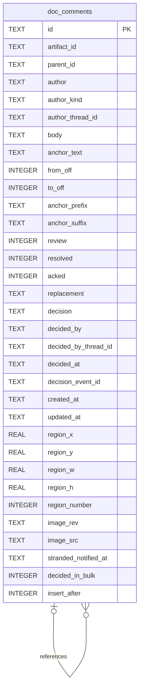

# Doc Comments Schema

Tables in the primary store created by `backend/infra/doc_comments_schema.py`.

## Tables 1–1

### `doc_comments`

| Column | Type | Primary key | NOT NULL | Default | References ||---|---|---|---|---|---|
| `id` | TEXT | Yes | No | — | — |
| `artifact_id` | TEXT | No | Yes | — | — |
| `parent_id` | TEXT | No | No | — | doc_comments.id |
| `author` | TEXT | No | Yes | — | — |
| `author_kind` | TEXT | No | Yes | 'user' | — |
| `author_thread_id` | TEXT | No | No | — | — |
| `body` | TEXT | No | Yes | — | — |
| `anchor_text` | TEXT | No | No | — | — |
| `from_off` | INTEGER | No | No | — | — |
| `to_off` | INTEGER | No | No | — | — |
| `anchor_prefix` | TEXT | No | No | — | — |
| `anchor_suffix` | TEXT | No | No | — | — |
| `review` | INTEGER | No | Yes | 0 | — |
| `resolved` | INTEGER | No | Yes | 0 | — |
| `acked` | INTEGER | No | Yes | 0 | — |
| `replacement` | TEXT | No | No | — | — |
| `decision` | TEXT | No | No | — | — |
| `decided_by` | TEXT | No | No | — | — |
| `decided_by_thread_id` | TEXT | No | No | — | — |
| `decided_at` | TEXT | No | No | — | — |
| `decision_event_id` | TEXT | No | No | — | — |
| `created_at` | TEXT | No | Yes | — | — |
| `updated_at` | TEXT | No | Yes | — | — |
| `region_x` | REAL | No | No | — | — |
| `region_y` | REAL | No | No | — | — |
| `region_w` | REAL | No | No | — | — |
| `region_h` | REAL | No | No | — | — |
| `region_number` | INTEGER | No | No | — | — |
| `image_rev` | TEXT | No | No | — | — |
| `image_src` | TEXT | No | No | — | — |
| `stranded_notified_at` | TEXT | No | No | — | — |
| `decided_in_bulk` | INTEGER | No | No | — | — |
| `insert_after` | INTEGER | No | Yes | 0 | — |

Indexes: `idx_doc_comments_artifact` (artifact_id, created_at), `idx_doc_comments_decision_event` (decision_event_id), `idx_doc_comments_region_number` (artifact_id, expression, region_number, unique), `idx_doc_comments_user_created` (created_at, id), `sqlite_autoindex_doc_comments_1` (id, unique).
