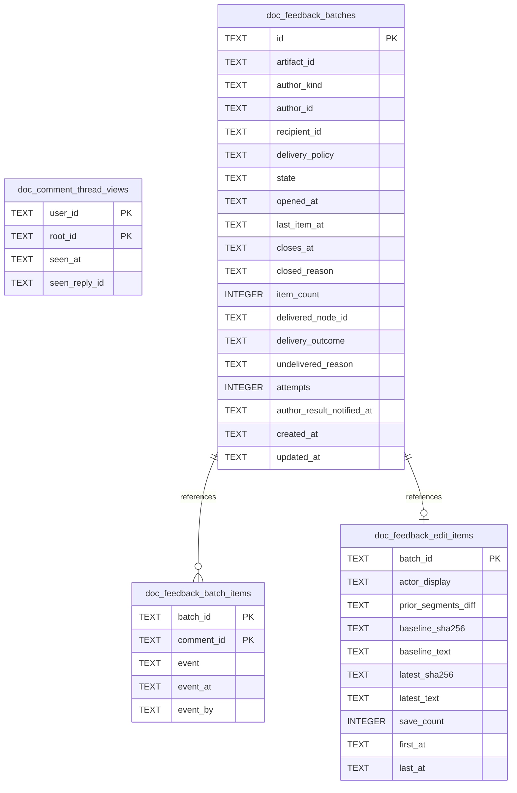

# Doc Feedback Schema

Tables in the primary store created by `backend/infra/doc_feedback_schema.py`.

## Tables 1–4

### `doc_comment_thread_views`

| Column | Type | Primary key | NOT NULL | Default | References ||---|---|---|---|---|---|
| `user_id` | TEXT | Yes | Yes | — | — |
| `root_id` | TEXT | Yes | Yes | — | doc_comments.id |
| `seen_at` | TEXT | No | Yes | — | — |
| `seen_reply_id` | TEXT | No | Yes | — | — |

Indexes: `sqlite_autoindex_doc_comment_thread_views_1` (user_id, root_id, unique).

### `doc_feedback_batch_items`

| Column | Type | Primary key | NOT NULL | Default | References ||---|---|---|---|---|---|
| `batch_id` | TEXT | Yes | Yes | — | doc_feedback_batches.id |
| `comment_id` | TEXT | Yes | Yes | — | doc_comments.id |
| `event` | TEXT | No | No | — | — |
| `event_at` | TEXT | No | No | — | — |
| `event_by` | TEXT | No | No | — | — |

Indexes: `idx_doc_feedback_batch_items_comment` (comment_id), `sqlite_autoindex_doc_feedback_batch_items_1` (batch_id, comment_id, unique).

### `doc_feedback_batches`

| Column | Type | Primary key | NOT NULL | Default | References ||---|---|---|---|---|---|
| `id` | TEXT | Yes | No | — | — |
| `artifact_id` | TEXT | No | Yes | — | artifact_identities.id |
| `author_kind` | TEXT | No | Yes | — | — |
| `author_id` | TEXT | No | Yes | — | — |
| `recipient_id` | TEXT | No | Yes | — | — |
| `delivery_policy` | TEXT | No | Yes | 'immediate' | — |
| `state` | TEXT | No | Yes | 'open' | — |
| `opened_at` | TEXT | No | Yes | — | — |
| `last_item_at` | TEXT | No | Yes | — | — |
| `closes_at` | TEXT | No | Yes | — | — |
| `closed_reason` | TEXT | No | No | — | — |
| `item_count` | INTEGER | No | Yes | 0 | — |
| `delivered_node_id` | TEXT | No | No | — | plan_nodes.id |
| `delivery_outcome` | TEXT | No | No | — | — |
| `undelivered_reason` | TEXT | No | No | — | — |
| `attempts` | INTEGER | No | Yes | 0 | — |
| `author_result_notified_at` | TEXT | No | No | — | — |
| `created_at` | TEXT | No | Yes | — | — |
| `updated_at` | TEXT | No | Yes | — | — |

Indexes: `idx_doc_feedback_batches_author` (author_kind, author_id, state, updated_at), `idx_doc_feedback_batches_due` (state, closes_at), `idx_doc_feedback_batches_open` (author_kind, author_id, artifact_id, recipient_id, delivery_policy, unique), `idx_doc_feedback_batches_recipient_open` (recipient_id, author_kind, author_id, delivery_policy, state), `sqlite_autoindex_doc_feedback_batches_1` (id, unique).

### `doc_feedback_edit_items`

| Column | Type | Primary key | NOT NULL | Default | References ||---|---|---|---|---|---|
| `batch_id` | TEXT | Yes | No | — | doc_feedback_batches.id |
| `actor_display` | TEXT | No | Yes | — | — |
| `prior_segments_diff` | TEXT | No | Yes | '' | — |
| `baseline_sha256` | TEXT | No | Yes | — | — |
| `baseline_text` | TEXT | No | Yes | — | — |
| `latest_sha256` | TEXT | No | Yes | — | — |
| `latest_text` | TEXT | No | Yes | — | — |
| `save_count` | INTEGER | No | Yes | — | — |
| `first_at` | TEXT | No | Yes | — | — |
| `last_at` | TEXT | No | Yes | — | — |

Indexes: `sqlite_autoindex_doc_feedback_edit_items_1` (batch_id, unique).
