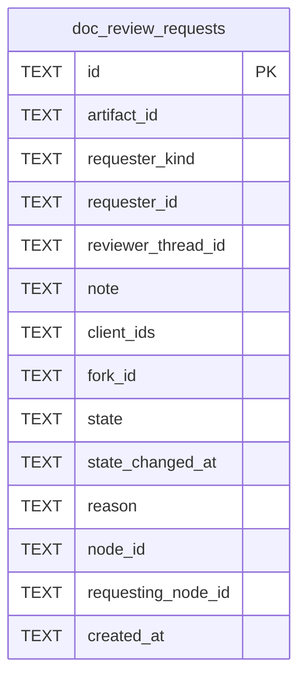

# Doc Review Schema

Tables in the primary store created by `backend/infra/doc_review_schema.py`.

## Tables 1–1

### `doc_review_requests`

| Column | Type | Primary key | NOT NULL | Default | References ||---|---|---|---|---|---|
| `id` | TEXT | Yes | No | — | — |
| `artifact_id` | TEXT | No | Yes | — | artifact_identities.id |
| `requester_kind` | TEXT | No | Yes | — | — |
| `requester_id` | TEXT | No | Yes | — | — |
| `reviewer_thread_id` | TEXT | No | Yes | — | threads.id |
| `note` | TEXT | No | No | — | — |
| `client_ids` | TEXT | No | Yes | — | — |
| `fork_id` | TEXT | No | No | — | — |
| `state` | TEXT | No | Yes | 'handed_back' | — |
| `state_changed_at` | TEXT | No | No | — | — |
| `reason` | TEXT | No | No | — | — |
| `node_id` | TEXT | No | No | — | plan_nodes.id |
| `requesting_node_id` | TEXT | No | No | — | plan_nodes.id |
| `created_at` | TEXT | No | Yes | — | — |

Indexes: `idx_doc_review_requests_reviewer` (reviewer_thread_id, created_at), `idx_doc_review_reviewer` (artifact_id, reviewer_thread_id, created_at), `sqlite_autoindex_doc_review_requests_1` (id, unique).
