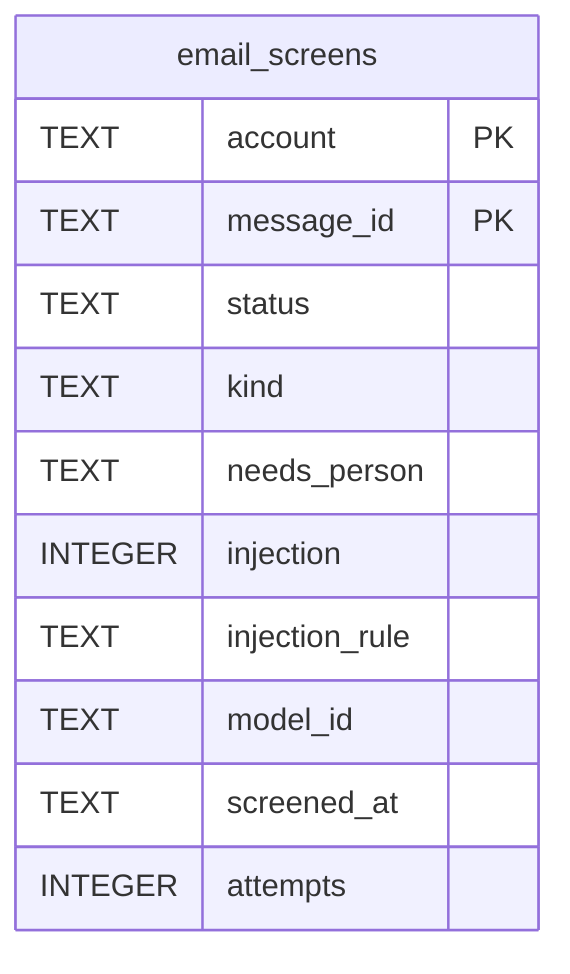

# Email Screens Schema

Tables in the primary store created by `backend/infra/email_screens_schema.py`.

## Tables 1–1

### `email_screens`

| Column | Type | Primary key | NOT NULL | Default | References ||---|---|---|---|---|---|
| `account` | TEXT | Yes | Yes | — | — |
| `message_id` | TEXT | Yes | Yes | — | — |
| `status` | TEXT | No | Yes | — | — |
| `kind` | TEXT | No | No | — | — |
| `needs_person` | TEXT | No | No | — | — |
| `injection` | INTEGER | No | No | — | — |
| `injection_rule` | TEXT | No | No | — | — |
| `model_id` | TEXT | No | No | — | — |
| `screened_at` | TEXT | No | Yes | — | — |
| `attempts` | INTEGER | No | Yes | 1 | — |

Indexes: `sqlite_autoindex_email_screens_1` (account, message_id, unique).
