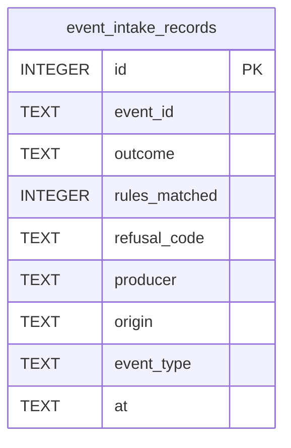

# Event Intake Schema

Tables in the primary store created by `backend/infra/event_intake_schema.py`.

## Tables 1–1

### `event_intake_records`

| Column | Type | Primary key | NOT NULL | Default | References ||---|---|---|---|---|---|
| `id` | INTEGER | Yes | No | — | — |
| `event_id` | TEXT | No | Yes | — | — |
| `outcome` | TEXT | No | Yes | — | — |
| `rules_matched` | INTEGER | No | Yes | — | — |
| `refusal_code` | TEXT | No | No | — | — |
| `producer` | TEXT | No | No | — | — |
| `origin` | TEXT | No | No | — | — |
| `event_type` | TEXT | No | No | — | — |
| `at` | TEXT | No | Yes | — | — |

Indexes: `idx_event_intake_accepted` (event_id, unique), `idx_event_intake_type` (outcome, event_type, at).
