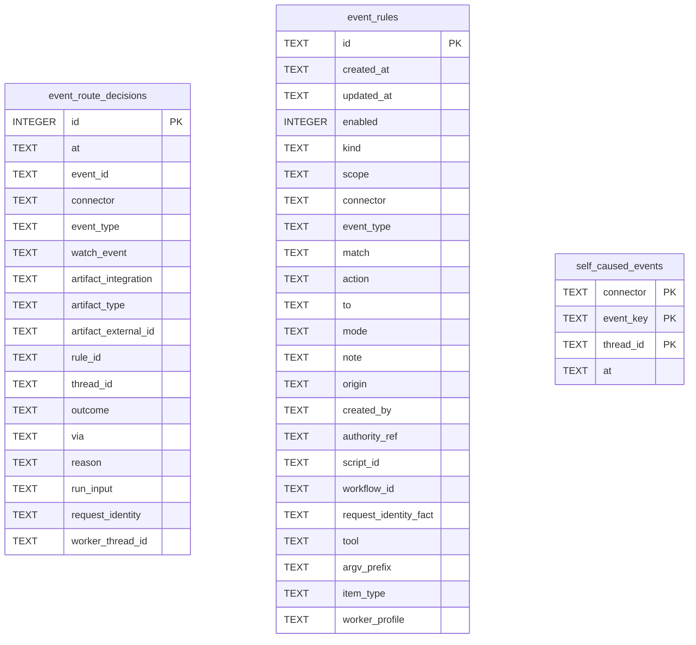

# Event Rule Schema

Tables in the primary store created by `backend/infra/event_rule_schema.py`.

## Tables 1–3

### `event_route_decisions`

| Column | Type | Primary key | NOT NULL | Default | References ||---|---|---|---|---|---|
| `id` | INTEGER | Yes | No | — | — |
| `at` | TEXT | No | Yes | — | — |
| `event_id` | TEXT | No | Yes | — | — |
| `connector` | TEXT | No | Yes | — | — |
| `event_type` | TEXT | No | Yes | — | — |
| `watch_event` | TEXT | No | Yes | — | — |
| `artifact_integration` | TEXT | No | No | — | — |
| `artifact_type` | TEXT | No | No | — | — |
| `artifact_external_id` | TEXT | No | No | — | — |
| `rule_id` | TEXT | No | Yes | — | — |
| `thread_id` | TEXT | No | No | — | — |
| `outcome` | TEXT | No | Yes | — | — |
| `via` | TEXT | No | Yes | — | — |
| `reason` | TEXT | No | No | — | — |
| `run_input` | TEXT | No | No | — | — |
| `request_identity` | TEXT | No | No | — | — |
| `worker_thread_id` | TEXT | No | No | — | — |

Indexes: `idx_event_route_decisions_artifact` (artifact_external_id, at), `idx_event_route_decisions_at` (at), `idx_event_route_decisions_event` (event_id), `idx_event_route_decisions_request` (rule_id, request_identity), `idx_event_route_decisions_rule` (rule_id, thread_id, outcome, at), `idx_event_route_decisions_runs` (outcome, id), `idx_event_route_decisions_worker` (worker_thread_id).

### `event_rules`

| Column | Type | Primary key | NOT NULL | Default | References ||---|---|---|---|---|---|
| `id` | TEXT | Yes | Yes | — | — |
| `created_at` | TEXT | No | Yes | — | — |
| `updated_at` | TEXT | No | Yes | — | — |
| `enabled` | INTEGER | No | Yes | 1 | — |
| `kind` | TEXT | No | Yes | 'route' | — |
| `scope` | TEXT | No | Yes | — | — |
| `connector` | TEXT | No | Yes | — | — |
| `event_type` | TEXT | No | No | — | — |
| `match` | TEXT | No | Yes | '[]' | — |
| `action` | TEXT | No | No | — | — |
| `to` | TEXT | No | No | — | — |
| `mode` | TEXT | No | No | — | — |
| `note` | TEXT | No | No | — | — |
| `origin` | TEXT | No | Yes | — | — |
| `created_by` | TEXT | No | Yes | — | — |
| `authority_ref` | TEXT | No | Yes | — | — |
| `script_id` | TEXT | No | No | — | — |
| `workflow_id` | TEXT | No | No | — | — |
| `request_identity_fact` | TEXT | No | No | — | — |
| `tool` | TEXT | No | No | — | — |
| `argv_prefix` | TEXT | No | No | — | — |
| `item_type` | TEXT | No | No | — | — |
| `worker_profile` | TEXT | No | No | — | — |

Indexes: `idx_event_rules_observe` (tool, enabled, scope), `idx_event_rules_scope` (scope, created_at), `idx_event_rules_type` (connector, event_type, enabled, scope, created_at), `sqlite_autoindex_event_rules_1` (id, unique).

### `self_caused_events`

| Column | Type | Primary key | NOT NULL | Default | References ||---|---|---|---|---|---|
| `connector` | TEXT | Yes | Yes | — | — |
| `event_key` | TEXT | Yes | Yes | — | — |
| `thread_id` | TEXT | Yes | Yes | — | — |
| `at` | TEXT | No | Yes | — | — |

Indexes: `idx_self_caused_events_at` (at), `sqlite_autoindex_self_caused_events_1` (connector, event_key, thread_id, unique).
