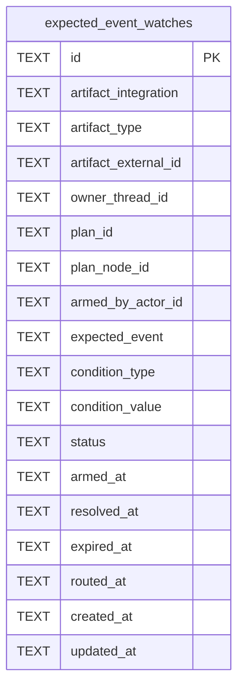

# Event Watch Schema

Tables in the primary store created by `backend/infra/event_watch_schema.py`.

## Tables 1–1

### `expected_event_watches`

| Column | Type | Primary key | NOT NULL | Default | References ||---|---|---|---|---|---|
| `id` | TEXT | Yes | No | — | — |
| `artifact_integration` | TEXT | No | No | — | — |
| `artifact_type` | TEXT | No | No | — | — |
| `artifact_external_id` | TEXT | No | No | — | — |
| `owner_thread_id` | TEXT | No | No | — | — |
| `plan_id` | TEXT | No | No | — | plans.id |
| `plan_node_id` | TEXT | No | No | — | plan_nodes.id |
| `armed_by_actor_id` | TEXT | No | No | — | — |
| `expected_event` | TEXT | No | No | — | — |
| `condition_type` | TEXT | No | Yes | — | — |
| `condition_value` | TEXT | No | No | — | — |
| `status` | TEXT | No | Yes | 'armed' | — |
| `armed_at` | TEXT | No | Yes | — | — |
| `resolved_at` | TEXT | No | No | — | — |
| `expired_at` | TEXT | No | No | — | — |
| `routed_at` | TEXT | No | No | — | — |
| `created_at` | TEXT | No | Yes | — | — |
| `updated_at` | TEXT | No | Yes | — | — |

Indexes: `idx_watches_dedupe` (artifact_integration, artifact_type, artifact_external_id, owner_thread_id, condition_type, condition_value, expected_event, unique), `idx_watches_status` (status, condition_type), `sqlite_autoindex_expected_event_watches_1` (id, unique).
