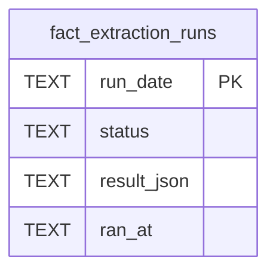

# Fact Extraction Schema

Tables in the primary store created by `backend/infra/fact_extraction_schema.py`.

## Tables 1–1

### `fact_extraction_runs`

| Column | Type | Primary key | NOT NULL | Default | References ||---|---|---|---|---|---|
| `run_date` | TEXT | Yes | No | — | — |
| `status` | TEXT | No | Yes | 'ok' | — |
| `result_json` | TEXT | No | No | — | — |
| `ran_at` | TEXT | No | Yes | — | — |

Indexes: `sqlite_autoindex_fact_extraction_runs_1` (run_date, unique).
