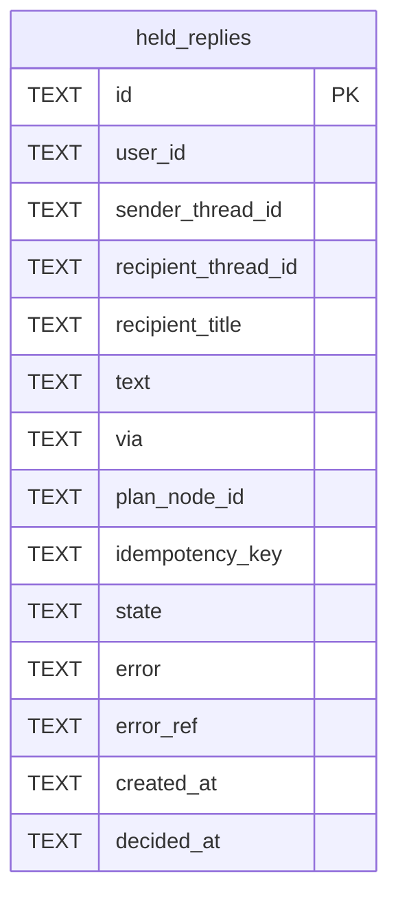

# Held Replies Schema

Tables in the primary store created by `backend/infra/held_replies_schema.py`.

## Tables 1–1

### `held_replies`

| Column | Type | Primary key | NOT NULL | Default | References ||---|---|---|---|---|---|
| `id` | TEXT | Yes | No | — | — |
| `user_id` | TEXT | No | Yes | — | — |
| `sender_thread_id` | TEXT | No | Yes | — | — |
| `recipient_thread_id` | TEXT | No | Yes | — | — |
| `recipient_title` | TEXT | No | No | — | — |
| `text` | TEXT | No | Yes | — | — |
| `via` | TEXT | No | Yes | — | — |
| `plan_node_id` | TEXT | No | No | — | — |
| `idempotency_key` | TEXT | No | No | — | — |
| `state` | TEXT | No | Yes | 'held' | — |
| `error` | TEXT | No | No | — | — |
| `error_ref` | TEXT | No | No | — | — |
| `created_at` | TEXT | No | Yes | — | — |
| `decided_at` | TEXT | No | No | — | — |

Indexes: `idx_held_replies_idempotency` (sender_thread_id, recipient_thread_id, idempotency_key, unique), `idx_held_replies_user_state` (user_id, state, created_at), `sqlite_autoindex_held_replies_1` (id, unique).
