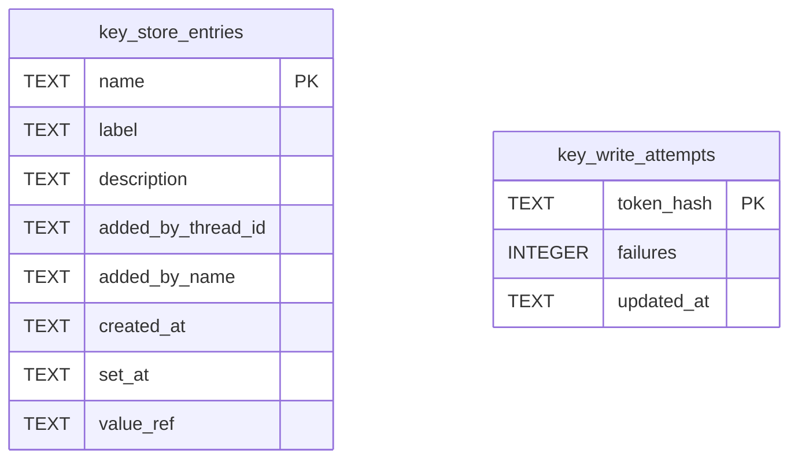

# Key Store Schema

Tables in the primary store created by `backend/infra/key_store_schema.py`.

## Tables 1–2

### `key_store_entries`

| Column | Type | Primary key | NOT NULL | Default | References ||---|---|---|---|---|---|
| `name` | TEXT | Yes | No | — | — |
| `label` | TEXT | No | No | — | — |
| `description` | TEXT | No | No | — | — |
| `added_by_thread_id` | TEXT | No | No | — | — |
| `added_by_name` | TEXT | No | No | — | — |
| `created_at` | TEXT | No | Yes | — | — |
| `set_at` | TEXT | No | No | — | — |
| `value_ref` | TEXT | No | No | — | — |

Indexes: `sqlite_autoindex_key_store_entries_1` (name, unique).

### `key_write_attempts`

| Column | Type | Primary key | NOT NULL | Default | References ||---|---|---|---|---|---|
| `token_hash` | TEXT | Yes | No | — | auth_tokens.token_hash |
| `failures` | INTEGER | No | Yes | 0 | — |
| `updated_at` | TEXT | No | Yes | — | — |

Indexes: `sqlite_autoindex_key_write_attempts_1` (token_hash, unique).
