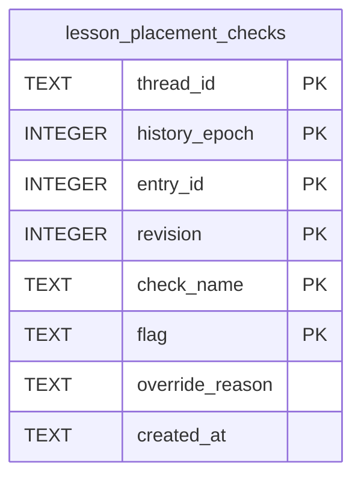

# Lesson Placement Check Schema

Tables in the primary store created by `backend/infra/lesson_placement_check_schema.py`.

## Tables 1–1

### `lesson_placement_checks`

| Column | Type | Primary key | NOT NULL | Default | References ||---|---|---|---|---|---|
| `thread_id` | TEXT | Yes | Yes | — | threads.id |
| `history_epoch` | INTEGER | Yes | Yes | — | — |
| `entry_id` | INTEGER | Yes | Yes | — | — |
| `revision` | INTEGER | Yes | Yes | — | — |
| `check_name` | TEXT | Yes | Yes | — | — |
| `flag` | TEXT | Yes | Yes | — | — |
| `override_reason` | TEXT | No | No | — | — |
| `created_at` | TEXT | No | Yes | — | — |

Indexes: `idx_lesson_placement_checks_thread` (thread_id, check_name), `sqlite_autoindex_lesson_placement_checks_1` (thread_id, history_epoch, entry_id, revision, check_name, flag, unique).
