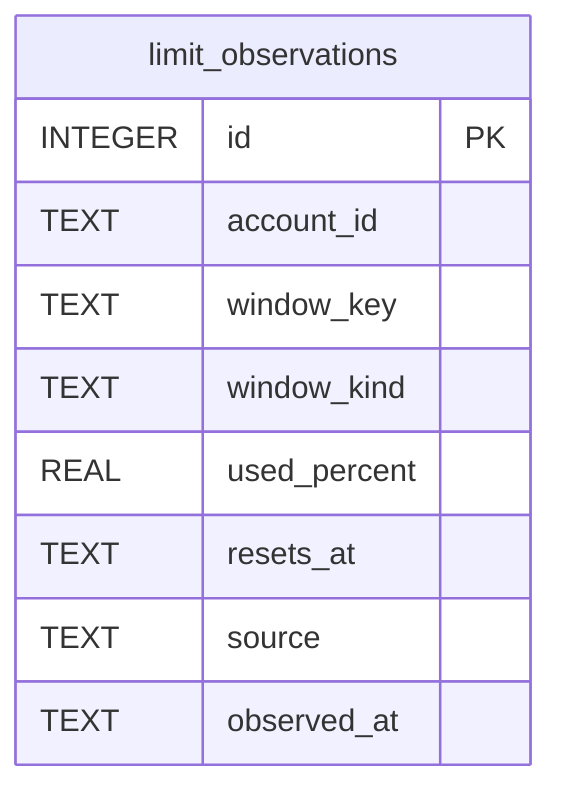

# Limit History Schema

Tables in the primary store created by `backend/infra/limit_history_schema.py`.

## Tables 1–1

### `limit_observations`

| Column | Type | Primary key | NOT NULL | Default | References ||---|---|---|---|---|---|
| `id` | INTEGER | Yes | No | — | — |
| `account_id` | TEXT | No | Yes | — | vendor_accounts.id |
| `window_key` | TEXT | No | Yes | — | — |
| `window_kind` | TEXT | No | Yes | — | — |
| `used_percent` | REAL | No | No | — | — |
| `resets_at` | TEXT | No | No | — | — |
| `source` | TEXT | No | Yes | — | — |
| `observed_at` | TEXT | No | Yes | — | — |

Indexes: `idx_limit_observations_window` (account_id, window_key, observed_at).
