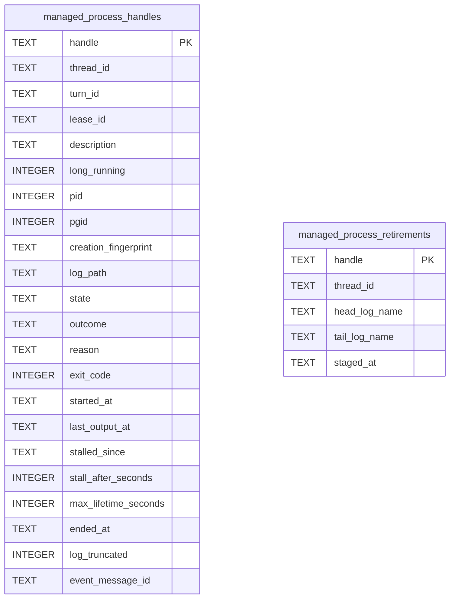

# Managed Process Schema

Tables in the primary store created by `backend/infra/managed_process_schema.py`.

## Tables 1–2

### `managed_process_handles`

| Column | Type | Primary key | NOT NULL | Default | References ||---|---|---|---|---|---|
| `handle` | TEXT | Yes | No | — | — |
| `thread_id` | TEXT | No | Yes | — | — |
| `turn_id` | TEXT | No | Yes | — | — |
| `lease_id` | TEXT | No | No | — | — |
| `description` | TEXT | No | No | — | — |
| `long_running` | INTEGER | No | Yes | 0 | — |
| `pid` | INTEGER | No | Yes | — | — |
| `pgid` | INTEGER | No | Yes | — | — |
| `creation_fingerprint` | TEXT | No | Yes | — | — |
| `log_path` | TEXT | No | Yes | — | — |
| `state` | TEXT | No | Yes | — | — |
| `outcome` | TEXT | No | No | — | — |
| `reason` | TEXT | No | No | — | — |
| `exit_code` | INTEGER | No | No | — | — |
| `started_at` | TEXT | No | Yes | — | — |
| `last_output_at` | TEXT | No | No | — | — |
| `stalled_since` | TEXT | No | No | — | — |
| `stall_after_seconds` | INTEGER | No | No | — | — |
| `max_lifetime_seconds` | INTEGER | No | No | — | — |
| `ended_at` | TEXT | No | No | — | — |
| `log_truncated` | INTEGER | No | Yes | 0 | — |
| `event_message_id` | TEXT | No | No | — | — |

Indexes: `idx_managed_process_handles_state` (state), `idx_managed_process_handles_thread` (thread_id, started_at), `sqlite_autoindex_managed_process_handles_1` (handle, unique).

### `managed_process_retirements`

| Column | Type | Primary key | NOT NULL | Default | References ||---|---|---|---|---|---|
| `handle` | TEXT | Yes | No | — | — |
| `thread_id` | TEXT | No | Yes | — | — |
| `head_log_name` | TEXT | No | Yes | — | — |
| `tail_log_name` | TEXT | No | No | — | — |
| `staged_at` | TEXT | No | Yes | — | — |

Indexes: `sqlite_autoindex_managed_process_retirements_1` (handle, unique).
